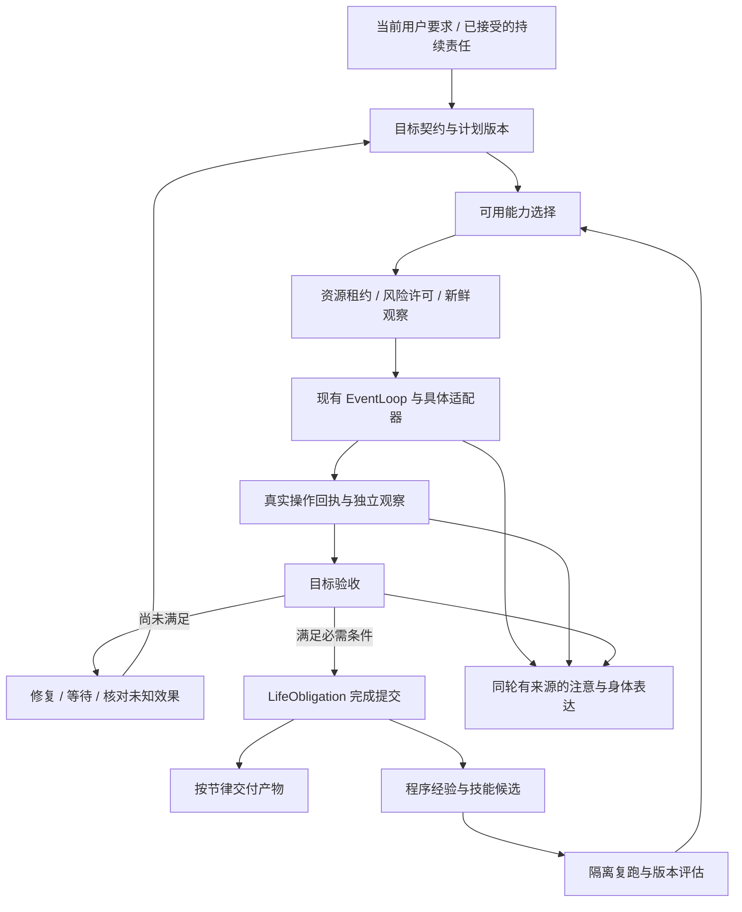

# Alicization 执行层完整优化开发方案

日期：2026-10-18。状态：开发与验收进行中，不是已完成声明。实际进度见实施清单与日期对应的体验记录。

本方案覆盖 [执行层审阅](../research/2026-10-18-execution-layer-digital-life-audit.md) 的 F1–F10。调研依据为 [15 项同类实现研究](../research/2026-10-18-execution-reference-study.md) 与 [固定提交及文件哈希](../research/2026-10-18-execution-reference-source-manifest.json)。机器可读工作项见 [实施清单](2026-10-18-execution-life-work-items.json)。

## 1. 产品目标与完成边界

让她能持续履行同一个目标：理解要求、选择可用能力、行动、观察、独立验收、纠错、被打断后恢复、交付，再将有证据的方法转为可复用技能。人格决定关心什么、如何取舍和何时沟通；工具不另建人格，情绪不改变实际完成事实。

本轮范围为 Phase 1 本地电脑，优先 Windows 和 Live2D。所有 F1–F10 均为必做，分批交付不能用“部分能力已上线”替代剩余项目。摄像头、智能家居、机器人和引入云工作流服务不属于本轮依赖。

### 1.1 必须保留的现有能力

- `TaskThread`、`LifeObligation`、现有 EventLoop、工具 registry、SQLite 单 writer 继续承担权威职责。
- 已有直接文件独立读回、界面复查、取消、Kill Switch、来源撤销、审计与原子提交继续适用。
- 新流式正文及 Live2D 显示游标继续使用，执行进度不创建第二条完整回复或新的口型时钟。
- 普通本地操作默认可用。危险效果按已定义风险、具体目标和可配置策略判断，不改成所有动作逐次询问。

### 1.2 用户体验终点

用户说“把这几份资料整理成索引并保存”，她能直接做有界的本地工作；确有歧义时只问影响结果的必要问题。用户中途说“按日期分”，她更新未完成部分。重启后能检查已生成文件并续做。完成时给可打开的产物，说明实际核验范围。做过几次后，更可靠地复用方法，减少返工和打扰。

等待用户、暂停、取消、外部结果不确定、技术验收通过、需要用户主观评价，各自有清楚状态。用户忙时，允许的后台工作可继续，面部、目光和动作表达她正在进行的真实活动。

## 2. 调研结论转成实现决策

以下 O/C 编号对应研究文档，均有实际文件或官方资料链接。

| 参考 | 采用的实现方式 | Alicization 的取舍 |
| --- | --- | --- |
| O01 Pi | 工具生命周期、steering、follow-up、显式续行 | 复用已有事件流，扩展现有 EventLoop，不引入第二个主循环 |
| O02 Hermes | 目标契约、确定性验收先行、技能写入保护 | 验收由注册配方执行，禁用任意生成的 shell 验收命令 |
| O03 N.E.K.O. | 身份关联任务、专用执行通道、多个边界检查取消 | 只适配执行机制，保持当前人格、记忆和身体协调器 |
| O04 OpenHands SDK | 事件因果链、写入保护、风险与确认策略分离 | 存储仍由现有 SQLite writer 提交 |
| O05 Browser Use | 控件操作、下载生命周期、批次部分结果 | 适配组件；代理自报 success 和模型 judge 均不直接完成根目标 |
| O06 UI-TARS | typed operator、截图坐标换算、暂停/预算 | 视觉兜底走窗口身份与焦点仲裁；不直接调用无边界全局输入 |
| O07 Windows-MCP | 自身按键账本、接管、UIA 控件处理 | 优先移植输入账本；不整包引入 Python 3.14 runtime |
| O08 LangGraph.js | 节点结果与检查点分别持久化 | 以当前 DB writer 实现协议，不增加第二个 SQLite 实例 |
| O09 Temporal | 心跳、排队/单次/整体时限、取消确认 | 本地实现所需语义，不依赖 Temporal 服务 |
| O10 Agent-S S3 | 当前观察上的行动反思、有限轨迹 | 不把反思文本当成成功证据，不沿用过时的全分层架构描述 |
| C01 OpenAI、C02 Claude | 模型动作与真实执行结果分离，逐项反馈 | provider-neutral 适配器，批次每个动作都独立检查 |
| C03 Power Automate | 属性 selector、多候选定位、错误处理 | 候选修复后重新核对目标，不能盲目找一个相似按钮点击 |
| C04 UiPath | 等待条件持久化后释放资源并接续 | 绑定相同责任版本，等待不占模型和输入锁 |
| C05 Manus | 已授权浏览器环境和用户接管 | 不复制用户浏览器档案，不自动开启主浏览器远程调试 |

### 2.1 可以实际二开的模块清单

| 上游模块 | 本地目标 | 复用方式 | 必须补的适配与验证 |
| --- | --- | --- | --- |
| Windows-MCP `desktop/control_ledger.py` | `execution/windows-input-ledger.ts` 与 native helper | 移植其“先记账再按下、异常释放、自身输入与用户输入分开”的算法 | 绑定 broker epoch、Windows Job、物理接管与取消回执；保留 MIT 版权 |
| Windows-MCP `desktop/control_recovery.py` | native helper 的输入监测 | 选择性移植状态快照及多次采样恢复 | 不把模糊 Win32 查询当作可靠释放证明，检查用户按键不被吞掉 |
| Browser Use download watchdog 与 click/download 关联 | `execution/browser-transfer.ts` | 移植 transfer 状态机与 GUID 关联 | Electron CDP 事件、受管下载目录、hash 和重启核对 |
| LangGraph.js `SqliteSaver.putWrites` | `execution/work-plan-repository.ts` | 移植节点写入键及冲突处理协议 | 换成现有异步 SQLite writer，验证事务和并发 CAS |
| Hermes `GoalContract` / `GoalGate` | acceptance compiler 与 verifier registry | 移植契约字段及验收先行顺序 | 以受控配方替代原 shell 执行，绑定本项目证据与权限 |
| OpenHands `ConfirmRisky` | 现有风险策略的可替换决策函数 | 选择性适配纯决策逻辑 | 遵守本项目普通动作默认可用、危险效果有界确认的策略 |
| UI-TARS Operator 的坐标与键名处理 | Windows 视觉输入 adapter | 适配纯转换函数与 Operator 契约 | 再查 helper 和 native 依赖许可/ABI，加入多显示器、DPI 和目标栅栏 |
| Pi 已有适配事件流 | 现有 third-party 模块 | 直接复用仓库已落地代码 | 检查背压、取消和单 owner，不顺带升级整套 SDK |

上表为本次研究支持的候选，实际移植提交要附具体函数、固定 hash、修改记录和适配测试。源码语言不同就明确为移植；闭源产品仅用于产品机制设计，不列入可复制代码清单。

## 3. 架构与权威归属



| 数据 | 唯一权威 | 其他模块如何消费 |
| --- | --- | --- |
| 人格、关系、长期偏好 | 现有 soul/self/relationship/memory owner | 编译规划上下文与交付风格，不由执行器覆盖 |
| 目标是否完成 | 现有 `LifeObligation` 与独立 verification | 线程、界面、回忆、身体读取同一结论 |
| 执行器是否结束 | 现有 `TaskThread` / attempt | 结束触发验收，不自动等于根目标完成 |
| 原子副作用及未知状态 | 现有 `LifeEffect` 与执行事件 | 每个动作关联责任、计划、attempt 与观察 |
| 计划及节点产物 | 新增桌面执行 repository，经同一 writer | 调度读该版本；不另建人格或目标状态中心 |
| 能力是否可用 | 现有 registry + 操作级 probe | UI 与模型共用结果，不暴露明知不支持的操作 |
| 资源和焦点所有权 | 主进程唯一 broker | 跨通道、跨 card 串行仲裁同一实体 |
| 技能激活状态 | 现有 skill registry | 候选通过回放评估才可激活 |
| Live2D 表达 | 现有身体协调器 | 读取有来源的执行注意事件，不据动画反写完成 |

### 3.1 模块落点

新逻辑先放 `apps/stage-tamagotchi/src/main/services/alicization/execution/`，按职责拆分：

| 文件或模块 | 责任 | 接入现有代码 |
| --- | --- | --- |
| `operation-capabilities.ts` | 平台、操作、模式、健康状态 | `turn-os/tool-registry.ts`、`executor-runtime.ts` |
| `task-acceptance.ts` / `acceptance-compiler.ts` | 编译及验证目标契约 | `task-thread-governor.ts`、`life-task-repository.ts` |
| `goal-verifiers/` | 文件集合、格式、界面、回执、质量与人工评价 | `life-goal-verifier.ts`、`life-task-verification-runtime.ts` |
| `work-plan-repository.ts` / `work-plan-scheduler.ts` | 计划 CAS、节点结果、预算接续 | `task-thread-orchestrator.ts`、现有 DB 写入队列 |
| `resource-broker.ts` / `foreground-broker.ts` | 资源身份、租约、接管、输入锁 | `execution-interrupt-registry.ts`、各 adapter |
| `action-permit.ts` / `effect-policy.ts` | 动作效果和授权摘要 | `life-interface-risk.ts`、现有权限 UI 与配置 |
| `windows-input-ledger.ts` / native helper | 自身按键状态及目标绑定输入 | Windows runtime、worker 和打包资源 |
| `browser-surface.ts` / `browser-transfer.ts` | frame/控件、下载上传、popup | Windows browser runtime 与现有桥 |
| `effect-reconciler.ts` / `compensation.ts` | 未知效果核对和可逆补偿 | `life-turn-runtime.ts`、executor resume |
| `procedure-admission.ts` / `skill-candidate-runtime.ts` | 程序经历准入与技能评估 | executor 经验构建、既有 skill registry |
| `execution-attention.ts` | 有证据的注意目标和操作阶段 | `life-execution-presence.ts` 与 Stage 协调器 |

`runtime.ts` 只组合 ports。较大的旧文件逐段抽取，不新增另一份重复实现。稳定前只把必要的 Eventa 负载放 `src/shared`；语义通过桌面验证后才考虑 shared packages。

### 3.2 跨进程接口

在 `apps/stage-tamagotchi/src/shared/eventa.ts` 集中定义以下语义，名称在实现时沿用仓库实际命名风格；主进程是唯一命令接收者，renderer 不能自行改变执行事实：

| 接口 | 必需输入 | 返回或事件 |
| --- | --- | --- |
| `execution.get-task` | cardId、rootObligationId | 契约摘要、当前 plan revision、节点与证据、产物、event cursor |
| `execution.revise-task` | 当前用户输入引用、expected obligation generation/revision、变更要求 | 新契约/计划或关键歧义；同时失效旧 permit |
| `execution.pause-task` | 根责任、expected revision、requestId | stopping/paused 和已发生影响，不提前伪装底层停止 |
| `execution.resume-task` | 根责任、expected revision、requestId | 已核对后的新 slice，或明确 blocked 原因 |
| `execution.cancel-task` | 根责任、expected revision、requestId | 取消回执、部分产物、未知效果列表 |
| `execution.take-over` | 已授权 surface、当前租约、requestId | 输入租约撤销、按键释放、旧队列停止回执 |
| `execution.task-changed` | 主进程发布，含 card/root/generation/plan/sequence | 有序增量；序号缺口由 renderer 拉 snapshot 补齐 |

同一 requestId 重复提交返回相同逻辑结果；同一 ID 不同参数拒绝。窗口重载或 card 切换从 snapshot 恢复，不重放 mutation。进度订阅只带私有证据引用和可显示摘要，不能泄露原始凭据、密码、用户未授权页面正文或内部推理。

### 3.3 三层状态及接续

| 层 | 状态含义 | 转移责任 |
| --- | --- | --- |
| 目标责任 | accepted / in-progress / verifying / fulfilled / blocked / cancelled 等现有状态 | 既有 obligation repository；fulfilled 必须有对应验证 |
| 工作窗口 | ready / running / yielded / waiting / stopping / stopped | scheduler 与资源 broker；yielded 不结束目标 |
| 外部效果 | prepared / claimed / dispatched / settled / uncertain 等现有状态 | 既有 effect repository；uncertain 只能经现实核对结算 |

`paused` 表示当前没有继续派发；`cancelled` 表示用户撤销该责任；`unknown` 描述现实效果，不应被状态按钮隐藏。一个被取消的任务仍可能附有已经写出的产物或未知提交记录。恢复只为当前有效责任创建新 attempt，不把取消责任自动改回运行。

## 4. 数据契约与存储

以下为待实施契约。生产实现使用 TypeScript、Valibot 和 registry 的输入 schema；所有 JSON 均限制深度、条目、字符串和字节，模型无权生成任意验证器或 native 代码。

### 4.1 目标契约

```ts
type GoalPredicate =
  | { kind: 'file-bytes'; path: string; sha256: string }
  | { kind: 'artifact-set'; manifestId: string; expectedCount: number }
  | { kind: 'structured-output'; artifactId: string; registeredSchemaId: string }
  | { kind: 'interface-state'; surfaceId: string; observationRecipeId: string }
  | { kind: 'external-receipt'; receiptRecipeId: string; targetHash: string }
  | { kind: 'quality-review'; rubricId: string; artifactIds: string[] }
  | { kind: 'user-review'; question: string; artifactIds: string[] }

interface TaskAcceptance {
  version: 1
  cardId: string
  rootObligationId: string
  obligationGeneration: number
  revision: number
  sourceInputIds: string[]
  criteria: Array<{
    id: string
    required: boolean
    predicate: GoalPredicate
    proofScope: 'bytes' | 'structure' | 'displayed-state' | 'external-state' | 'quality' | 'user-reported'
  }>
  permittedResourceIds: string[]
  permittedEffectPolicyId: string
  stopConditions: string[]
  contractHash: string
}
```

- 取当前用户要求及有效来源编译契约，不能取模型事后写出的结果来重新定义成功。
- 确定可推断的普通操作无需额外确认；涉及覆盖范围、发送对象等关键歧义才进入 `waiting-input`。
- 有主观质量要求时保留 quality/user-review。文件 hash 只证明字节，格式 validator 只证明结构，界面文字只证明当时显示，不扩大证明范围。
- 确定性检查先执行；模型质量评审只消费固定 rubric 和观察证据，不能掩盖缺文件、路径错误、未提交和未知回执。
- 根目标以所有 required 条件满足为准。技术完成和用户满意分别记录；只有契约要求用户评价时才等待该项。
- 内部 `user-reported` 证明不得成为新任务的静默默认。无法编译可验证条件时显式说明未知范围或选择用户评价。

### 4.2 计划、工作窗口与动作

```ts
interface WorkStep {
  id: string
  dependsOn: string[]
  capabilityId: string
  input: Record<string, unknown>
  inputHash: string
  acceptanceCriterionIds: string[]
  resourceIds: string[]
  retryMode: 'read-only' | 'reconcile-first' | 'manual-only'
  state: 'pending' | 'running' | 'awaiting-verification' | 'verified' | 'waiting' | 'blocked' | 'cancelled'
  attemptId: string | null
}

interface WorkPlan {
  id: string
  cardId: string
  rootThreadId: string
  rootObligationId: string
  obligationGeneration: number
  revision: number
  acceptanceHash: string
  steps: WorkStep[]
  sourceEvidenceRefs: string[]
}

interface ActionPermit {
  id: string
  cardId: string
  rootObligationId: string
  obligationGeneration: number
  planId: string
  planRevision: number
  stepId: string
  attemptId: string
  capabilityId: string
  inputHash: string
  targetObservationId: string
  targetFingerprint: string
  effectDigest: string
  approvalRef: string | null
  brokerEpoch: string
  fencingToken: number
  expiresAt: number
}
```

ActionPermit 只由主进程创建和验证；模型只提出动作。原始 token、cookie、密码和完整敏感正文不进入 permit 审计，使用摘要和私有引用。

根 `TaskThread` 关联根责任；需要独立 adapter 的步骤使用关联子 thread/attempt，持久化 parent/root/step 关系。子动作回执只能满足其对应 criteria，不能直接完成根任务。根目标仍只有 `LifeObligation` 一份权威。

每个有界工作窗口创建 `task-run` ingress，明确引用已接受责任、generation、契约 hash、计划 revision、预算及来源。扩展现有 `beforeAction` 校验这条责任引用，不复用已经结束的旧 user-turn，也不伪造新的用户消息。取消、撤销、过期或改版的责任不能继续派发。

### 4.3 SQLite 迁移

在现有 migration 入口新增一次有版本、可回滚的数据迁移；所有写入仍经过现有事务队列。建议表如下，字段可在实现评审中补充，身份键和唯一性不可省略：

```sql
CREATE TABLE life_execution_contracts (
  card_id TEXT NOT NULL,
  obligation_id TEXT NOT NULL,
  obligation_generation INTEGER NOT NULL,
  revision INTEGER NOT NULL,
  contract_hash TEXT NOT NULL,
  body_json TEXT NOT NULL,
  active INTEGER NOT NULL CHECK (active IN (0, 1)),
  created_at INTEGER NOT NULL,
  PRIMARY KEY (card_id, obligation_id, obligation_generation, revision)
);
CREATE UNIQUE INDEX life_execution_contract_active
  ON life_execution_contracts(card_id, obligation_id) WHERE active = 1;

CREATE TABLE life_work_plans (
  card_id TEXT NOT NULL,
  plan_id TEXT NOT NULL,
  revision INTEGER NOT NULL,
  root_thread_id TEXT NOT NULL,
  root_obligation_id TEXT NOT NULL,
  obligation_generation INTEGER NOT NULL,
  contract_hash TEXT NOT NULL,
  body_json TEXT NOT NULL,
  event_cursor INTEGER NOT NULL,
  created_at INTEGER NOT NULL,
  PRIMARY KEY (card_id, plan_id, revision)
);
CREATE TABLE life_work_step_results (
  card_id TEXT NOT NULL,
  plan_id TEXT NOT NULL,
  plan_revision INTEGER NOT NULL,
  step_id TEXT NOT NULL,
  attempt_id TEXT NOT NULL,
  input_hash TEXT NOT NULL,
  effect_id TEXT,
  observation_refs_json TEXT NOT NULL,
  verification_refs_json TEXT NOT NULL,
  state TEXT NOT NULL,
  updated_at INTEGER NOT NULL,
  PRIMARY KEY (card_id, plan_id, plan_revision, step_id, attempt_id)
);
CREATE TABLE life_work_slices (
  card_id TEXT NOT NULL,
  slice_id TEXT NOT NULL,
  plan_id TEXT NOT NULL,
  plan_revision INTEGER NOT NULL,
  ingress_id TEXT NOT NULL,
  cursor_json TEXT NOT NULL,
  wake_condition_json TEXT,
  status TEXT NOT NULL,
  updated_at INTEGER NOT NULL,
  PRIMARY KEY (card_id, slice_id)
);
CREATE INDEX life_work_slices_ready
  ON life_work_slices(card_id, status, updated_at);
```

表中的节点和工作窗口状态用于调度；目标 fulfilled 只能来自现有 `obligation-verify`。证据 blob 放既有私有存储，表只保存不可变引用、hash、范围、采集者、观察时间和来源关系。DDL 必须先在 fixture 中检查现有 schema、约束及恢复语义后纳入 migration。

旧线程没有契约时保留历史和原证明，不回填“已完成”。恢复旧待办先核对事实并形成新契约；未证实的旧成功经验从成功路由候选中撤下，保留原始经历供审计。不得把一次迁移写成永久的双轨真相。

## 5. 核心运行协议

### 5.1 每一步必须经过的链路

1. 读取根责任、有效来源、契约 hash 和当前计划 revision。
2. 筛选依赖已验证的待办；检查 card、取消、暂停、预算和操作级 capability。
3. 向唯一 broker 申请规范化资源及必要的物理输入租约；取得新观察。
4. 对照观察编译动作效果、目标和输入摘要；运行风险策略；需要时消费绑定当前内容的授权。
5. 提交 `LifeEffect` 准备与派发事实，并生成 ActionPermit；dispatch 前重新核对目标、许可、租约和取消。
6. 调用现有 adapter，收集每个动作的 applied/not-applied/unknown 及部分结果，不把整个批次压成一个 success。
7. 独立读回目标状态或输出物，追加证据，调用对应 verifier。
8. CAS 提交节点结果和进度。全部必需条件满足才提交根责任完成；否则进入修复、等待或下一工作窗口。
9. 交付和身体模块消费已提交事实；程序经验准入读取相同的验证结果。

SQLite 提交与外部动作无法构成一个跨系统事务。派发后崩溃必须进入 reconciliation，不能许诺所有工具 exactly-once。ActionPermit 解决的是准入和身份一致性，独立观察解决的是已经发生了什么。

### 5.2 持久工作与重规划

保留当前 16 步和时间预算，作为一次工作窗口的边界。预算耗尽时保存已验证产物、下一节点、未解决项和 wake condition，状态为 `yielded`，不虚构目标失败或完成。调度器用新的 task-run 接续。

重新规划必须携带 expected plan revision 和根责任 generation；复用节点要求输入 hash、验收条件、来源版本及现实产物仍一致。用户改要求后，仅失效受影响子图；新增、删除、替换的条件均有审计事件。模型原始隐式思维不作为持久化协议，只存结构化决策、理由摘要和证据引用。

等待用户、登录、外部作业或文件出现时保存明确引用并释放输入锁；依赖事件到达后再检查同一责任是否仍有效。没有新证据或条件未满足时不反复调用模型。

### 5.3 资源与焦点

资源键至少覆盖规范化文件、目录、浏览器 tab/frame、原生 window/process/desktop、物理输入。文件别名、大小写、junction 和新文件父目录需要规范化，不能仅比较模型给出的路径字符串。多资源按稳定顺序申请，读可共享、写互斥。

broker 在主进程跨 adapter/card 唯一存在；以 boot epoch 与单调 fencing token 防止旧回调派发。租约超时不自动证明旧执行器已经停止：先取消并等待确认，必要时核对未知效果，不能把锁简单让给另一个写者。进程重启后所有旧 token 失效。

物理键鼠对同一输入 desktop 全局串行。用户真实输入或切换目标时，先阻止新注入、取消当前批次并释放自身持有的按键；不释放用户自己的键。后台 UIA、受管浏览器 CDP 与前台 SendInput 分别声明能力；不能声称任意快捷键可后台作用于指定窗口。

## 6. Windows 与浏览器能力补齐

### 6.1 Windows

第一步立即隐藏或明确标注尚未实现的 `desktop_press_keys`，probe 至少区分 supported、unavailable、degraded、needs-foreground、blocked-by-policy。模型、任务路由和设置页共用 probe，不能仅检查 handler 是否存在。

实现顺序：

1. UIA 定位与操作：稳定 AutomationId/role/祖先属性，Invoke、Value、Selection、Toggle、ExpandCollapse、Scroll；歧义返回候选，不自行选相似控件。
2. 窗口与弹窗链：PID 创建时间、HWND、desktop、所有者关系、观察 generation，防止句柄复用和“保存”弹窗误认。
3. 键盘与 Unicode：目标绑定、中文/emoji、多行、快捷键映射、按下/释放账本、取消及物理接管。能用 UIA 完成的动作优先用 UIA。
4. 视觉兜底：声明截图坐标空间、窗口边界、显示器原点、DPI 和观察时间；动作前检查窗口移动/缩放及遮挡。支持有限 click、drag、scroll，不接受任意模型代码。
5. 应用就绪：进程 spawn 只记 dispatched，观察到目标窗口才记 ready；文件保存必须关闭/重开或独立读回验证。

优先移植 O07 的 `InputLedger` 算法；原生边界由现有 worker 演进为受管 helper，入口采用结构化 stdin 或私有 IPC。helper 不持有人格或模型凭据，纳入精准 PID/Job 管理。多步输入由 helper 在每一小步检查取消、目标和 epoch，结束后回报按键释放状态。

### 6.2 受管浏览器

保留按 card 隔离的 Electron session。观察返回 opaque elementRef，绑定 tab、frame、document generation、backend node、控件摘要和 observedAt；模型不得提交未观察的任意 JavaScript。兼容同源与跨源 frame 的独立 CDP session，并支持可访问的 open shadow root。

补齐语义输入、select/checkbox、真实 CDP 鼠标键盘、滚动容器、文件选择、上传、下载和 popup。每次突变后失效旧 ref。新窗口跟踪 opener 和所属任务；导航或重定向仍检查目的地，不自动扩大任务授权范围。

下载使用 transferId/GUID 关联开始、完成、实际路径、大小、hash；只有完成并读回才成为产物。上传绑定用户选择的确切文件快照、目标和授权内容，不用“点击上传了”证明服务端接收。

### 6.3 已授权的现有浏览器

实现本地扩展 + native messaging adapter，或连接用户明确配置的专用 CDP 浏览器。扩展只向任务授予选定 tab/origin 和 typed 操作，凭据与 cookie 留在浏览器；不扫描或复制 Chrome/Edge 档案，不改变用户主浏览器启动参数。

关闭任务 tab、撤销访问或用户接管都使旧 observation、permit 和所有排队输入失效。接管完成后重新观察当前页面并接续相同责任。现有登录态属于访问环境，不能当成发送、购买或读取所有网站的授权。

## 7. 动作效果、验证和恢复

### 7.1 风险语义

以实际资源、输入内容、发送对象、来源敏感度和具体效果编译风险。原按钮关键词保留为信号，不担任唯一裁判。外部网页/文件/模型工具结果均属于观察，不得产生新的授权或修改目标契约。

确认摘要绑定 capability、目标观察、内容 hash、目的地、影响范围与失效时间；用户确认期间任一字段变化都重观察，不能用旧确认执行新动作。风险策略支持用户配置的有界 bypass，仍保留范围、预算、审计、取消和事实核验。

受管浏览器需要在派发前建立请求策略，监测 form、fetch/XHR、导航及下载上传。请求方法不能代表全部语义，GET 也可能产生写入，cookie 也会随请求发送。WebSocket 消息、service worker 和某些站点行为无法仅靠页面按钮或普通 webRequest 拦截完整约束。高影响动作若不能绑定其真实效果，就转为明确的受限适配器或用户接管，不声称已有通用外传防护。

### 7.2 验证配方

| 配方 | 独立证据 | 完成限制 |
| --- | --- | --- |
| 文件字节与集合 | 规范化路径、稳定读回 hash、数量、成员清单 | 不推断内容正确或研究完成 |
| 格式/结构 | 注册 schema、解析结果、字段与约束 | 不运行模型生成的任意检查程序 |
| 界面状态 | 新观察、目标身份、预声明 predicate | 只证明当前显示；刷新前后可见状态不能替代服务端回执 |
| 外部操作 | 适配器提供可验证 receipt / 事务查询 | 无回执时为 unknown；不凭 HTTP 200 或成功文案扩大证明范围 |
| 质量 | rubric、固定产物、独立评审摘要与来源 | 不覆盖确定性失败，不自证真实外部影响 |
| 用户评价 | 对应目标与产物版本的实际反馈 | 保留 user-reported 证据性质 |

每个结果保存 verifier ID/version、attempt、criterion、观察时间、输入/产物 hash、证据来源及 verdict。核验时若文件变化、来源撤销、计划更新或 card 不同，返回 stale/unknown，不猜测满足。

### 7.3 未知结果和补偿

统一实现 CLI、Codex、浏览器、桌面和外接 adapter 的 `reconcile()` 协议：只读检查 effect 是否 applied、not-applied 或 unknown。核对过程也要有作用域和预算，不能在“检查”名义下重新操作。

| 现实状态 | 下一步 |
| --- | --- |
| 效果已发生且满足条件 | 附加证据，跳过重复操作，继续后续步骤 |
| 可以证实尚未发生 | 在契约和授权仍有效时重新准备新 attempt |
| 效果只完成一部分 | 保存部分成果，规划仅补齐缺失部分 |
| 无法证实 | 保持 unknown，明确需要的证据或人工介入 |
| 已取消 | 不自动恢复；保留已发生影响和产物供用户查阅 |

可逆文件修改采用备份或原子替换，并保存 before/after hash。补偿只在当前内容仍等于自己写入的版本时执行；用户后来修改过的内容不得回滚。发送和支付不定义假撤回；只能依据服务实际能力做后续纠正，必要时另获当前授权。

取消协议为 stopping → 注入停止 → 自身键释放/进程退出或确定未停 → 结果核对 → interrupted/unknown。界面立即反馈停止请求，但不在底层仍执行时显示“已完全停止”。

## 8. 主动性、技能与身体的一致闭环

### 8.1 主动工作

主动调度候选来自已接受日常责任、到期依赖、用户允许的维护工作和已有个人项目；去除只接受 codingLike 的通用限制。候选仍带证据、授权、预期收益、截止条件、资源成本、用户忙闲与人格偏好。

“能否后台推进”和“是否现在告知用户”分别决策。工作完成但用户忙时保留可交付回执，等待合适时机；不能为热闹反复新建任务或汇报。关系与情绪影响节奏，不得捏造已经做事。新前台交互优先，暂停边界作用于所有持有输入的通道。

### 8.2 程序经验与技能

先修复现有成功 trace 筛选：必须同时绑定同 card 的 task、当前 attempt、有效 generation、fulfilled 独立验证和未撤销来源。历史失败按失败教训存放，不进入成功通道偏好。当前 task `completed` 不能单独提升熟练度。

成功条件从 repository 中的实际 verification 和来源依赖读取，不能只信 `thread.metadata.lifeGoalOutcome` 等投射缓存。事件查询必须带 attempt 身份。验证器版本、产物 hash、计划和根责任 generation 任一不匹配，都重新评估适用性；过期成功经验可以保留为历史经历，但不证明当前执行必然有效。

候选技能包含适用情境、参数 schema、所需能力、前提、步骤、目标 predicate、效果、恢复方案、源证据、版本和反例。技能文件不含 key、cookie、私人原文或固定用户绝对路径。

候选 → 静态检查 → 隔离复跑 → 跨输入测试 → 评估通过 → 既有 registry 激活。评估失败保存可解释理由；站点/应用变化、依赖失效或来源撤销时降级/撤销。已有技能的新版本必须与旧版本对比完成率、返工、资源与打扰，不以“写出了 SKILL.md”作为成长完成。

### 8.3 执行注意与 Live2D

在实际执行事件上增加 `reading`、`comparing`、`acting`、`waiting`、`checking` 等子阶段，以及被允许暴露的 attention target、phase revision、因果 event ID、有效期和来源强度。保留原 root task/attempt 归属。

当前 `scenario: coding` 改为由真实任务域派生。身体协调器把注意对象映射为有限视线、停顿和小动作；桌面坐标先转换为角色所在显示器的相对方向。窗口在视野之外、舞台隐藏或用户禁用感知时，保持不伪装可见的注意表达。

正文继续由已有显示游标控制口型，真实 TTS 继续由音频控制嘴部。执行进度不启动讲话，不在每次心跳重复动作；有独立完成证据才表达完成。取消、接管和旧 attempt 事件立即撤销对应表达，回到当前情境或自然待机。

## 9. 产品入口与可观察性

在现有任务/责任入口展示：目标、当前步骤、已验证产物、正在等待什么、停止状态、未证实影响和下一步；提供打开产物、暂停、继续、取消、接管、修正要求。页面由主进程快照与事件驱动，不能成为新任务中心。

面向用户使用具体文案，例如“索引已保存，正在检查条目是否齐全”“已停止后续操作；两份文件已写入”“提交结果尚未确认，需要检查回执”。避免把内部错误码、模型链或协议参数放入默认流程；诊断详情可另展开。

日志统一关联 card、root obligation、generation、plan revision、step、attempt、action、observation、verification 和 trace。保留进度、恢复、真实完成率、重复副作用、错误目标派发、取消延迟、未知状态积压与技能返工指标。不得以工具调用次数、动画次数或自报成功率代替完成率。

## 10. 开发工作包与交付顺序

每个 EX 工作包必须同时提交实现、与跨子系统不变量相关的测试、接入点和结果记录。详细依赖及验收 ID 保存在机器清单；全部状态初始为 proposed。

| 工作包 | 具体交付 | 对应缺口 | 前置 |
| --- | --- | --- | --- |
| EX00 | 固定基线、复用清单、回归场景和身份边界 | 全部 | 无 |
| EX01 | 平台/操作级 capability 与健康探测 | F1、F6 | EX00 |
| EX02 | 目标契约、单 writer migration、复合验收 | F2 | EX00 |
| EX03 | 成功经验的 proof/attempt/source 准入 | F3 | EX02 |
| EX04 | 效果分类、许可摘要、注入来源与请求策略 | F4 | EX02 |
| EX05 | 资源 broker、物理输入锁、接管与 fencing | F1、F6、F7 | EX00、EX04 |
| EX06 | Windows 键盘、Unicode、按键账本与释放 | F1 | EX01、EX05 |
| EX07 | UIA 控件、菜单弹窗、DPI 与视觉兜底 | F6 | EX06 |
| EX08 | 浏览器 frame/elementRef/CDP 操作 | F6 | EX01、EX04、EX05 |
| EX09 | 浏览器上传下载与 popup 完整生命周期 | F6 | EX08 |
| EX10 | 已授权浏览器连接和用户接管 | F6、F7 | EX08、EX05 |
| EX11 | 工作计划、子步骤结果及 CAS repository | F5 | EX02、EX05 |
| EX12 | 预算 yield、新 task-run ingress 与接续 | F5 | EX11 |
| EX13 | 五类 adapter 统一未知结果核对 | F7 | EX11、EX04、EX06、EX08 |
| EX14 | 可逆补偿、取消完成协议和部分产物 | F7 | EX13 |
| EX15 | 非代码日常责任主动调度与安静交付 | F8 | EX12、EX13 |
| EX16 | 技能候选、参数化经验与证据依赖 | F9 | EX03、EX11 |
| EX17 | 隔离复跑、跨输入评估、激活和失效 | F9 | EX16、EX14 |
| EX18 | 执行注意、Live2D 目光和有限动作接入 | F10 | EX11、EX13 |
| EX19 | 任务交付、修改要求、停止/接管 UI | F2、F5、F7、F10 | EX11、EX13、EX18 |
| EX20 | 旧数据迁移、保留策略与空间清理 | F3、F5、F7、F9 | EX02、EX11、EX16 |
| EX21 | 故障注入、竞争、跨 subsystem 集成 | 全部 | EX07、EX09、EX10、EX12–EX20 |
| EX22 | 后台 Windows/Live2D 与真实模型验收 | 全部 | EX21 |
| EX23 | 全量检查、生产构建和成品身份核验 | 全部 | EX22 |

### 10.1 第一批即可开工的改动

1. 在 `operation-capabilities.ts` 给 Windows `desktop_press_keys` 标明尚未就绪，打通 registry、路由和 UI 的同一 probe；增加“存在 handler 但操作不支持”的测试。
2. 在 `procedure-admission.ts` 抽出成功经验条件；`executor-runtime.ts` 改为只使用对应 attempt 的独立验证；对未核验、失败和撤销来源固化测试。
3. 在目标契约 migration 和 compiler 中实现“生成两个文件并做索引”的复合验收；用漏文件、错路径和缺索引验证不会误完成。
4. 接着实现输入 broker 与键盘账本，再接 Windows runtime。不要先加一条裸 SendKeys 快捷路径。

## 11. 验收矩阵与故障注入

以下是必须满足的验收规格；实际通过、失败和未完成范围以机器清单及日期进度记录为准。详细测试 ID 与工作包对应关系见机器清单。

| 测试组 | 必测输入与故障 | 成功标准 |
| --- | --- | --- |
| Q01 能力 | Windows 缺快捷键、应用不存在、权限不足 | 模型不获得假就绪能力，错误可恢复 |
| Q02 目标 | 多产物缺失、错位置、结构错误、显示成功但未持久化 | 根目标不 fulfilled，无伪成功交付 |
| Q03 经验 | completed 未验证、验证失败、旧 attempt 混入、来源撤销 | 成功经验和技能准入被拒绝 |
| Q04 风险 | 中性按钮提交、自动保存、重定向、确认期间换内容 | 副作用策略生效，旧授权失效 |
| Q05 竞争 | 两通道改同一文件、不同路径别名、跨 card 回调 | 同一资源正确互斥，旧 fence 无法派发 |
| Q06 原生输入 | Ctrl+S、Tab、Escape、中文/emoji、半按键时取消 | 目标正确，自身按键释放，无用户输入丢失 |
| Q07 Windows UI | 菜单、滚动、保存/覆盖弹窗、HWND 复用、DPI 变化 | 新鲜定位及父子关系正确，不能误点击 |
| Q08 浏览器 | iframe、open shadow root、控件重渲染、select、滚动容器 | ref 绑定正确，旧 ref 拒绝，逐步读回 |
| Q09 文件传输 | 中断上传、慢下载、重名、popup 下载、关闭 tab | 文件与 transfer 精确关联，取消不冒充回滚 |
| Q10 接管 | 已登录测试浏览器、授权撤销、物理接管 | 队列失效，凭据不复制，重新观察后接续 |
| Q11 长任务 | 超过 16 步、模型断流、等待跨重启 | 同根责任接续，不重复已经验证的副作用 |
| Q12 修复 | 改要求、部分成果已存在、产物被用户改动 | 仅失效相关子图，不覆盖用户后续修改 |
| Q13 恢复 | 派发前后/落库前后崩溃、点击后无回执 | 核对 applied/not-applied/unknown，再决定 |
| Q14 补偿 | 原文件备份、写后用户再编辑、取消未停止 | 无越权回滚，真实状态和界面一致 |
| Q15 主动 | 非代码待办、用户忙、安静时段、暂停或新交互 | 适度后台推进，无定时刷屏和重复任务 |
| Q16 技能 | 换文件/输入/页面、误学成功、版本失效 | 可迁移，失败不激活，旧技能能撤销 |
| Q17 身体 | 阅读/比较/等待/复核、旧 attempt、无声进度 | Live2D 与事实一致，无重复大动作/假口型 |
| Q18 产品 | 修改要求、停止、继续、接管、打开产物、重载 | 单一责任和进度，无重复消息/隐藏错误 |
| Q19 长期 | 历史任务增长、低磁盘、缓存清理、来源删除 | 有界查询与存储，证据依赖可追查 |
| Q20 成品 | 安装包/解包版、首次启动、重启恢复、正常退出 | 源码/编译/ASAR 身份一致，进程和临时文件收束 |

在 prepare、取得许可、派发前、派发后、拿回执前、验收前、提交前分别注入崩溃。覆盖 DB 写失败、租约失效、网络超时、窗口消失、用户改文件、来源撤销和 card 切换。测试重复运行不能靠放宽语义、延长过期许可或跳过现实读回来变绿。

### 11.1 不打扰主桌面的验证协议

- 单元/集成测试不依赖真实 Electron；mock IPC 与外部服务，验证跨层不变量。
- 受管浏览器采用 headless 或后台 CDP；原生 UIA 用 `run-private-desktop.ps1` 和自有窗口，全部加入精确身份的 Windows Job。
- 不切换 Default input desktop，不覆盖主页面，不读取用户真实任务内容，不按进程名批量杀进程。
- **2026-10-25 用户明确改为直接在本机测试，替代原先的 VM 前置要求。** 物理 SendInput 与真实焦点验证使用精确绑定 exe、PID/启动时间、HWND、session/user 和 nonce 的自有测试窗口；检测到用户输入或焦点变化即停止新注入，保留原有风险确认与独立释放核对。后台 Live2D 可以在真实 Default desktop 上将自有应用窗口放在所有显示器之外并禁止抢焦点；该模式不证明物理摆放、焦点、点击穿透或桌面注视坐标。不活跃 Win32 desktop 的 UIA/窗口消息结果也不能替代真实前台输入证据。不再为本任务准备或启动 VM。
- Live2D 使用实际模型，保存真实 draw 值、任务事件归属和截图。受控动作校准与自然任务表达分别记录；语音测试静音，口型校验使用实际时钟。
- 真实模型体验使用合成档案和 localhost 测试业务；有意义的执行回执由文件、页面和 native 观察独立验证。商业网站支付、真实发信和用户私人文件不作为默认试验材料。

### 11.2 必须从头跑通的产品场景

1. 整理 10 个自有测试文件，生成分类目录和可打开索引；独立核对成员、内容及路径。
2. 已授权浏览器中填写本地业务表单，处理 iframe、下拉框和附件，取得实际回执并保存下载产物。
3. Windows 编辑器输入中文并保存；遇覆盖弹窗改为新文件；重开验证内容。
4. 长任务运行超过一轮预算，用户中途改变分类方式；重启后只接续未完成部分。
5. 操作派发后回执丢失，检查已发生效果；不重复写入或提交。
6. 用户忙时继续允许的后台责任，合适时交付；暂停和接管均停止输入，说明已发生影响。
7. 同类任务换输入复跑已评估技能；失效页面触发降级和修复候选。
8. 上述过程均由 Live2D 表达对应阅读、比较、等待、复核与完成，文字/语音/动作只有同一事实来源。

八类必需场景和关键故障变体至少各跑三次，保留全部失败记录。真实模型波动的完成率另统计；任何错误目标派发、重复危险副作用、伪完成或来源污染均阻止发行。体验数目只作覆盖记录，不代替语义验收。

### 11.3 身体与安装生命周期的专项验收

- Live2D 待机：保留连续采样记录，检查眨眼、视线、呼吸和小动作；心跳、重载或重复事件不能重新触发同一套大动作或表情循环。
- Live2D 对话：真实流式首字、标点停顿、中文/英文/数字、无声文字与真实 TTS、打断、取消、错误及恢复，分别核对实际显示游标、音频时钟、嘴部参数和面部/身体表现。
- 执行与对话并发：阅读、输入、等待、复核和完成与同一任务事实绑定；对话抢占、接管、来源撤销及角色切换后，过时注意与口型不继续。
- 安装版和解包版：分别从干净的合成档案首次启动、退出和再启动；核对实际运行源码身份、子进程和单实例转交，不以构建成功代替启动验收。
- 升级与回退：保留合成人格、关系、记忆、待办及未明执行记录，实际升级、重启、迁移失败和回退；旧版本不理解新计划时停止接续。
- 卸载与重装：区分程序文件与用户数据；默认保留人格和记忆，显式选择删除测试数据时仅操作已列明的合成档案。验证重装后身份和记忆恢复。

这些检查与 EX18、EX20、EX22、EX23 一起记录实际证据，不能由单元测试数量替代。

## 12. 迁移、检查命令和发行

### 12.1 迁移与切换

先对新计划做只读 shadow 编译与旧任务事实比较，不派发第二套操作；fixture 验证 migration 后，再用合成档案启用新的执行入口。所有操作必须经过唯一 owner，禁止新旧系统同时执行同一责任。

切换时暂停新接收、收束当前派发、保留未知效果、备份 DB 并迁移；核对活动人格、记忆、待办、来源依赖和 task/attempt 关系后启用。回退停用新入口但保留新事件与产物；旧版本无法解释新计划时保持 held，不自动重放。迁移/回退路径必须实际测试。

### 12.2 开发命令

测试路径为本方案将新增的目录，完成对应工作包后执行；不把当前不存在的测试命令描述为已通过。

```powershell
pnpm exec vitest run apps/stage-tamagotchi/src/main/services/alicization/execution
pnpm exec vitest run apps/stage-tamagotchi/src/main/services/alicization/life-task-verification-runtime.test.ts apps/stage-tamagotchi/src/main/services/alicization/task-thread-orchestrator.test.ts
pnpm exec vitest run apps/stage-tamagotchi/src/main/services/alicization/executor-runtime.test.ts apps/stage-tamagotchi/src/main/services/alicization/life-execution-presence.test.ts
pnpm -F @proj-alicization/stage-tamagotchi typecheck
pnpm typecheck
pnpm lint:fix
pnpm -F @proj-alicization/stage-tamagotchi build
git diff --check
```

构建后执行后台 Live2D 体验、本机精确自有窗口的原生输入体验、成品启动/退出、真实模型交叉验证，再用现有 release provenance 比较构建前源码、编译文件与 ASAR。按照 11.1 的最新授权，不再将 VM 作为前置要求。用户启动新版前退出旧进程，避免单实例锁把启动交给旧版。

### 12.3 空间、隐私与许可证

所有临时目录写 owner manifest：任务 ID、准确路径、PID/Job、创建时间和保留理由。只清理已结束的本轮自有临时目录。源码节选与许可证保留用于复核；不下载权重、视频或整库依赖作为调研垃圾。

截图、浏览器缓存、临时音频和大模型原始响应配置保留上限；失败场景保留必要证据，成功可压缩/归档。删除前核对证据依赖，保留审计 tombstone；不删除用户产物、历史安装包或未知目录。低磁盘时先暂停可选工作和清理自有缓存，原子写失败不能误报完成。

实际移植时增加 third-party source manifest、原 LICENSE/NOTICE、修改说明和依赖清单；检查生产安装器确实包含。当前研究仅核实所选源码及根许可证，未将所有原生依赖认定为可直接发行。

## 13. 最终闭环判据

F1–F10 每项必须具备：实现入口、唯一状态 owner、下游行为接入、异常/取消/重启路径、可追溯证据、实际体验记录。所有 EX 工作包完成且验收满足前，文档状态保持进行中，不写“全部缺口已补齐”。

执行完成的标准是：她能可靠地履行日常责任，知道自己做了什么、还缺什么、何时应该继续或停下，能解释结果并从有证据的经历中提高能力；人格、记忆、对话和身体继续来自同一个她。此标准是 Phase 1 执行层的工程验收，不作科学意义上已实现生命或意识的宣称。
