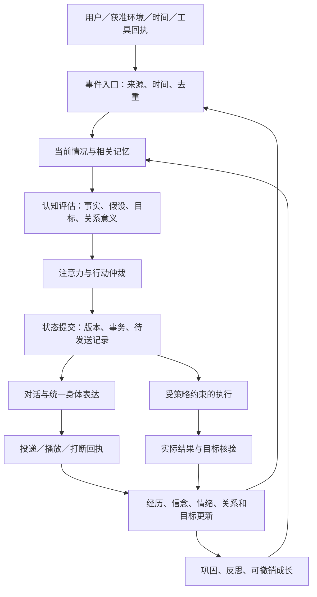

# Alicization 数字生命闭环调研与实施方案

调研日期：2026-10-04。项目基线：`7880afc29ab33a4cf4de89f7a6610664278494c3`，以及本工作区已有的 Windows 启动、人格初始化、托盘和舞台修复。本文是研究与设计提案，不表示下述能力已经实现或验收通过。

## 1. 结论、目标和证据边界

Alicization 的下一步应当把已有的心智、记忆、情绪、对话、主动性、执行和身体系统接成一个可持久化、可纠错、可恢复的生命循环。核心交付物是：一次经历产生有来源的理解，理解改变持续状态，状态影响表达与行动，行动产生可核验结果，结果再改变记忆、关系和后续选择。

“数字生命”在这里有可检验的工程定义：同一个身份跨时间延续，有自己的稳定倾向、可发展的兴趣、真实经历、未完成事项、关系历史和有限自主性；能感知获准的环境，形成和修正理解，表达、行动、承担约定、从结果学习，并通过同一身体状态自然呈现。主观意识、感受或生物意义上的生命，不能由本方案或当前这些产品的公开资料证明。不能把模型自称“我有感觉”当成验收证据。

本次比较 **14 个项目**，覆盖已提供商业服务的陪伴产品、开放源码的具身项目、记忆与执行基础设施、研究原型。它们承担不同职责，不用一个总分混排。闭源产品的内部算法以未知标记；官方功能说明属于供应商证据，不能冒充独立长期实测。开源项目检查具体版本的实现，不把 README、路线图或接入接口等同于完整能力。

证据分为四类：

- **源码事实**：在已拉取版本中看到实现与调用关系。
- **官方说明**：产品文档、维护者文档和技术公告描述的能力。
- **研究证据**：论文报告的实验与限定场景。
- **设计建议／待验证**：对 Alicization 的取舍、假设和验收要求。

本次没有登录商业产品开展长期体验，也没有运行这些外部仓库的应用或基准。源码分析用于理解机制和边界。四个当前实现仓库已拉取；另拉取 Letta 旧仓库确认迁移。版本记录见同目录 `2026-10-04-digital-life-source-manifest.json`。

## 2. 十四个项目：可取的机制与应用边界

### 2.1 Replika：把长期陪伴做成持续关系入口

**官方说明**：记忆界面让用户查看、移除关于自己、宠物和身边人的信息；通知可以延续先前话题并邀请交流。[记忆说明](https://help.replika.com/hc/en-us/articles/360000874712-What-does-my-Replika-remember-about-me)、[通知说明](https://help.replika.com/hc/en-us/articles/360027515872-How-do-I-set-up-my-app-s-notifications)

**值得采用**：关系有可见历史；记忆纠错应进入日常产品体验；陪伴不限于用户发起的一问一答。Alicization 应让用户自然发现“她记住了什么”，并用一次纠正改变后续行为。

**边界**：这些文档没有证明通用电脑执行、可回放心智或本地人格所有权。不能由亲密文案、头像或记住几项偏好推断完整数字生命。其官方也明确否认当前产品具有自我意识；把拟人体验和意识证明分开。[官方解释](https://help.replika.com/hc/en-us/articles/360058852132-Is-Replika-sentient)

### 2.2 Nomi：身份核心、关联记忆和有节制的主动性

**官方说明**：Identity Core 保存重要偏好、价值、行为和共同经历；Mind Map 作为长期记忆的关联概览，与详细记忆并存，用户可查看、编辑。主动消息可开关、选择频率，未回复时延长间隔。[Identity Core](https://nomi.ai/updates/introducing-the-nomi-identity-core-fostering-dynamic-and-authentic-identities/)、[Mind Map](https://nomi.ai/updates/mind-map-2-0-bringing-nomi-memory-into-view/)、[主动消息](https://nomi.ai/nomi-knowledge/proactive-messaging-when-your-nomi-messages-you-first/)

**值得采用**：让“我的身份”“我们的关系”“这件事与其他经历的联系”拥有不同但相连的表示；长期概览不能抹掉原始经历；主动性同时考虑机会和打扰成本。

**边界**：官方所说的离线“思考、活动”不能证明实际执行了工具或现实活动；内部生成、持久化、修正机制未公开。Alicization 可以有想象和内部演练，但必须与真实经历分开。身份成长要有版本、来源和撤销能力。

### 2.3 Kindroid：承认记忆保真度不同，展示召回来源

**官方说明**：区分持续上下文、分层中期记忆、可检索长期记忆和关键词日记；Learned Context 涵盖成长与关系、重要事实、当前上下文。文档承认远期召回不如近程可靠，并提供本轮召回提示。[2026-08-11 更新的记忆文档](https://kindroid.ai/v2/docs/memory/)

**值得采用**：短、中、长期采用不同粒度；人格底稿保持精简；当前事情与历史事件分离；显示本轮真正用到的记忆，有利于解释误记和漏记。

**边界**：无限存储量不等于无限准确召回。关键词日记也不等于时间推理、因果理解或自动纠错。专有中期算法无法审计，不照搬“无限记忆”的产品承诺；Alicization 要测下游回复是否真正受正确记忆影响。

### 2.4 Character.AI：角色表达与可控世界上下文

**官方说明**：Pinned Memories 可固定聊天消息；当前 Lorebooks 文档描述按关键词激活、多个角色可共享的世界条目，功能处于订阅 beta。[Pinned Memories](https://support.character.ai/hc/en-us/articles/24327914463003-Pinned-Memories)、[Lorebooks](https://support.character.ai/hc/en-us/articles/52739596326811-Lorebooks)

**值得采用**：人物风格、表达习惯、世界知识可以分别配置；重要关系设定可明确固定；上下文按需激活，避免所有背景每轮挤入提示。

**边界**：创作世界条目和真实共同经历需要不同来源标记。聊天级固定消息不能承担跨天任务履约；官方界面功能也不能证明统一的行动／认知闭环。Alicization 应保留角色表达能力，同时明确现实、角色设定、假设与想象的边界。

### 2.5 AIRI：可拥有的具身伴侣与多种终端

**官方说明**：支持 Web／桌面、Live2D／VRM，并以游戏、应用感知和本地模型集成为方向。[项目介绍](https://airi.moeru.ai/docs/en/docs/overview/)、[当前仓库](https://github.com/moeru-ai/airi/blob/main/README.md)

**值得采用**：可替换身体和模型、桌面常驻、流式语音和游戏交互，以及与 Alicization 相近的组件生态。优先利用已有技术基础，避免重复建设渲染和语音接入。

**边界**：维护者讨论仍将部分记忆工作描述为提案或评审中的 PR；不能把 Memory Alaya 路线图和基础数据库支持直接当成成熟生命记忆。[记忆设计讨论](https://github.com/moeru-ai/airi/discussions/1400)、[提案](https://github.com/moeru-ai/airi/issues/879)

**对本项目的取舍**：继承身体与交互能力；人格、记忆和关系语义仍由 Alicization 桌面核心负责，避免每个插件另建一个“她”。

### 2.6 Open-LLM-VTuber：打断必须改变对话记忆

**源码事实**：基础代理的 `handle_interrupt(heard_response)` 会将最后一段回复调整为用户实际听到的内容，并记录打断；有流式句段、TTS、Live2D 和工具调用组织。当前版本也存在 Letta 适配器，但它的 `handle_interrupt` 是 `pass`。[基础代理](https://github.com/Open-LLM-VTuber/Open-LLM-VTuber/blob/992309c0aa19845960228f880013d4685fde93b5/src/open_llm_vtuber/agent/agents/basic_memory_agent.py)、[Letta 适配器](https://github.com/Open-LLM-VTuber/Open-LLM-VTuber/blob/992309c0aa19845960228f880013d4685fde93b5/src/open_llm_vtuber/agent/agents/letta_agent.py)

**值得采用**：区分生成的回复、已显示的回复、已播放的回复。被打断的后半段不能被当作已告诉用户；嘴型、音频、动作与记忆需要一起取消或收尾。

**边界**：其 README 的长期记忆描述与发布说明存在差异；源码表明基础历史和可选 Letta 接入并存，因此不能简单断言“没有长期记忆”，也不能断言“接了 Letta 就全部闭环”。必须按代理与具体路径分别验证。[发布记录](https://github.com/Open-LLM-VTuber/Open-LLM-VTuber/releases)

后端与前端授权条款不同，模型资产另有许可；本文采用设计思路，任何直接复用代码或资产需要按具体文件核对。

### 2.7 SillyTavern：成熟的上下文控制，仍需生命状态层

**官方说明**：World Info 支持关键词、递归关联、不同作用域、上下文预算及可选向量匹配，条目动态加入提示；文档明确说明注入并不保证模型使用。[World Info 文档](https://docs.sillytavern.app/usage/core-concepts/worldinfo/)

**值得采用**：上下文来源、激活条件和预算可检查；角色、用户、聊天作用域分明；避免盲目把记忆全部拼进提示。

**边界**：这一机制主要控制本次生成上下文，本身没有证明承诺履约、实际执行结果、情绪因果与长期身份演化。Alicization 应采用可解释的上下文选择，生命状态仍应存在于提示之外。

### 2.8 Letta／MemGPT → 当前 Letta Code：持续状态、版本化记忆和后台巩固

**版本变化**：旧 `letta-ai/letta` 的当前主分支说明当前实现已移至 `letta-ai/letta-code`，旧 V1 服务器保留在 archive。不能把旧服务器架构当作当前产品唯一实现。[迁移说明](https://github.com/letta-ai/letta)

**官方与源码事实**：当前 MemFS 用 Git 管理人格、用户信息和深层参考记忆；根层内容常驻，深层内容按需读取。后台 dreaming 可归纳近期经历，代码存在记忆约束、Git 同步及无人值守记忆进程隔离入口。[MemFS](https://docs.letta.com/concepts/memfs)、[Memory & dreaming](https://docs.letta.com/configuration/memory)、[当前源码](https://github.com/letta-ai/letta-code/tree/bc4b97c3185302890cfb511c6d1e49f49fc5300c/src/agent)

**值得采用**：人格和记忆有版本边界；后台巩固与前台对话分离；同一身份跨会话；学习产物是可查看、可回滚的变更。

**边界**：当前 MemFS 默认没有语义／向量索引；可编辑记忆不自动保证内容真实。自改提示、技能乃至运行框架的能力需要更严格的变更管理。Alicization 不因此更换整套 SQLite 记忆，也不让学习过程直接改执行权限和应用代码。

### 2.9 Graphiti／Zep：事实的时间与证据来源

**源码事实**：实体关系包含来源 episode、事实有效／失效时间与系统失效记录；矛盾处理会在适用的时间条件下使旧关系失效，保留历史。[关系结构](https://github.com/getzep/graphiti/blob/3c427640abf909f12f71f963fce15eb514a3c493/graphiti_core/edges.py)、[矛盾处理](https://github.com/getzep/graphiti/blob/3c427640abf909f12f71f963fce15eb514a3c493/graphiti_core/utils/maintenance/edge_operations.py)

**值得采用**：同时保存事情何时成立、系统何时得知；问“现在”和“以前”时读取不同视图；实体关系关联原始经历；语义、全文和图关联联合检索。[官方概览](https://help.getzep.com/graphiti/getting-started/overview)

**边界**：图中的边仍可能来自模型错误抽取，不能因其结构化就视为真相。Graphiti 是框架，Zep 是不同交付方式的托管上下文产品。先在现有 SQLite 中实现时间和来源语义；是否引入图数据库，应由多跳查询收益和本地维护成本决定。

### 2.10 LangGraph：持久化工作流与恢复边界

**官方说明**：checkpointer 保存线程中的阶段状态，store 保存跨线程信息；支持暂停、恢复和回放。文档明确指出内存 saver 不会跨进程重启保留数据。[持久化](https://docs.langchain.com/oss/python/langgraph/persistence)、[Checkpointers](https://docs.langchain.com/oss/python/langgraph/checkpointers)

**值得采用**：思考、行动、等待用户、验证和归档有明确阶段；恢复只重做适合重做的工作；线程状态与长期身份分开。

**边界**：工作流能恢复，不代表外部副作用只发生一次。重放可能重新进入节点，应用仍需幂等键、结果核验和不确定状态处理。借鉴阶段恢复协议即可，不必为了图框架重写整个 Alicization。

### 2.11 OpenHands：动作、观察与持久会话的明确分工

**官方与公开源码事实**：当前 Software Agent SDK 使用类型化动作／观察、会话状态、事件存储和工作区边界；设计文档强调唯一可变会话状态及应用层与代理核心分离。持久化目录未配置时仍可能使用内存存储。[设计](https://github.com/OpenHands/docs/blob/main/sdk/arch/design.mdx)、[SDK](https://github.com/OpenHands/software-agent-sdk)、[会话状态源码](https://github.com/OpenHands/software-agent-sdk/blob/main/openhands-sdk/openhands/sdk/conversation/state.py)

**值得采用**：执行者提供结果观察，身份核心决定意义和后续关系表达；操作事件可以追踪；权限、工具、工作区分别管理。

**边界**：这是执行基础设施，不提供完整陪伴人格或身体连续性。类型化成功事件也不自动等于用户目标达成。Alicization 要补任务验收条件、真实产物和完成后的关系反馈，不能让编程代理成为另一个人格中心。

### 2.12 Generative Agents：经历 → 检索 → 反思 → 计划

**研究与源码事实**：论文在 25 人物沙盒中展示观察、记忆、反思和计划的组合；源码按近时性、重要性、相关性排序，反思关联支持节点，并按累计重要性触发。[论文](https://arxiv.org/abs/2304.03442)、[检索](https://github.com/joonspk-research/generative_agents/blob/fe05a71d3e4ed7d10bf68aa4eda6dd995ec070f4/reverie/backend_server/persona/cognitive_modules/retrieve.py)、[反思](https://github.com/joonspk-research/generative_agents/blob/fe05a71d3e4ed7d10bf68aa4eda6dd995ec070f4/reverie/backend_server/persona/cognitive_modules/reflect.py)

**值得采用**：没有新聊天输入也可以维护正在进行的生活；反思要依赖经历，计划要受到经历影响；关注累积显著性而非每个心跳都调用大模型。

**边界**：沙盒行为与短期研究评价不能证明真实桌面上的长期数字生命。不能照搬每天固定人类作息，也不能让语言生成的反思覆盖相反证据。Alicization 的生活活动应对应真实数字环境、内部学习或清楚标记的想象。

### 2.13 Inworld：角色图与实时表达，必须按当前产品形态理解

**官方说明**：旧 Character Studio 已退役；人物、知识、长期记忆、关系、情绪和语音能力转为在 Runtime 与游戏／应用中组合。Unreal 角色模板包括对话、情绪、声音和嘴型等。[当前迁移文档](https://docs.inworld.ai/character-studio-deprecation)

**值得采用**：角色与实时表达由明确图和运行接口组合；情绪、声音、关系和知识各有职责；应用拥有世界状态并负责接线。

**边界**：旧 Studio 的介绍不能当作当前可直接购买的端到端人格托管服务。模板存在不代表跨年身份、记忆纠错或电脑执行已闭合。Alicization 应保留自己的生命状态，按需使用供应商语音等能力。

### 2.14 NVIDIA ACE：环境状态和实际动作共同驱动具身人物

**官方说明**：ACE 展示感知、认知、行动、记忆和渲染组成的角色架构；2026-06 的 Game Agent SDK beta 提供有状态 Agent、无状态 Chat 和 RAG 接口，本地模型与游戏环境集成。[架构说明](https://www.nvidia.com/en-us/geforce/news/nvidia-ace-autonomous-ai-companions-pubg-naraka-bladepoint/)、[2026 SDK 技术说明](https://developer.nvidia.com/blog/build-on-device-ai-companions-with-the-nvidia-ace-game-agent-sdk-and-unreal-engine-5-plugins/)

**值得采用**：把世界状态同步、有限动作空间、模型计算与图形资源协调作为真实运行问题；用分层频率组织即时反应和长期策略。

**边界**：游戏状态较结构化，通用 Windows 桌面有更多观察缺失、延迟和不确定副作用；demo、beta 和正式发布要分别理解。Alicization 保留现有 Live2D／VRM 和跨硬件适配，不把完整生命核心绑到特定显卡或游戏引擎。

### 2.15 综合取舍

| 借鉴对象 | 采用的机制 | 在 Alicization 中的落点 | 不直接照搬的部分 |
| --- | --- | --- | --- |
| Replika、Nomi、Kindroid | 关系连续、分层记忆、纠错入口、主动节奏 | 关系／记忆 owner 与日常交互 | 黑箱人格、无限准确记忆、无证据离线经历 |
| Character.AI、SillyTavern | 角色表达、上下文作用域、按需激活 | 对话上下文编译和人格表达 | 用角色背景覆盖真实事件与执行记录 |
| AIRI、Open-LLM-VTuber | 具身、语音、流式表达、打断 | 当前桌面身体与语音链 | 只接组件而不验证回写语义 |
| Letta Code | 身份跨会话、记忆版本、后台巩固 | 现有 SOUL／反思／成长治理 | 无审核修改核心价值、权限或应用代码 |
| Graphiti | 时间事实、矛盾修正、来源关联 | 当前长期记忆和信念修正 | 立刻引入重型图服务、把模型抽取当事实 |
| LangGraph、OpenHands | 阶段持久化、动作观察、恢复 | 当前任务／执行 owner | 把工作流线程当成完整人格 |
| Generative Agents | 观察、反思、计划的持续循环 | 心智、兴趣、目标、后台活动 | 人类作息剧本和未经验证的经验归纳 |
| Inworld、ACE | 有状态角色与表达／行动协调 | 身体统一投影、分层调度 | 供应商或游戏引擎拥有人格主权 |

## 3. Alicization 当前基础与实际缺口

### 3.1 已经值得保留的基础

`docs/runtime-status.md` 确定 SOUL 为人格来源、WorkingMemory 为短期 owner、LongTermMemoryRecall 为长期召回 owner、Workbench 为治理入口。代码包含心智 spine／kernel、信念与修正、承诺、关系、情绪、身体、执行反馈、主动反馈和成长治理。`executor-runtime.ts` 已有不确定操作先检查、避免重复变更的恢复处理；`runtime-dialogue-delivery.ts` 已有投递确认与重试。不能把这些基础一概说成不存在。

本轮是关键路径静态检查，尚未逐条跑完全部运行路径，因而不会宣称每个模块都已成熟，也不会仅凭文件名判断功能完成。

### 3.2 已由当前源码确认的问题

| 发现 | 证据位置 | 对数字生命的影响 | 处理方向 |
| --- | --- | --- | --- |
| 一条心智持久化路径忽略非取消写入错误，之后仍更新内存并发出状态 | `runtime-visual-presence-state.ts:214`、`:264` | 本轮看似状态已更新，重启可能回到旧状态；用户难以知道连续性受损 | 核心持久化必须返回可核验提交结果；失败进入明确降级 |
| 四类 mind head 逐个写入，再单独保存整体状态 | 同文件及 `memory-mind-state-runtime.ts:65` | 此路径没有把所有相关写入置于同一提交边界，中途中断可能产生不同版本 | 由现有 DB 写入队列提供跨 owner 的原子批次，避免另造连接和嵌套事务 |
| 现有短期 commitment 使用 16～36 分钟等 TTL，并在到期后被跳过 | `commitment-ledger.ts:35`、`:140`、`:481` | 可承载短时关切，不能直接承担“明天／下周”约定 | 短期关切保留；长期义务连接现有持久任务／提醒，并以履约结果终结 |
| 当前情绪 kernel 含多处固定权重和标签转换 | `emotional-kernel.ts` | 需要验证这些参数是否带来合理因果和稳定行为，数字值不能证明情绪成熟 | 建事件归因、校准和行为验证，渐进调整，不把所有规则改成模型自由输出 |
| 对话 delivery ack 按 turn／时间 cursor 清除待投递消息 | `runtime-dialogue-delivery.ts:400` | 这项确认说明投递进度，无法单独证明用户听到了完整语音 | 保留投递 ack，增加并核实播放进度／打断回执到对话与记忆的接线 |

“不同版本”“恢复偏差”是这些代码路径可导致的风险，本文没有声称已经复现用户的数据库损坏或实际丢失。其他路径是否已有更强保护，需要在实施前补调用链审计。

### 3.3 需要补证的闭环

- 长期承诺是否在时间变化、睡眠、重启、用户改期后仍有明确状态与责任。
- 召回是否在规模增长后改变真实模型回复，而非只在测试中检索到条目。
- 模型否定、用户纠正和新证据是否共同改变信念、情绪、关系、下一次计划与身体表达。
- 自主行为的结果是否真实回流；未回复、看见、满意、任务成功是否被错误混为一谈。
- 人格成长是否能解释“因为什么经历发生了哪些改变”，并可撤销。
- 舞台可见性、原生窗口层级、鼠标穿透、声音播放是否有真实系统层的健康证明。此前的“角色不可见但遮挡屏幕”说明这也是生命运行的基础闭环。

## 4. 目标架构：一个持续主体，多系统有明确 owner

Kernel 的职责是安排顺序和提交边界；各 owner 保留独立逻辑、存储与读模型。统一版本不要求一个巨大 JSON、一个巨大 store 或一个巨大提示。现有 VisualPresenceState 可以继续承担投影，但长期应让核心心智状态的权威性不依赖舞台是否存在。身体离线时人格仍然可恢复。

### 4.1 状态归属

| 状态 | 权威 owner | 写入条件 | 下游消费者 |
| --- | --- | --- | --- |
| 身份与基础人格 | 现有 SOUL 生命周期 | 初始化／明确的人格版本变更 | 所有对话、认知、行动选择 |
| 自我经历与自我叙事 | 现有 autobiographical／self continuity | 有来源经历与经过治理的反思 | 自我描述、成长、兴趣、关系 |
| 用户与关系模型 | 现有 relationship／person-state | 明确互动事件与反馈；保留不确定性 | 对话、主动性、情绪、关切 |
| 当前注意、上下文 | WorkingMemory／当前 mind state | 新输入、任务进展、时间变化 | 当前理解与对话上下文 |
| 事实、经历、知识 | LongTermMemory 系列 | 清洗准入、来源、修正与生命周期 | 认知、检索、计划 |
| 信念与假设 | 现有 belief ledger／revision | 证据变化、澄清、冲突处理 | 对话事实声明、计划、情绪评估 |
| 短时情绪与长期关系余韵 | emotional kernel／ledger 与现有 residue | 有原因的 appraisal、衰减、调节 | 语气、身体、主动性、注意力 |
| 目标、长期约定、执行状态 | 现有 goal／TaskThread／reminder owners | 承诺准入、计划、回执、取消、改期 | 行动、后续对话、履约记忆 |
| 自发兴趣与个人项目 | 现有 desire／motive／goal | 有经历支持、边界和资源预算的提议 | 有限探索、主动分享、反思 |
| 身体表现与能力 | body kernel／embodiment runtime | 已提交心智投影、设备回执 | Live2D、VRM、声音、嘴型 |
| 运行可靠性 | 提交协调与生命周期层 | 启动、提交、恢复、关闭、故障 | 所有 owner 与健康界面 |

实施时先核对每个 owner 的现有字段和语义，再扩展缺失契约。新增字段名是提案，不能直接当成已存在接口。相同概念只能有一个权威 writer，其他模块使用带版本的派生视图。

### 4.2 最小事件与提交契约

每个事件至少携带：

| 字段 | 用途 |
| --- | --- |
| `eventId`、`idempotencyKey` | 接收重试或重复回调时识别同一事件 |
| `identityId/cardId`、`scope` | 身份、关系、任务和私密领域隔离 |
| `kind`、`schemaVersion` | 明确事件类别和迁移方式 |
| `occurredAt`、`observedAt` | 事件实际发生时间与系统获知时间 |
| `source`、`evidenceRefs`、`epistemicStatus` | 来源、证据与事实／转述／假设／想象分类 |
| `causationId`、`correlationId` | 因果来源与跨对话／工具／身体关联 |
| `baseRevision`、`policyVersion` | 防止旧推理覆盖新状态，记录当时策略 |

提交返回 `committedRevision`、owner 版本、已接受事件 ID、待投递项 ID、提交状态及错误。`confidence` 若存在只能是未经校准的模型／规则估计，不能把 0.9 当成真实 90% 正确概率。重要信念依赖证据与校准评价。

**提交顺序**：接收事件 → 读取一致视图 → owner 产生有限补丁 → 校验来源与不变量 → 在已有 DB 写入队列中提交事件、补丁和 outbox → 提交成功后发布状态／派发副作用 → 收到结果后再次提交。耗时模型调用和外部工具调用放在数据库事务之外。

SOUL 是文件，与 SQLite 不能天然实现一个跨介质 ACID 事务。人格版本变更需记录 intent、内容哈希、临时写入／原子替换、activation receipt 和恢复阶段；启动时核对实际文件与数据库版本，失败可恢复到最后一致版本。不能简单写一句“统一事务”掩盖这个边界。

## 5. 生命循环的十二个必需闭环

### 5.1 身份：她是谁，如何仍然是她

身份由稳定 ID、SOUL 基础人格、具有来源的自传、当前自我理解和关系历史组成。会话 ID、模型 ID、Live2D 模型和设备 ID 都不能代替身份。清空短期聊天不清空人格；换模型和身体不制造新人格；备份迁移保留身份历史。

基础价值、稳定倾向、习得偏好和当前情绪分别变化。单次表扬、争执、模型失败、长时间未回复不允许重写基础价值。允许她表达不同意见、形成细小的偏好、主动推进有意义的个人项目；这些变化来自经历而非随机人格漂移。

自传分别记录真实共同经历、系统真实活动、别人告诉她的事情、她的解释和虚构背景。“看过某文件”“玩过某游戏”“想过一个故事”是不同事件。初始人设可以存在，但不能成为虚假履历。

**回写与验收**：每次成长产生候选、来源、变化范围和版本；重启与模型切换后抽查身份、关系和未完成事；有变化时能解释依据并撤销。

### 5.2 感知：她到底知道什么

Phase 1 的输入以文字、语音、用户主动分享、获准的桌面／文件／任务观察、时间和系统健康事件为主。相机、持续环境麦克风、智能家居和机器人仍按项目阶段推进。

观察先保留来源、时间、范围和质量，再生成解释。窗口标题不能直接证明用户心情；一句“我没事”也不能确定真实情绪；模型在截图中推断出的状态不自动成为事实。敏感推断和不确定信息进入暂存假设，必要时用自然澄清获得证据。

旧截图和旧工具结果有 freshness；准备操作前重新确认目标状态。用户只允许观察某个窗口时，不得顺手扩展到全桌面。静默关怀不应依赖未经授权的窥屏。

**回写与验收**：感知质量不足就保持未知；权限撤销即时停止输入；感知错误修正必须更新信念和基于旧信念的计划。

### 5.3 认知：理解、预测、纠错和反事实

认知维护当前情境、主体与实体、事实、假设、关注点、目标和可能行动。候选理解引用证据；新信息可能确认、否定、细化或使原理解过期。观察事实不能被模型总结悄悄重写。

有矛盾时先区分：真实变化、时间不同、两个不同人、口误／玩笑、角色扮演、模型抽取错误。用户修改自己的偏好通常可立即形成新有效版本；关于外部客观事实的纠正仍记录为用户转述，必要时验证。不能用“最新一条覆盖全部历史”。

计划描述预期结果与检查方法，回执比较预期／实际。反事实推演用于选择，不写入真实经历。认知需要元认知：知道证据不足、工具不可用、记忆可能错，知道何时问、看、等、做或不做。

模型提出有限的结构化判断与计划；确定性 owner 负责版本、约束、时序、权限和持久化。保存简洁判断依据、证据和不确定性即可，不把模型原始隐含思维链当作可审计事实或生命状态。

**回写与验收**：误读修复不仅改变下一句话，还撤销旧计划、更新相关记忆、调整关系表达并停止错误主动行为。

### 5.4 记忆：经历如何成为可用经验

采用现有分层 owner：即时上下文、工作记忆、事件经历、时间事实、关系／情感经历、技能知识、自我叙事。中层概览连接原始细节；向量只是检索索引，删除／迁移向量不删除权威记忆。

写入流程：事件 → 候选抽取 → 去重与实体归并 → 来源／作用域检查 → 时间冲突处理 → 清洗准入 → 持久化 → 索引 → 可检索验证。索引异步失败时标记 pending，保留关键词或结构检索能力，不能显示全部记忆已可用。

召回流程：判断当前需要 → 约束实体、关系、时间和预算 → 联合全文、向量、结构关联 → 去重与时间冲突过滤 → 选证据 → 组织适当上下文 → 检查回复是否被证据支持。相关性和真实性分别判断；召回了并不代表模型使用了。

事实同时保存有效时间和记录时间。例如“上个月喜欢咖啡、现在因睡眠改喝茶”，询问历史时可说咖啡，日常建议应使用当前版本。两个同名朋友不能合并；引用来源撤销后，依赖它的概览、信念、成长候选和训练样本都要失效或重审。

遗忘分为降低检索优先级、压缩、失效、用户明确删除。用户删除要覆盖权威条目、衍生概览、索引、缓存与未应用候选；备份和已训练权重的处理能力必须如实说明。已进入模型权重的内容不能保证通过删除一条数据完全消除，因此训练应独立授权且使用可卸载适配器，删除涉及的来源时先撤销对应产物。

**回写与验收**：规模下测抽取、跨会话推理、时间推理、知识更新、应当不知道时拒绝编造；再测这些能力如何影响主动关怀与执行。可参考 [LongMemEval](https://arxiv.org/abs/2410.10813)、[LoCoMo](https://arxiv.org/abs/2402.17753)，同时增加 Alicization 自己的中文关系与履约场景。

### 5.5 情绪：事件意义如何持续影响行为

情绪源于事件对目标、关系、控制感、不确定性和重要价值的影响，使用因果记录而非只让模型选择“开心／伤心”。短时激活、持续心境、具体关系余韵分别保存与衰减。情绪模型是行为状态，不构成主观感受证明。

一次事件只被计入一次；回放不重复升高亲密度。衰减用真实经过时间，避免时钟回拨和休眠造成异常；衰减到有意义的基线，不让每次重启恢复到相同热情。误解被纠正后，基于误解的情绪也应重新评估。

情绪影响关注、语气、节奏、表情和适当主动性，不改变事实真伪、操作权限或任务验收。关系紧张时允许克制与真实分歧，同时遵守已有承诺。她的“疲惫”若仅为表达模型，要与实际计算／资源限制区分，不能宣称不存在的生理状态。

**回写与验收**：能关联“哪件事导致了哪些状态变化”；同一事件的语气、声音、表情、主动节奏一致；改善来自修复事件，不能机械加好感值。

### 5.6 关系：修复、边界与共同历史

关系状态含信任、熟悉、边界、共同习惯、未修复误解、共同项目与既往履约；这些是不同维度，不压成单一好感度。尊重用户空间、表达分歧、共同完成一件事也能体现陪伴。

区分明确正面／负面反馈、话题转移、未回复、投递失败与用户忙碌。未回复是未知反馈，不能自动等于失望或认可；纠正技术错误不应被当成人格厌弃。一次修复由认识问题、调整行为和后续证据组成。

学习陪伴偏好时保持语境：用户希望工作时安静，不等于永远不主动；晚间偏好轻声，不等于所有任务都降低信息量。边界改变有生效范围、时间和取消方式。

**回写与验收**：用户不再提醒同一边界；争执后状态适度延续但不惩罚用户；长期共同经历自然出现，不频繁背诵档案或索取情感回应。

### 5.7 目标与承诺：她说过的事成为可履行的责任

必须区分内在兴趣、短时关切、建议、用户请求、明确承诺、已经完成的任务。语言中“我会……”若造成实际期待，应创建或更新一个可追踪的义务。先评估能力、时间、权限与可用资源，再承诺；做不到则协商。

长期义务至少有对象、理由、来源、期限／触发条件、当前阶段、取消／改期信息、完成判据、结果证据和关联任务。参考生命周期：`proposed → accepted → planned → executing/waiting → verifying → fulfilled`，另有 `blocked/cancelled/superseded/failed`。当前项目已有任务状态时复用并补语义，不平行新增第二个任务权威。

短期关切可以自然减弱；跨天承诺只能通过履约、明确取消、改期或透明失约处理结束。电脑关闭期间不能执行的约定，启动后判断是否仍有价值再恢复，不能补发全部过期提醒。工具执行后还需归档履约结果并更新共同经历。

**回写与验收**：明天约定、用户改期、重启、旧回调晚到、执行失败、用户撤回都得到正确终态；不能同时说“取消了”和继续操作。

### 5.8 主动性与内在生活：有原因、有时机、有真实成果

主动性来源可以是共同约定、未完成目标、获准的新事件、持续兴趣、关系修复机会和有价值的新发现。自发兴趣由过去经历形成，例如持续关注某个游戏、写短篇、学习一个允许访问的主题；不能每个心跳随机换爱好。

候选要回答：为何关心、为何现在、根据什么、是否需要用户参与、成功是什么、打扰多少。仲裁提供说话、静默观察、内部整理、有限探索、推进已授权任务、等待等选项。安静也是完整决策。

明确约定提醒与普通关怀使用不同策略：前者由到期责任调度；后者受注意力、安静时段、最近互动、话题重复和关系边界约束。重复不回应要减弱频率；未发送的候选会过期，不保留成启动时的消息洪水。

内在活动记录类型与结果：真实阅读／工具学习有证据，内部构思是构思，想象是想象。若没有后台运行，就不能在回来后伪造“刚才完成了”一项活动。后台失败可以自然告知，但不能用“思考中”永远掩盖无进展。

**回写与验收**：每次主动行为有来源与选择记录；反馈会改变相似情境的选择；用价值与打扰率评估，不以主动次数作为成长指标。[主动对话研究](https://arxiv.org/abs/2501.00383)支持将内容动机与发言机会分开，但其多人会话实验不直接证明长期桌面体验。

### 5.9 对话：她当前的理解成为真实表达

对话用同一个身份、关系、记忆、目标、情绪和真实结果；聊天窗口、舞台气泡、语音和执行回报不能各自生成相互矛盾的回复。语义包括回答、澄清、安慰、分享、协商、纠正、承诺和结果报告；表达方式由人格与情境决定。

上下文包含必要的稳定身份、当前情境、证据、未完成事项、表达状态和工具可用性，具有来源和预算。复杂场景可使用一次有限规划加表达；简单聊天直接使用已提交状态，避免为每句话顺序调用大量“心智模型”。

流式表达把生成、显示、播放、打断分别记录。文本可见不等于用户阅读，音频播放完也不等于理解或认可；回执只证明它实际能证明的事。被打断后可以保留已经显示的文本，但后续不能假定用户听到了未播放的提醒。

临时模型／工具故障以实际状态表达，不能输出固定人格句伪装成功。模型回复中自称完成的事情需要执行证据；模型生成的自我描述不能直接更新 SOUL。

**回写与验收**：问答、情感沟通、做事、失败解释和改口都属于同一主体；用户插话后沿新意思继续，旧流式片段不再污染当前身体和承诺。

### 5.10 执行：目标与结果一致

执行链：意图 → 能力选择 → 计划 → 风险策略 → 必要确认 → 派发 → 工具观察 → 独立目标核验 → 交付 → 反馈学习。常规本地操作默认可用；破坏文件、敏感读取、对外发送、支付、硬件和物理操作按项目宪章定义风险边界。

工具定义输入范围、副作用、权限、目标资源、幂等性、取消能力、结果结构、超时和验证方式。确认针对具体动作与目标；目标或危险参数改变时失效。模型、网页、检索记忆或插件输出不能自行扩展权限。

工具返回成功通常只证明调用完成。写文件需验证目标路径与实际内容／哈希；安排提醒需验证持久记录、到期调度和投递机制；改设置需回读；发消息必须区分已请求、服务已接受和可获得的送达证据。无法验证时保留 `applied-unverified` 或对应现有语义。

崩溃发生在外部副作用与回执之间时进入不确定状态，先只读检查结果，不能重放危险写入。取消确认后已启动的操作可能部分完成，应报告实际状态并执行可用补偿；不声称所有动作都能回滚。

**回写与验收**：结果推动目标终态、经历、技能知识和关系信任；错误不被训练成成功样本；同一任务的工具回调、主动回报和聊天回报一致且不重复。

### 5.11 身体：状态通过同一个身体呈现

身体输入是已提交状态版本、当前表达意图、语音段与动作约束。声音、嘴型、脸部、视线、动作和待机采用一份表达计划，动作冲突由身体 owner 仲裁。身体能力不匹配时降级，例如模型没有某表情时保持合适基态，不能随机用相反情绪替代。

音频时间是嘴型与句段动作的对齐依据；加载完成、显示成功、播放进度、打断、渲染丢失分别回执。旧版本 cue 与取消后的音频段不得再次生效。断声后嘴型回到静止，动作仍可自然收尾。

桌面身体加载失败时，窗口不能继续以不可见大片区域截获鼠标；保持可发现的恢复入口和健康状态。需要原生 Windows 可见性、命中区域、多屏 DPI、休眠恢复和实际音频输出的验证，浏览器截图不能代替这些。

**回写与验收**：表情与话意一致，打断后嘴型／声音／动作同步收束；换身体保留同一人格，只有可表达能力改变。

### 5.12 成长：经历怎样改变后续选择

成长分为事实更新、关系理解、偏好变化、技能学习、表达习惯与人格演化。更新事实不需要训练；学会一个任务优先形成有来源的技能记忆；人格变化是较慢的审查过程。LoRA 仅在行为记忆与提示已稳定且评价证明收益后采用。

反思输入包含真实结果、显式反馈、相关经历与不确定性；输出有限候选和支持／反对证据。模型自己的总结不能成为唯一证据，更不能通过反复总结放大为“真相”。误失败、原始日志和 review 候选不进入人格训练。

变更流程：候选 → 质量与来源检查 → 影响范围 → 沙盒对照回放 → 应用版本 → 观察效果 → 保留或撤销。普通事实和小范围习惯可以受治理自动应用；核心人格、训练、权限和代码变更使用更严格的独立决策。执行策略不因“越来越亲密”自动放宽。

撤销沿依赖关系传播：来源被撤销后，派生自我叙事、人格候选、技能样本和训练适配器要失效或重新验证；运行时卸载必须有真实回执。

**回写与验收**：同类错误减少且人格仍然稳定；能解释变化证据；回滚后恢复行为；改善不能只靠同一模型给自己打高分。

## 6. 时间、并发、恢复与资源：闭环能长期运行的条件

### 6.1 调度频率和效率

不为“活着”建立不停调用 LLM 的循环。按事件驱动，配置轻量健康／到期探测；用户对话、真实工具结果、显著环境变化触发认知；记忆巩固、个人项目和反思在空闲且资源允许时运行。

即时层处理音频／表情／取消；交互层处理当前话语与行动；持续层处理目标、关系和时间；巩固层处理长期整理。频率由场景和测量决定，不把固定毫秒数当作心智理论。

每个 identity 有统一计算与注意预算：最大并发、token、工具步骤、后台时间、显卡／内存、费用和重试次数。复杂任务允许更深推理，普通闲聊复用有效状态；没有新信息就等待。用户说“不在乎速度，只在乎效率”应落实为减少无效重算、伪闭环和反复返工，而非无限后台思考。

### 6.2 并发与陈旧推理

用户消息、工具回调、后台反思和时间事件可能同时到达。按身份提交协调，工具／模型在事务外并行工作，返回时检查 `baseRevision` 和依赖版本。若用户已取消目标或修正事实，旧结果只能成为历史记录，不能覆盖当前计划或继续执行。

别用一条全局长队列阻塞所有取消与投递确认。取消、紧急停止、健康与回执有可及时处理的路径；最终状态仍按确定的提交规则整合。多个客户端不能同时成为人格 writer；将来跨设备使用单 writer／租约或明确冲突协议，桌面 Phase 1 先证明本机一致性。

### 6.3 数据库、文件和外部副作用

同一数据库中的事件、owner 版本、目标变化与 outbox 在一个事务中保存。幂等键带身份作用域，重复写入得到已有结果。外部执行使用持久 intent、结果回执和 reconciliation；不能宣称跨所有外部服务 exactly-once。

事件日志并不要求永远保存原始私密内容。按价值和保留策略归档，检查点保留足够恢复证据；删除或匿名化后更新完整性与派生依赖。日志、事件、记忆和训练数据是不同生命周期的数据。

### 6.4 启动、暂停、休眠和重启

启动依次检查：身份目录与 SOUL → 数据库及 schema → 最近一致版本 → 未终结任务与租约 → outbox → 模型／语音／身体能力 → 可以恢复的工作。先恢复真实状态，再让模型生成问候或继续计划。

运行生命周期至少区分启动、就绪、降级、暂停、关闭、恢复。数据库写失败时不继续声称永久记住；读取失败时不静默新建空人格；损坏时保留恢复材料并提供修复入口。只有非核心可丢弃投影才允许透明重建。

时间使用 UTC 记录、用户时区展示；过程超时使用单调时钟；检测时间回拨、跨时区、休眠和长离线。醒来时只处理仍适用的责任与状态，不批量生成过去数小时的虚假生活。

### 6.5 模型与依赖变化

模型是可替换认知能力，人格身份与记忆不属于模型。切换模型重跑身份、事实、行动、表达契约；上下文预算与结构输出能力重新评估。小模型负责适合的局部处理，复杂认知可使用更强模型，但调用范围仍由本地核心控制。

Embedding 模型、维度、距离度量与文本编译版本组成索引 namespace；更换时后台构建新索引、验证覆盖和召回后切换，旧索引保留至切换完成，不能混用向量。

依赖 SDK 的版本固定并记录；公开接口升级经过适配测试。Letta 和 Inworld 的迁移已经说明，不应让供应商生命周期改变她的身份来源。

### 6.6 备份与迁移

使用一致数据库快照、SOUL 版本、记忆／技能和任务记录、必要资源引用构成身份备份，秘密凭据独立处理。备份带 schema、哈希和版本；必须实际恢复验证。重建索引可比恢复所有缓存更可靠。

恢复到旧备份不能撤销已经发生的外部动作；任务先做只读对账。跨设备复制后防止两个活跃 writer 执行同一承诺。身份移动是同一主体的迁移，复制后同时运行则应有明确分支语义，不含糊地宣称还是完全相同的一个她。

## 7. 一条完整示例：跨天约定与关系反馈

用户说：“明天下午提醒我交材料，今天先陪我聊一会儿，我有点紧张。”

1. 感知保存用户的请求与自述情绪，不把“紧张”泛化为诊断。
2. 认知识别两个需要：有时间约束的提醒，以及当前陪伴。时间不明确时澄清；按用户时区解析“明天”。
3. 目标 owner 建持久提醒义务，记录具体时间、内容、能力边界与投递渠道。电脑需要运行才可提醒时清楚表达可用条件。
4. 状态提交保存义务、当前关系上下文、情绪评估与待表达内容；成功后回复确认与陪伴。
5. 身体表达选择合适节奏、表情、视线与语音；确认部分是否播放记录回执。
6. 用户打断说“改成后天”。立即停止旧句段，修订同一约定，旧 due event 即使晚到也不能重新触发。
7. 软件关闭、次日启动，恢复修订后的责任和当前关系；不伪造关闭期间的观察，也不默认用户仍然紧张。
8. 到期调度核对最新约定与上下文，投递提醒，记录投递／播放状态。没有送达证据时保留待送达，不标履约完成。
9. 用户说“已交了，谢谢你”，将自述完成作为材料任务结果，并归档提醒履约和共同经历；如果她亲自提交材料，则还需要真实工具结果证明。
10. 后续反思可以形成“重要事情之前，用户更喜欢陪聊再讨论步骤”的局部候选，不能立刻推广为所有情境或改变基础人格。

这条链同时包含心智、对话、人格、记忆、认知、情绪、关系、执行、主动性、身体、时间与成长。一个环节完成，不能替代其他环节的验收。

## 8. 产品体验：用户能感到连续性，也能纠正它

日常体验应简洁：人格初始化少量自然选择；当前角色可见；对话状态清楚；正在做的事和需要用户决定的事项易发现。详细因果、检索证据和诊断信息进入可展开的治理界面。

四个用户入口足够承载核心治理：

- **她记得的事**：查看、纠正、忘记，看到本轮相关来源。
- **我们正在做的事**：长期约定、等待、进展、取消、改期和结果。
- **她的变化**：有经历支持的偏好／表达／人格候选及撤销。
- **运行与身体状态**：是否可见、可说话、可执行，失败原因和恢复动作。

“为什么这样做”展示简短的实际原因与所用经历；不展示模型原始隐含思维链，也不拿生成的心理独白充当真实审计。“没有新输入时她在做什么”只呈现真实后台活动或明确的内部构思。

人格初始化的自然语言修订要实际进入人格版本并对后续行为生效，保存成功必须由核心回执确认。用户不应为了普通聊天先理解复杂的心智指标和架构术语。

## 9. 在现有仓库中的实施顺序与验收门

按依赖推进，沿已有 owner 做渐进修改。每个阶段同时交付一个可体验场景、持久状态、诊断证据、失败处理和撤销／恢复路径。未满足退出条件，不以“模块已经添加”判完成。

| 阶段 | 具体工作 | 现有主要落点 | 退出条件 |
| --- | --- | --- | --- |
| P0 基线与路径核对 | 画出对话／主动／执行回调／身体／成长真实调用链；列单一来源与重复投影；建立中文场景基线 | `runtime.ts`、`digital-life-*`、主聊天、WorkBench、当前 tests | 每项能力都有实现证据、未验证项和可重现基线；不再混用计划与实现 |
| P1 可靠连续状态 | 修正核心写入失败面；批次提交 mind heads／核心版本／outbox；SOUL 文件变更恢复协议；启动健康 | `runtime-visual-presence-state.ts`、`memory-mind-state-runtime.ts`、`db.ts`、SOUL lifecycle | 写入失败／部分中断／重启不产生假成功或静默空人格；已有记忆可迁移 |
| P2 长期目标与履约 | 短关切与长期义务分语义；连接 TaskThread／reminder；改期、取消、失约与恢复 | `commitment-ledger.ts`、goal stack、task／executor runtime、reminder scheduler | 一条跨天约定跨重启完成；旧回调不重启已取消任务；不确定副作用先核验 |
| P3 认知与记忆因果 | 来源分类、双时间、实体消歧、冲突传播；真实召回对照与规模质量 | belief／revision、WorkingMemory、LongTermMemoryRecall、既有 quality harness | 用户纠正能影响后续认知／动作；不知道时不编造；跨天和规模召回达到设定门槛 |
| P4 情绪、关系与对话 | appraisal 归因、时间衰减、误读修复、情绪／关系分层；表达使用一致状态 | emotional／relationship／mind／dialogue modules | 同一事件不重复更新；修复影响下次行为；语音打断不会被记为完整告知 |
| P5 自然主动与内在生活 | 价值／时机仲裁、兴趣和个人项目、注意／计算预算、结果反馈 | desire／motive／initiative／proactive runtime | 静默正确；主动行动有来源、结果、反馈；无新价值不重复关怀；无虚构活动 |
| P6 身体与真实执行闭合 | 统一版本表达计划、播放／取消回执、身体健康；能力与产物验证器 | body／embodiment、stage、executor adapters／delivery | 原生桌面可见且不阻挡空白；声脸嘴型一致；任务完成有证据 |
| P7 可治理成长与长期证明 | 候选、对照、应用回执、回滚、来源撤销；备份恢复；长期观测 | reflection／self-evolution／persona pipeline／Workbench | 成长改善留出场景且身份稳定；撤销传播；30／90 天观察与迁移验证 |

P2～P6 可以在 P1 基础上按功能依赖交叉推进，但每个交付必须走到结果回写。P7 的基础来源治理从 P1 开始，训练与更强自修改能力后置。

每项实现前写一页契约：owner、输入、状态变化、下游行为、成功证据、错误、取消、重启、资源预算、用户可见状态。实现后先做跨子系统不变量与真实场景验证，再做必要的 scoped typecheck／lint／构建检查。避免只增加与实现相同的 helper 测试。

## 10. 验证闭环：不仅证明“调用过”，还证明“行为变了”

### 10.1 场景矩阵

| 编号 | 场景 | 必须观察的正确结果 |
| --- | --- | --- |
| I1 | 同一身份换聊天／身体／模型 | SOUL、关系、重要经历和未完事项保持；能力差异明确 |
| I2 | 清空短期聊天 | 工作上下文按规则清理，身份与长期记忆仍在 |
| I3 | 一次争执或表扬 | 关系／短时状态适度变化，基础人格不突然改写 |
| M1 | 数周前的人名、事情和关系线索 | 正确实体与经历被召回；不是只有关键词直接询问时才有效 |
| M2 | 旧偏好被明确修订 | 当前建议用新版，历史问题仍能解释旧版 |
| M3 | 两个同名人物 | 身份隔离，不能串入另一人的经历 |
| M4 | 角色扮演、假设和真实活动混合 | 三类来源分明，不把想象写成现实 |
| M5 | 请求忘记一段经历 | 条目、索引、缓存和派生候选处理一致；重建后不复活 |
| M6 | 问从未发生的事 | 明确不知道，不能生成虚假共同记忆 |
| C1 | 用户纠正误解 | 信念、旧计划、情绪依据和后续表达共同修订 |
| E1 | 关怀后用户沉默 | 保留未知反馈，适度退让；不自动升／降好感或处罚 |
| E2 | 工作时安静、休息时愿意聊 | 边界只在对应语境生效，不永久取消主动性 |
| G1 | 明天／下周约定跨重启 | 约定仍有状态，到期按最新版本执行或透明解释失约 |
| G2 | 改期／取消后旧事件晚到 | 无旧提醒、无继续变更，旧事件只归入历史 |
| A1 | 工具称成功但产物错误 | 目标核验失败，不报告达成、不生成成功学习样本 |
| A2 | 副作用已发生但回执前断电 | 恢复先读回检查，不重复写入或发送 |
| A3 | 操作中取消 | 及时停可停部分，报告实际已发生部分与补偿可能 |
| A4 | 目标参数在确认后改变 | 必要确认重新评估，不沿用过期授权 |
| D1 | 说到半句用户插话 | 旧音频／嘴型／动作停止；后续不假设未播放段已告知 |
| B1 | 角色模型加载失败 | 空白区域释放鼠标，有恢复入口；人格不被重置 |
| B2 | 多屏 DPI／休眠／显卡资源紧张 | 身体可恢复，命中与原生层级正确，后台预算受控 |
| L1 | 后台兴趣活动无实际运行 | 不伪造已阅读／已学习；构思和现实结果分开 |
| L2 | 多次相似真实经历 | 形成有限、可解释的候选，并改善留出场景 |
| L3 | 撤销成长来源／回滚 adapter | 衍生状态和真实 loader 一致失效；无需重生身份 |
| R1 | 数据库写入失败／部分字段失败 | 不发永久保存成功；恢复到一致版本或明确降级 |
| R2 | 同一回调重复、多路输入乱序 | 无重复履约、关系增长或主动消息；旧版本不能覆盖新版 |
| R3 | embedding 切换与索引中断 | 旧／新空间分开；失效透明；记忆本体不丢 |
| R4 | 时钟回拨／长离线／更换时区 | 超时、衰减与到期责任合理；不生成补偿性消息洪水 |
| R5 | 身份备份恢复至新机器 | 同一身份可用；外部动作对账；不出现两个执行 writer |
| R6 | Provider 超时、工具错误、错误结构 | 如实失败；可取消／重试；未污染记忆与训练 |

### 10.2 四层证据

1. **契约和确定性验证**：版本、来源、状态机、取消与风险规则，虚拟时钟控制关键边界。
2. **跨系统集成**：真实临时 SQLite、回调、重启恢复、故障注入，使用隔离身份。单元测试不依赖真实 Electron。
3. **真实模型与打包桌面验证**：模型输入／召回／回复行为，真实工具产物，原生 Windows 显示、输入和音频；记录 commit、构建哈希与依赖配置。
4. **长期体验**：30 天确认日常可用，90 天观察持续人格与关系；这是新增验收计划，未完成前不宣称通过。时间压缩模拟只验证逻辑，不能替代真人长期体验。

每层都有反例：取消、停电、重复、陈旧结果、未回复、模型胡编和权限变化。真实用户数据不用于故障注入。真实 API 试用、质量回放、规模压测和训练数据继续使用现有隔离原则。

### 10.3 指标与门槛

硬不变量优先，不能用平均“生命分数”抵消严重问题：无未授权危险副作用；无被核验为错误仍报告成功；无确认失败仍声称已永久记住；无跨身份私密记忆混入；无因重复事件导致重复发送／关系累计；未知结果不伪装已完成。

需要长期统计的指标分轴记录：

| 维度 | 指标 | 评价方式 |
| --- | --- | --- |
| 身份连续 | 关键价值／人物／关系／目标保持，变化来源覆盖 | 前后场景回放＋人审，模型更换对照 |
| 记忆 | 抽取正确率、召回／最终回答质量、旧事实误用、未知编造 | 中文 gold set、时间与冲突场景、公开基准适配 |
| 履约 | 到期责任处理率、失约透明度、取消遵守率 | 持久状态与工具／投递证据对账 |
| 主动性 | 有价值主动、打扰率、重复率、未知反馈处理 | 用户自然反馈＋情境标注，沉默不算认可 |
| 执行 | 真实目标达成、假成功、不确定恢复正确性 | 独立 readback 和产物验证 |
| 具身 | 状态／语音／嘴型／动作一致，打断残留，窗口健康 | 实际桌面录制／事件回执／人工核对 |
| 成长 | 留出场景收益、人格漂移、来源与回滚覆盖 | 冻结基线、候选对照、不同模型／人审 |
| 运行 | 数据一致、恢复成功、失败可见、后台资源消耗 | 故障注入、持久化审计、长时运行 |

建议先用至少 100 个中文留出场景和多个固定模型配置建立基线；这是初始工程规模提案，之后按失效分布扩展。概率性指标的具体数值门槛在基线测量后冻结，并报告样本数、置信区间与错误类别；不得任意给所有项目打出未经实测的百分比分数。

改动 A/B 对照时固定来源数据、模型版本与预算；去掉记忆、情绪、反思或执行回写各做一次消融，确认该组件确实改变了应改变的行为。评价不是要求统一措辞，而是检查事实、关系、边界、履约与表达一致性。

## 11. 选型、成本和仍需决定的参数

优先保持 Electron／TypeScript／Eventa 和当前 SQLite 架构。采用外部项目的机制，用少量适配器引入必要能力；不同时引入 Letta 服务、Neo4j、另一套 agent 运行时和多个记忆中心。只有现有实现经过测量无法满足需求时，才针对瓶颈替换。

同一个模型不必负责全部工作。模型配置需要比较中文表达、结构输出、工具可靠性、长上下文利用和修正能力；资源允许时简单处理用本地模型，复杂判断使用可配置更强模型。具体型号、速度、价格、显存和月度费用要在用户机器、所选服务和真实使用量上测量，本文不虚报成本或交付时间。

运行成本按每类事件的调用数、输入／输出 token、embedding 写入、TTS 时长、重试与后台任务统计，形成每次有效完成和每一天陪伴的成本。后台整理只处理新增或变更数据；保留可恢复队列和预算，不重复重建全部“心智”。

当前还需在实施阶段确定：

- 用户机器的 RAM／GPU、是否必须完全离线、允许的云调用与预算。
- 希望的主动节奏、常驻／关机习惯，以及提醒需要覆盖的离线条件。
- 允许的普通本地操作、危险动作确认规则与旁路范围。
- 核心人格允许变化的范围、训练是否启用、记忆保留与备份策略。

这些是配置与后续验证参数，当前研究和 P0／P1 准备工作不依赖先获得全部答案。默认遵循 AGENTS.md：本地优先，Phase 1 桌面主验证场，普通执行可用，危险能力有策略，所有终端属于同一身份。

## 12. 应当先完成的一个版本

第一个交付版本至少跑通三条纵向场景：

1. **纠错后的关系连续**：一次误解被用户纠正，信念、情绪、记忆、表达和下一次主动行为共同改变，重启后仍保持。
2. **跨天承诺与实际履约**：约定、改期、持久化、重启、到期、执行／投递、核验、反馈和经历归档完整贯通。
3. **有真实结果的自主活动**：由稳定兴趣提出有限项目，在预算与许可范围内执行，失败可停、成果可查、分享有时机、经验可巩固并撤销。

三条场景共用同一个身份、状态提交和身体表达，不分别做成三个演示代理。每条都同时通过正常路径和失败／打断／恢复路径。完成它们后，再扩大技能数量、丰富人格表现和推进后续感知阶段。

方案是否朝数字生命前进，应由“同一个她能否记住、理解、选择、履约、纠错、成长并持续呈现”来判断，而不是由模块数量、提示长度、主动消息数量或自称有意识来判断。

## 13. 本地实现证据入口

以下链接指向本轮检查的真实文件。本文的缺口结论限于说明的路径，其他模块尚需 P0 调用链核对。

| 文件 | 本轮检查内容 |
| --- | --- |
| [Runtime Status](C:/Users/Administrator/Desktop/git/alicization/docs/runtime-status.md) | 当前权威 owner、未完成工作、失败与训练边界 |
| [桌面组合入口](C:/Users/Administrator/Desktop/git/alicization/apps/stage-tamagotchi/src/main/services/alicization/runtime.ts:1460) | 记忆、学习、心智、执行与身体的实际接线 |
| [Digital Life Kernel](C:/Users/Administrator/Desktop/git/alicization/apps/stage-tamagotchi/src/main/services/alicization/digital-life-kernel.ts:297) | 心智提交形状和各子系统视图 |
| [心智持久化路径](C:/Users/Administrator/Desktop/git/alicization/apps/stage-tamagotchi/src/main/services/alicization/runtime-visual-presence-state.ts:214) | 多个 mind head 与状态写入、失败面、内存更新与发出投影 |
| [Mind State DB 接口](C:/Users/Administrator/Desktop/git/alicization/apps/stage-tamagotchi/src/main/services/alicization/memory-mind-state-runtime.ts:65) | 单个 head 的实际写入边界 |
| [短期承诺](C:/Users/Administrator/Desktop/git/alicization/apps/stage-tamagotchi/src/main/services/alicization/commitment-ledger.ts:35) | TTL、优先级、释放和到期跳过 |
| [心智状态构建](C:/Users/Administrator/Desktop/git/alicization/apps/stage-tamagotchi/src/main/services/alicization/runtime-mind-state.ts:1048) | 世界、信念、目标、情绪、关系等构建逻辑 |
| [情绪 Kernel](C:/Users/Administrator/Desktop/git/alicization/apps/stage-tamagotchi/src/main/services/alicization/emotional-kernel.ts) | 标签与权重如何影响情绪需求 |
| [执行恢复](C:/Users/Administrator/Desktop/git/alicization/apps/stage-tamagotchi/src/main/services/alicization/executor-runtime.ts:1461) | 已有先核验、不重复副作用的恢复基础 |
| [执行反馈](C:/Users/Administrator/Desktop/git/alicization/apps/stage-tamagotchi/src/main/services/alicization/runtime-execution-feedback.ts) | 执行结果反馈与学习输入 |
| [对话投递](C:/Users/Administrator/Desktop/git/alicization/apps/stage-tamagotchi/src/main/services/alicization/runtime-dialogue-delivery.ts:400) | 当前 ack 的字段与清除语义 |
| [主动反馈](C:/Users/Administrator/Desktop/git/alicization/apps/stage-tamagotchi/src/main/services/alicization/runtime-proactive-feedback.ts) | 待反馈主动行为与结果结算 |
| [身体协调](C:/Users/Administrator/Desktop/git/alicization/apps/stage-tamagotchi/src/main/services/alicization/embodiment/runtime-embodiment-coordinator.ts:1220) | 语音段、动作与表情计划的现有基础 |
| [外部源码版本记录](C:/Users/Administrator/Desktop/git/alicization/docs/research/2026-10-04-digital-life-source-manifest.json) | 5 次仓库拉取，4 个当前实现的源码检查范围与固定 commit |
