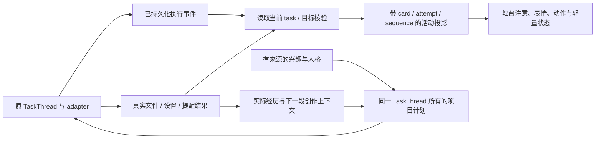

# 桌面生命体验：源码研究与本轮实现

后续连续性修复、独立 Windows 桌面的后台原生验收和最新 EXE 记录见 [桌面生命连续性与后台原生验收](2026-10-05-life-continuity-and-background-acceptance.md)。本文件下方的包版本及验收边界保留原轮次记录。

日期：2026-10-05。范围是 Phase 1 的行动、身体表达和持续个人活动。用户授权直接复用同类项目代码；研究目录为 `C:/Users/Administrator/AppData/Local/Temp/alicization-expression-research-20261005`，旧固定版本研究目录继续复用。外部项目仅静态阅读，没有安装或运行它们的应用。

## 十一个项目的实现取舍

| 项目与源码 | 取用的实现经验 | 本地接入与限制 |
|---|---|---|
| [pi 事件流](https://github.com/earendil-works/pi/blob/b2b5c42f6138b73ec4b2f49ec0ca468800f88586/packages/ai/src/utils/event-stream.ts)、[agent loop](https://github.com/earendil-works/pi/blob/b2b5c42f6138b73ec4b2f49ec0ca468800f88586/packages/agent/src/agent-loop.ts) | 独立事件流、FIFO 消费、工具生命周期与取消 | **实际复用代码**为 `third-party/pi-event-stream.ts`：改为函数 API、单消费者、有界队列和明确 close/drain，供已提交的执行状态投影消费。保留 MIT 来源、版权和完整许可；许可随桌面 resources 打包。原 Turn OS 继续派发工具。 |
| [N.E.K.O. motion player](https://github.com/Project-N-E-K-O/N.E.K.O/blob/f2fea6de7149ef333422e61bafa4102d44f2cf2c/static/vrm/motion/player.js)、[主动投递](https://github.com/Project-N-E-K-O/N.E.K.O/blob/f2fea6de7149ef333422e61bafa4102d44f2cf2c/main_logic/proactive_chat/delivery.py) | 动作代次、取消恢复、基础动作与短暂动作分开；提交后再记录主动投递 | 采用动作过渡与实际结果分层；角色不根据一个 stdout 成功字样庆祝，不将生成计划当成已执行动作。没有将其云端、屏幕持续采样或完整应用引入本项目。 |
| [VPet MainDisplay](https://github.com/LorisYounger/VPet/blob/c3420bb77d6d00ed5fabf975a0945c4f6179bba3/VPet-Simulator.Core/Display/MainDisplay.cs)、[MainLogic](https://github.com/LorisYounger/VPet/blob/c3420bb77d6d00ed5fabf975a0945c4f6179bba3/VPet-Simulator.Core/Display/MainLogic.cs) | 动作进入、持续、退出与工作状态分别处理；身体并非单段待机 | 增加默认小动作，保持已有 idle 动画连续，不在每次状态刷新时重播手势。未复制 WPF 状态中心、喂食货币规则或角色美术资产。 |
| [Hermes session persistence](https://github.com/NousResearch/hermes-agent/blob/93c9360a8da592cee43e8895403e91c7a920b0ce/agent/session_persistence.py)、[memory manager](https://github.com/NousResearch/hermes-agent/blob/93c9360a8da592cee43e8895403e91c7a920b0ce/agent/memory_manager.py) | 长生命周期工作恢复、真实内容与临时控制材料分开、明确后台资源边界 | 已核验的项目产物进入下次创作；项目原计划、进展和来源保持可查。行为输出不是永久人格变化，也不凭练习次数宣布技能提升。 |
| [Generative Agents plan](https://github.com/joonspk-research/generative_agents/blob/fe05a71d3e4ed7d10bf68aa4eda6dd995ec070f4/reverie/backend_server/persona/cognitive_modules/plan.py) | 多尺度计划与行动持续时间、遭遇事件后的接续 | 实现 2–4 段有界个人创作项目，跨天接续同一计划。计划仍需要真实本地写入和独立核验；不复制模拟世界的进餐/睡眠作为真实经历。 |
| [OpenHands EventLog](https://github.com/OpenHands/software-agent-sdk/blob/1b2b5c850b6a99d8b742bfe20d198d6167165ca2/openhands-sdk/openhands/sdk/conversation/event_store.py) | 持久事件、父子关系、锁与重复检查 | 身体观察放在 execution event 持久化之后，并再次读取权威 task/goal；未增加第二套工具派发或事件数据库。 |
| [LangGraph.js SqliteSaver](https://github.com/langchain-ai/langgraphjs/blob/1cee82d0c48fbaeb2d71433211b03113992cc114/libs/checkpoint-sqlite/src/index.ts) | 写入、检查点与已完成工作分离 | 项目进展从已验证步骤推导，重启后继续下一步；不根据渲染器缓存重写文件。继续使用原 SQLite writer。 |
| [Graphiti edges](https://github.com/getzep/graphiti/blob/3c427640abf909f12f71f963fce15eb514a3c493/graphiti_core/edges.py) | 来源与事实有效时间 | 项目接续要求当前有效兴趣版本；来源撤销后停止，原 TaskThread 里的计划也进入已有红删流程。未引入图数据库。 |
| [Letta memory worker](https://github.com/letta-ai/letta-code/blob/bc4b97c3185302890cfb511c6d1e49f49fc5300c/src/agent/subagents/memory-worker.ts) | 后台工作在固定来源与版本上完成，再整合 | 个人活动继续受前台抢占和来源版本控制；动作服务只读取人格，不成为另一个人格 writer。没有为每个行为创建新 agent。 |
| [Open-LLM-VTuber conversation](https://github.com/Open-LLM-VTuber/Open-LLM-VTuber/blob/992309c0aa19845960228f880013d4685fde93b5/src/open_llm_vtuber/conversations/single_conversation.py) | 生成、合成、播放与打断分开 | 继续保持实际音频回执；身体的动作播放不代替对话投递证据，暂停终止 transient gesture。未用全文归档推断用户已听完。 |
| [SillyTavern expressions](https://github.com/SillyTavern/SillyTavern/blob/06bde939fb1e9c4c8d8641d810f0a916b5bce127/public/scripts/extensions/expressions/index.js) | 表情分类与可用资源/回退分开 | 能力声明要求实际骨骼/表情支持；目标完成时保留原人格的情绪，伤心时不强制欢呼。仅阅读其机制，未复制 AGPL 实现。 |

前四个为本轮新获取的固定 commit，后七个为再次检查的既有固定版本。它们不等同于所有项目当前最新版。另查阅 [three-vrm humanoid API](https://pixiv.github.io/three-vrm/docs/classes/three-vrm.VRMHumanoid.html) 和 [Three.js animation API](https://threejs.org/docs/) 来核对真实骨骼与 additive animation；实际接口以安装版本和类型检查为准。

## 生产接入

- `life-execution-presence.ts` 是只读观察器：执行事件提交后刷新；先检查当前身份和 attempt，再投影阶段。adapter completed 进入 verifying，只有 fulfilled＋独立 satisfied proof 才进入 finished；取消、来源失效、失败、等待确认各有状态。没有读取命令内容来猜成功。
- `life-presence-transport.ts` 明确绑定主舞台窗口的 Eventa 出站路由。原全局 Electron context 在没有 invoke sender 时不会自动广播；原生测试因此发现执行已完成但舞台收不到状态。路由在窗口建立时接入，销毁与退出时清理，不向浏览器工具窗口或任意 webContents 广播。人格仍由同一 desktop runtime 所有。
- `use-stage-activity-presence.ts` 是临时显示状态：旧代次、旧顺序、过期或错误形状拒绝；相同阶段的 heartbeat 延续可见性而不重播动作；后台个人项目不会抢占前台执行表现。
- `stage-activity-indicator.vue` 只显示普通活动状态，不承担人格或任务权威。Stage 组合这些模块；切换身份/模型清理临时状态。
- `procedural-gestures.ts` 为真实 normalized bones 创建 additive clips：点头、摇头、侧头、专注、观察、安慰、挥手和轻度庆祝。动画混合器实际执行，保持原 idle/姿态，取消后恢复，缺少必需骨骼的能力不声明。动作与表情选择继续经过原 manifest；没有下载第三方美术资产作为交付。
- `life-personal-series.ts` 的根计划由第一条 TaskThread metadata 所有，普通 upsert 不能改写；后续步骤从原计划和真实已核验文件推导，不是另一份人格/目标 store。每段仍走 owned-note adapter 和独立文件核验；每日最多一步，前台优先。scheduler 只持有下一次机会的时间与项目 ID。
- 项目计划包含在第一段实际产物里并与固定 proof 匹配。缺文件、文件内容改变、计划改变、来源撤销、用户取消或否定反馈时停止接续；旧草稿不当作真实生活经历。来源红删继续去掉计划 metadata。未把任何候选成长自动代替用户采用。

## 验收与完成边界

场景测试已经覆盖：真实 SQLite/文件产生的执行、错误内容阻止完成、手动独立重查后完成、旧 attempt 与身份切换、事件流关闭、实际动画 mixer 的八种动作及取消、liveness 不重播、负面情绪不被庆祝覆盖；还有跨天、重启、同一计划继续、前文真实文件采用、计划冻结、来源遗忘、产物变动和到期不循环触发。

测试日志分别位于 `output/life-experience-action-body-tests.log` 和 `output/life-experience-personal-series-tests.log`。最终整合、原生与构建结果继续记录在本文件后续验收段；上述机制不能替代长期自然度观察。

这轮的具体边界：新增有界创作项目接续和桌面行动表达，没有声称已具备所有应用的通用 GUI 自动操作、丰富专业美术动作、自由开放探索或主观意识。默认小动作是程序生成的基础表现；仍需要完整日常场景和实际相处来评估自然度。

## 本轮最终测试记录

| 范围 | 结果与证据 | 限制 |
|---|---|---|
| 桌面全量服务/渲染契约 | 5,463 通过，8 条保留原有跳过条件；`output/life-experience-desktop-final.json` | 最后新增窗口路由以后按受影响范围重测，未重复整个全量；不能把跳过条目算通过。数据库重放超过默认 5 秒，使用 30 秒有界限时。 |
| 身体、Live2D/VRM、音频 | 737 通过；`output/life-experience-expression-regression.json` | 动画混合器和骨骼实际运动、取消恢复有测试；不等于专业美术或自然度评分。 |
| 最后的执行观察器、窗口路由、主 runtime 和 Epoch 2/3 | 178 通过；`output/life-experience-transport-final.json` | 与全量报告有重叠，不能相加为独立测试总量。 |
| Windows 原生执行场景 | 正确文件实际写入、独立 satisfied、orienting→working→verifying→finished；错误字节实际写入、独立 not-satisfied、进入 blocked，未错误庆祝；工作手势真实播放。`output/life-acceptance/experience-native-observation.json` | 是打包前开发 runtime 的观察，不是最终安装包的原生验收。该次执行场景跳过了八手势单独矩阵；不能把空矩阵算八项通过。 |
| 类型/格式 | 全工作区 typecheck、桌面构建 typecheck；定向 ESLint 修复，零错误 | 定向修复保留既有大量本地修改，未执行可能改写无关文件的全仓 lint:fix；仍有既有 runtime 与测试格式警告。 |

原生检查也发现并修复了 VRM 表情控制器的深层 reactive 包装问题：内部 refs 被展开，诊断读取报错；现用 shallowRef 保留控制器的 refs。

用户随后要求测试不占用正在使用的主页面。本轮可见测试窗口已退出；后续只执行后台类型检查、测试、构建、打包和包内字节核对。**最终安装包的桌面可见性/安装交互未再次运行**，这一限制记录到 release-provenance，不能以后台构建成功代替。

## 新版交付与后台包检查

- 新安装器：[Alicization-0.3.0-windows-x64-experience-20261005.exe](C:/Users/Administrator/Desktop/git/alicization/apps/stage-tamagotchi/dist/life-experience-20261005/Alicization-0.3.0-windows-x64-experience-20261005.exe)。大小 `606,855,123` 字节；SHA-256 `49214d9723378d2eb8ba4aea2ba49e47e3df7a84681790611eea59c1a5e0082d`。
- 解包程序：[alicization.exe](C:/Users/Administrator/Desktop/git/alicization/apps/stage-tamagotchi/dist/life-experience-20261005/win-unpacked/alicization.exe)。整个 `win-unpacked` 目录须保持完整。
- 远端 `main` 再次拉取后仍是 `7880afc29ab33a4cf4de89f7a6610664278494c3`；本包包含本地开发与原有修改。不是未修改的上游 commit 构建。
- 构建前与交付时源码指纹一致：`037d29ddd8b4483293e034d68e8bcc19e3bf7fb678946529767215ab662a181a`。app.asar 内每个编译文件均与本轮 `out` 逐一匹配，pi MIT 许可也逐字节核对。
- 最终 EXE 在确认 RunAsNode fuse 已启用后，以 Node 模式通过后台检查：Electron `40.8.0`、原生模块 ABI `143`、SQLite 内存库读写成功、向量扩展 `v0.1.6` 加载成功，创建窗口数为 `0`。检查没有载入主应用入口或用户人格数据库，也没有运行安装交互。
- [发布溯源](C:/Users/Administrator/Desktop/git/alicization/apps/stage-tamagotchi/dist/life-experience-20261005/release-provenance.json) 记录源码、全部编译文件、原生依赖、安装器哈希和不同测试范围。后台原生依赖成功与桌面可视化验收分别记录。

源码来源索引见 [十一项目与十八文件的固定版本哈希](2026-10-05-desktop-life-source-manifest.json)。Phase 1 的长期自然度仍未验收通过；这次新增动作、执行反馈和个人项目接续需要实际相处来评估。
