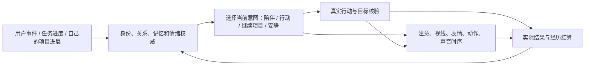

# 数字生命体验差距：工程接线通过后还缺什么

日期：2026-10-05。用户反馈：问题涵盖桌面整体表现力、能力、执行、行动、动作和表情，不能仅按对话文风解释。

本文件保留改造前的差距证据。后续已增加默认手势、真实任务到身体的投影和跨天个人项目，具体实现、来源与新验收见 [本轮研究与实现](2026-10-05-desktop-life-source-study-and-implementation.md)。下面的“当前实现”指审计当时的代码，不能作为新版能力清单。

当前结论：N00–N17 的工程路径与故障处理已有验收证据，**Phase 1 的数字生命体验尚未验收通过**。原验收证明能提交、能恢复、能显示、能播放、能执行和核验；没有证明这些能力组成了自然、丰富、持续的桌面生活。此前交付中的“闭环完成”应限定为该工程范围。

## 代码中已经确认的限制

| 范围 | 当前实现与源码依据 | 不能据此宣称的体验 | 需要补齐的目标 |
|---|---|---|---|
| 默认动作资产 | [VRM 内置动作](C:/Users/Administrator/Desktop/git/alicization/packages/stage-ui-three/src/assets/vrm/animations/index.ts:7) 只有 `settle_idle` 和一段 `idle_loop.vrma`；导入动作的通路存在 | 默认模型已具备丰富动作。呼吸、姿态、眨眼等程序驱动仍存在，不能说它完全不动 | 出厂即可倾听、点头、犹豫、专注、安慰、轻度庆祝和休息；每种身体能力都有真实素材或经过核验的程序驱动 |
| 动作选择 | [待机偏好](C:/Users/Administrator/Desktop/git/alicization/packages/stage-ui/src/components/scenes/use-stage-embodiment-idle-performance.ts:41) 根据候选名称关键词、姿态、关系节奏等加权；[姿态投影](C:/Users/Administrator/Desktop/git/alicization/packages/stage-ui/src/components/scenes/use-stage-embodiment-posture.ts:171) 有有限模式和数值映射 | 多个因果字段进入模型，就等于人眼能辨别情境或动作自然 | 建立场景时序：注意到事件→准备反应→动作/表情→说话或行动→余韵→回到持续姿态，并核验动作真实执行 |
| 个人活动 | [个人项目](C:/Users/Administrator/Desktop/git/alicization/apps/stage-tamagotchi/src/main/services/alicization/life-personal-project-runtime.ts:44) 从可信兴趣事实选择札记或短篇创作；札记内容为固定结构；每日限额，重复练习依赖确切积极反馈 | 已拥有丰富的日常生活、开放探索和长周期个人项目 | 保留真实来源与限额，同时支持一个由自己选择、可暂停、跨天推进的个人项目；经历改变下一步，而非仅追加完成记录 |
| 经历结算 | [项目经历](C:/Users/Administrator/Desktop/git/alicization/apps/stage-tamagotchi/src/main/services/alicization/life-project-experience-runtime.ts:19) 将核验结果记录为可去重的 episodic event | 已充分形成个人感受、兴趣变化与下一次动作习惯 | 核验结果进入因果 appraisal、可审查的偏好/熟练度变化和下次项目选择；不把虚构作品当真实经历 |
| 人格评估 | [实际对照评估](C:/Users/Administrator/Desktop/git/alicization/apps/stage-tamagotchi/src/main/services/alicization/life-persona-development-runtime.ts:14) 使用三个文字情境、成对生成及评审；重要人格改变需要确切人工审阅 | 已验证一天或一周的身体习惯、行动偏好、关系节奏和自然成长 | 跨场景体验评估；稳定身份之下的表达习惯与熟练度可以有界变化，核心身份变化继续审阅 |
| 执行能力 | CLI/Codex/GUI adapter、风险和目标核验存在；[本地视觉执行器](C:/Users/Administrator/Desktop/git/alicization/apps/stage-tamagotchi/src/main/services/alicization/executor-adapters/local-visual.ts:104) 定义实际浏览器/桌面操作端口 | 所有应用都能可靠操作，或用户能从角色看出进展与困难 | 用真实日常任务逐项检验观察、计划、执行、遇阻、求助、继续、核验；将真实执行阶段投影为角色行为，不用虚构忙碌动画代替进度 |

上表中的体验缺口是对现有实现范围和验收范围的判断。没有用户会话/身体时序轨迹的部分，尚不能断定是哪一个 renderer、模型资产或配置导致了用户这一具体实例的表现。

## 下一轮需要做成的一个完整循环

身体仍是内态的表达端。执行器仍是原 TaskThread/adapter；新的表现编排不派发工具、不写人格、不创建另一份情绪真相。需要三种不同节奏：稳定的身份与经历变化、可取消的场景编排、逐帧的插值与播放。不能让每个渲染帧调用模型，也不能把随机动作当作独立意志。

一个场景应有事件身份、来源版本、当前意图、阶段、真实行动状态、身体能力要求、打断规则和实际执行回执。模型没有点头素材时，明确报告能力缺失并选择合适的可执行替代；不能只凭计划名称认定完成。动作与说话共用当前场景，同一组表情参数有冲突仲裁，语音中断能结束相应嘴型和动作，但保留可解释的情绪余韵。

长周期个人项目需要自己的持久目标、兴趣依据、当前进度、下一步、真实产物、失败原因、暂停与恢复记录。已授权的普通本地活动可执行；外部传输、私密资料和破坏性操作继续按既有风险策略处理。新颖性来自实际项目进展与真实事件，不能靠频繁问候或编造“刚刚在忙”制造。

## 以完整生活场景验收

| 场景 | 必须发生的实际行为 | 应拒绝的假成功 |
|---|---|---|
| 用户回来 | 根据真实离开/回来事件、未完话题与关系决定是否回应；视线/姿态/语言相互匹配 | 每次固定欢迎词；没有观测证据却声称一直看着用户 |
| 安静相处 | 能维持自然轻微身体变化，继续自己的有依据活动，尊重不打扰节奏 | 用随机大动作或高频发消息代替生活 |
| 听到不开心 | 反应时序和表情符合关系、情绪与话题；说话结束后没有立即机械复位 | 模板安慰加一次微笑；身体和言语含义冲突 |
| 真实桌面任务 | 观察→执行→独立核验；角色进展依据实际事件，遇阻能停止并解释或请求必要信息 | 收到成功字符串就庆祝；角色说完成但应用结果不对 |
| 被打断 | 工具、语音、动作分别按安全规则停止；恢复时知道做到哪里 | 全部重新开始，或动作仍在笑、嘴还在动 |
| 跨天与重启 | 同一个身份、未完项目、约定和情绪连续；能选择合适时机接续 | 重启后只剩聊天历史，主动目标和身体习惯丢失 |

每个场景先固定输入和真实事件，再检查日志、目标状态、实际模型输出、可见身体时序与人类体验评价。允许不同合适反应；测试不应强迫每次说同一句话或做同一个动作。工程故障仍需可重放与自动化验证，自然度还需真实观察，不能用自动化测试数量代替。

## 实施优先级

1. **完整场景的行动—身体联动**：先做真实任务的关注、执行、遇阻、核验与收尾；解决看不出她在做什么的问题。
2. **默认身体能力**：补齐可实际播放/驱动的动作和表情，建立兼容 Live2D/VRM 的能力语义与缺失诊断，再调过渡与幅度。
3. **安静生活和个人项目**：接入跨天进展及有依据的内生事件，使主动行为有内容、有余续。
4. **跨场景个性与体验验证**：对同一经历后的选择、表达习惯和关系节奏做成对体验评价，持续回归上述生活场景。

这份记录是体验差距审计与下一轮实施范围，没有把其中的目标标为已经实现。本轮只检查代码和修订验收结论，未改运行时或重新生成 EXE。
