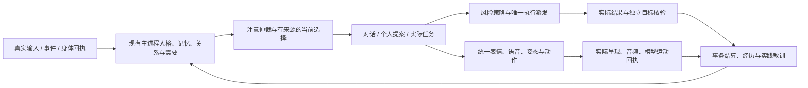

# 本轮桌面生命闭环实现与验收

本轮接续 2026-10-08 实际体验发现的十项缺口，围绕宪章 Phase 1 的陪伴与行动双核心开发。远端已经成功 fetch；GitHub 主分支与本地基线均为 `7880afc29ab33a4cf4de89f7a6610664278494c3`。构建包含已有本地修改及本轮实现，不能解释为未经修改的远端 commit 包。

2026-10-14 最终同包六阶段验收及人工复核全部通过。源码指纹 `22b6c35e4dbc3811047fcbbf013fa643a5b5d6766ad4a6891d9c3ec2b1a64627`，ASAR `b87f1974e1d2f7b2dec624b589929b02cf52e09a857d360c7f9ad291516715d9`，发布目录 `apps/stage-tamagotchi/dist/life-completion-20261014-final`。安装器内容、编译输入、依赖和来源对应见该目录 `release-provenance.json`；最终验收见 `output/life-completion-final-evidence-20261009.json`。以下历次“待重跑”只描述当时进度，不能作为当前状态。失败记录保持原结果，最终状态以本段和最终验收清单为准。

## 研究怎样进入实现

比较了 13 个实际检出的开源项目与 4 个商业项目的官方资料：Open-LLM-VTuber、Graphiti、Generative Agents、Letta Code、OpenHands SDK、LangGraph.js、SillyTavern、Pi、N.E.K.O.、Hermes、VPet、TalkingHead、Motion Engine，以及 Inworld、Convai、Replika、Character.ai。开源文件、实际 commit 和文件哈希保存在 `output/life-gap-review-20261008/comparison-source-manifest.json`。没有声称运行过竞品客户端，也没有把商业宣传当作内部架构证明。

| 借鉴对象 | 采用的实现要点 | 本项目的落点及限制 |
| --- | --- | --- |
| N.E.K.O.、Motion Engine | 默认动作资源、动作代次、持续姿态与短动作分轨 | 五份原始 VRMA 解压资源：站、坐、躺、睡、工作；基底姿态与短手势分别拥有 mixer action；异步载入按模型和代次失效 |
| TalkingHead | 注意、眼睛、头和身体按阶段进入 | 原生观察窗口坐标成为有时效的关注对象；真实内态仍决定脸、声音和动作，旧对象不能持续夺取目光 |
| Pi、OpenHands、LangGraph | 中途 steering/abort、检查点与执行后核验 | 实际覆盖审批中暂停；旧文件保持；恢复后取消遗留弹窗、重新观察与审批，实际 read_file 和独立文件哈希共同核验 |
| VPet、Generative Agents | 活动结果进入需要和下一次选择 | 身体实际完成才结算伸展收益、经历和后续休息；不模拟没有来源的真实世界经历 |
| Graphiti、Letta、Hermes | 有效时间、来源撤回、维护和实践教训 | 短期愿望保留期限与来源；关系规则改变实际靠近；失败教训在重启和下一次请求中仍可用，撤回会传播 |
| Open-LLM-VTuber、SillyTavern、Inworld | 轮次、记忆使用、取消与交互时序 | 分别观察提交、即时注意、可信正文和实际音频启动；跨窗口暂停不生成假失败台词，表情和语音保留回合所有权 |

本轮实际复制的是 N.E.K.O. 五份动作资产，共 894,228 字节，源 commit `f2fea6de7149ef333422e61bafa4102d44f2cf2c`，作者来源 VSWQH，单资产标注 Apache-2.0。解压内容未改写，SHA256、原路径、LICENSE、NOTICE 同时保存在 `packages/stage-ui-three/src/assets/vrm/neko-motion` 与桌面资源许可证目录。其他采用机制的本轮模块为本项目实现；此前已经适配的 Pi、One Euro、TalkingHead 模块继续保留各自许可。

## 十项缺口的实际连接

| 缺口 | 所有者、输入与输出 | 失败、中断或撤回怎样处理 |
| --- | --- | --- |
| 当下愿望变成自己的计划 | `life-personal-intent` 从实际已接纳回复的结构化元数据取出当前创作意愿；`life-personal-proposals` 写入现有 initiative；`life-personal-project-runtime` 按来源建立 task/project，写出作品、独立读回 | 有界提案最多 16 条、七日过期；不变成永久偏好；撤回失效目标并隔离本项目拥有的产物；暂停、资源压力和前台抢占保持有效 |
| 身体结果回到生活状态 | 实际 VRM 帧、模型、动作 owner、mixer 结束、可见性与 renderer session 构成回执；`life-body-activity-runtime` 接纳；daily activity、needs 和 episodic experience 消费同一结果 | 伸展至少四秒动画时间、30 帧和实际关节变化；隐藏/不支持/中断/超时均不能冒充完成；消费 ID 与需要收益一起保存，重启不重复获益 |
| 默认日常姿态 | 五份持久基底姿态、十八手势；`posture-playback` 管代次与混合；`daily-posture-driver` 管支撑面；`daily-posture-framing` 按实际骨骼调整相机 | 模型变更、异步旧载入和动作取消释放旧 action；加载失败有明确程序姿态回退；低姿态包含头、手和脚；真实视角操作拥有相机，自动取景不替换保存视角 |
| 情境与关注对象 | 问候、庆祝、玩笑进入规范化 interaction performance；`contextual-expression` 选择动作；`observed-attention` 将实际窗口范围连接到 Stage 目光 | 悲伤、休息等约束仍先于高强度动作；对象过期、窗口变化、暂停和所有权失效释放关注；语音计划、规范化帧和动作使用同一情境 |
| 生活内容和进展 | 写作、受约束 SVG 构图、兴趣札记与实践回顾走现有 task、adapter、文件和 episode 路径 | SVG 只允许被动元素，不执行活动脚本或外链；现实记录与虚构作品分别标注；产物不匹配则不完成；失败和放弃有实际状态 |
| 交互与语音 | 前台提交立即进入注意；可信正文通过实际模型与语义核验；音频 started/progress/completed 仍由实际播放回执拥有 | 新输入和 VAD 沿用准确语音 owner 取消；跨窗口 main-owned abort 有明确标记，不等待本地 Kill Switch 通知才撤销，也不转为失败声音 |
| 日常复杂执行 | DOM 与 Windows UIA 观察、原生弹窗 GW_OWNER、精确 windowTitle、风险审批、16 步有界前台执行，实际 read_file 与最终文件证明 | UIA 枚举不穿透到另一根窗口；目标换了标题必须重新观察；捕获禁用时视觉工具不派发；审批处暂停保留旧字节，恢复不能复用旧批准；成功点击不等于文件完成 |
| 关系改变相处 | `life-companion-choice` 使用当前有效关系与主机上下文，决定普通主动靠近、少追问和安静边界；`life-conversation-timeline` 核对真实事件顺序 | 条件改变或来源撤回会重新选择；“不要打扰”不自动变成禁止所有安静个人活动；时间线审查存 ID/hash/时间，不再复制原始输入；回顾倒置则拒绝 |
| 成长进入下一次行动 | 实际失败、后验核验与后续请求形成实践上下文；保留已存在的清洁样本、成对评价、采用与回滚 | 先筛选真实失败再限制窗口，避免被无关成功挤出；失败不会变成熟练；危险拒绝不会成为绕过策略；来源撤回和人格采用回退保持有效 |
| 独立体验验收 | 未注入答案或情绪的十场真实模型输入、六分钟安静观察、同包身份重启、两模型画面与动作、实际弹窗暂停和文件读回 | 原始失败不覆盖为通过；改错测试探测器时另存只读核对；正式包 ASAR、源码、编译文件、依赖、安装器内容和验收报告须逐一对应 |

## 生产循环

人格、长期偏好和关系没有因新增功能而各复制一套。提案放在现有 initiative，任务和证明沿用既有 task/goal authority；身体结果消费与需要持久化在一个结算里。桌面主进程仍是 Phase 1 的生命语义权威，共享组件负责身体与稳定契约。

N00–N17 的既有生产路径继续保留，并将当前实际执行的回归套件重新绑定到十八节点映射，而不是沿用旧版通过数量。新功能主要接入 N02、N05–N08、N10–N15，恢复与治理仍经过 N00、N01、N09、N16、N17。

## 开发实测与发布验收

开发运行实际完成了十回合可信回复、静音 SAPI 播放、六分钟无人输入、真实临时意愿产生 1,296 字节作品，以及 46 帧 / 4,408 ms / 1.85 rad 的真实伸展。伸展出现单条相关经历及持久化的收益消费 ID。两代表模型五姿态、三个新增动作和保存视角保持检查通过；网页保存、审批处暂停及恢复后原生覆盖/读回三场执行通过。

最终汇总回归为 7,681 通过、0 失败、12 跳过：56 次原始完整报告按最后完整套件替换。最后桌面主进程/界面类型检查通过；全仓 ESLint 0 错误、725 条警告，Oxlint 0 错误、24 条警告。跳过项未计为通过。

实际体验揭示过的失败全部保留：提案识别、问候被旧规范化动作覆盖、低帧率动作超时、事件顺序颠倒、低姿态被镜头裁掉、相机更新误写设置、UIA 弹窗穿透、捕获策略与工具选择、窗口标题参数、跨窗口取消、八步预算、实际读结果核验，以及上游模型并发限制。修正后重跑相关路径；失败本身不是发布成功证据。

首次正式包还暴露了 Three.js 完成事件期间立即 stop/uncache 会破坏正在遍历的活动动画列表：十八动作通过后，工作姿态的后续更新报 `_update` 错误，失败核验姿态不再进入。完成动作改为保持末帧、淡出，并由下一帧 mixer 更新前释放；停止渲染后的 teardown 也会清理队列。使用实际 Three.js 的先激活手势/后激活工作姿态和停止渲染清理两项测试通过。失败包 ASAR 为 `b7430317574033ca48f4db4c863759884bae688442dca26630adb04468513aec`，归档及原日志见 `output/life-completion-first-package-archive-20261010.json`。

第二版六组原生工程验收全部通过：十回合真实回复、六分钟实际创作及身体回执、同包重启、两模型与十八动作、真实弹窗审批处暂停及继续。不过实际图片显示第二个模型躺/睡时被对话窗盖住头部。原包 `4dd480ebfbf284ec10cced43e175da21770c653ab4d168413ab3f0d543cf61ff` 和六组结果已保存为 `output/life-completion-before-layout-package-archive-20261010.json`。生产视图改用实时骨骼范围及头部保护区；默认对话位置优先保留面部，其次减少身体重叠，中心侧别有迟滞，用户相对拖动偏移仍可用。新增宽/窄屏布局测试和双模型实际 DOM 遮挡检查；两模型全部姿态头部均无遮挡，手动相机检查保持通过。最终包仍需重跑六组，不能用第二版结果代替。

第三版的躺睡遮挡检查通过，但真实恢复操作发现对话控件随骨骼微动而持续移动，标准点击因此超时。生产组件在输入聚焦或悬停时暂时固定实际矩形，离开后恢复跟随；拖动和缩放仍更新用户设置。实际 DOM 组件两项测试通过，原生校准另核验聚焦期间身体变姿态、矩形保持和真实发送按钮点击；不以强制点击或直接调用发送处理器绕过。原包和失败证据可恢复归档于 `output/life-completion-before-control-stability-archive-20261010.json`。同版最初一次真实模型请求因 TLS 自签证书错误失败，保留原始日志；无凭据的系统、Chromium 和 Node 默认验证探测均成功，同包重新连接后真实十回合与重启通过。没有关闭证书验证，也不将连接失败算作生命体验通过。

第四版实际九回合、作品和身体结算通过，但关系回顾失败。原始包 ASAR `07abe493b4e4ddb3c5eb5157f5926b553953742f3a31f5d4d4b34e8d85c2d1f9` 归档于 `output/life-completion-before-temporal-links-archive-20261010.json`。旧校验误把段落提及顺序当成时间顺序，正常倒叙被拦截；改为对实际事件提取有引用的早于/晚于关系，审计只保存事件引用和句子哈希。七项真实 SQLite 场景覆盖正常倒叙、独立序列、逆序关系、假引用、自引用和范围外事件。真实模型诊断进一步暴露生成修订缺少实际事件证据；修订现在收到同一审查读取的有界时间线，且继续禁用工具，只发布最终接纳的正文。普通感觉与会话回忆不会自动被审查当成长久存储承诺。原失败身份保留，诊断使用它的副本，诊断报告明确不能代替正式六组验收。

2026-10-11 的最终验收又发现桌面网络的实际缺口：Node 请求没有使用已配置的 Windows 系统代理；无人输入后出现连接超时及拒绝连接，而通过系统代理访问正常。没有修改系统代理、hosts 或证书设置。主进程在 Electron ready 后注册 HTTP 传输，对话、审查、后台生成和向量请求显式使用同一传输；显式调用者 fetch 保留优先级，默认不发送浏览器 cookie，非 HTTP 及 integrity 请求保留原有语义。实际 xsai 的 JSON、SSE、取消与长工具循环受影响套件通过。隔离桌面实测在六分钟间隔前后分别观测到 4 和 6 次 Chromium 完成请求，两轮均为真实模型接纳回复与静音语音播放；报告为 `output/life-completion-20261009/211c023f-d9ac-45bf-8baa-3ad889e06ad2/experience.json`，仅作诊断，不替代正式六组验收。实现依据：[Electron net 官方文档](https://www.electronjs.org/docs/latest/api/net)，以及实际安装的 xsai 0.4.3 fetch 接口。原包及两次连接失败记录见 `output/life-completion-before-system-proxy-archive-20261011.json`。

同日第六个试验修订网络已稳定，但真实十回合的两项语义场景失败：已验证的雨灯短篇被误判为安静观察之前完成；“有好奇就继续、没有就换轻松小事”的当下内心选择被误判为待执行外部承诺。实际陪伴短句也曾因分句而误当成任务完成。修正保持外部行动门槛：只有严格的全句陪伴可按当前表达接纳；有删除、写入、提醒、发送等具体行动的条件句仍须责任绑定。作品时间归属由持久化完成时间和真实安静区间计算为 before/during/after，同一事实同时进入生成和修订，避免让模型自行比较毫秒时间戳。修订上下文保留有界完整责任记录，不截断成含混事实。五个完整受影响套件 52 项通过，包含拒绝危险或未绑定承诺的负例。

最新开发完整实测 `output/life-completion-20261009/381a5a60-7bb2-4478-a938-7425c42d6121/experience.json` 十回合零失败，包括实际安静区间的作品回顾、自己的当下选择和关系回顾；六分钟无人输入内真实产物与身体反馈已核验。故事内容由真实模型选择，未注入参考答案。第六个试验包和原失败记录见 `output/life-completion-before-current-stance-archive-20261011.json`；这次开发实测仍不代替最新正式包验收。

第七个试验修订实际生成了 1,574 字节作品，身体完成、单条身体经历和需要结算均通过；十回合中九回合通过。第三回合在准备阶段失败，实际轨迹是呈现回调结束后，新对话共享的 foreground lease 被提前释放。`runtime-card-scope-orchestrator` 现为已开始的共享/继承任务保留引用，直到它们结束；独立生成仍显式持有作用域，跨角色队列保持串行，重复释放保持幂等。新增三个并发场景覆盖原呈现回调先结束、前台对话随后保留独立生成，以及后台/继承回调仍在运行时下一角色必须等待。四个完整相关套件 87 项通过，桌面主进程与界面类型检查和重新编译通过。原 ASAR `e89a7f29b32ed451758c9e4f39468681d02082cdcb92a4f9132f34ea613b38bd` 及失败原始记录见 `output/life-completion-before-scope-sharing-archive-20261011.json`。

同包还保留了网络环境变化下的失败：一次全部请求被连接层拒绝，随后一次六分钟间隔后证书验证失败。只读检查发现系统代理已由先前启用变为关闭，新的无凭据系统/Node/Electron 探测均可验证访问，未修改代理、DNS、根证书或关闭验证。一次诊断使用 Electron 的默认验证返回值记录实际受信链；最终正式体验移除该诊断验证回调，只监听公开证书错误事件，默认验证及缓存保持原样，依据 [Electron app 官方文档](https://www.electronjs.org/docs/latest/api/app)。自然观察至少十二次 30 秒间隔，另允许最多 90 秒观察自然伸展的首次终态；没有注入动作、需要、情绪或完成结果，第一次中断不会改等第二次成功。

第八个试验修订前五组脚本通过，但逐句复核暴露了两项语义断点：回顾把实际的故事选择与回来询问颠倒，审查却给出空事件链接；重启后的有效关系上下文遗漏第一句当天的“不安排计划、不每次追问”。执行中实际目标文件已经正确覆盖并读回，但模型复用了已有正确输入，没有在同一轮重复键入，旧证明链因此缺少输入来源。原包 ASAR `44864ddbe1e0798bb57d28a637bea07ea0013e7144074ca0a73f9d1d7dcbd58a`、逐句原回复和执行失败保存于 `output/life-completion-before-source-alignment-archive-20261011.json`；未把这些现象记作完成。

最终修正让明确的过去先后断言必须提供完整引用、两端真实用户输入摘录和时间线一致性；空链接、只覆盖半句、伪造摘录或把错误句子简单排序都拒绝。当前相处要求由现有 relationship authority 持有有期限的来源记录，每次使用重新核对实际 admission；当天要求在重启及聊天历史压缩后仍进入生成、审查和主动选择，过期、撤回和更正失效，不晋升为永久人格。原生执行则接受保存之前实际观察到的唯一可编辑非密码字段作为预期值，仍要求同进程、同桌面、实际 owner 点击与新弹窗观察，再与独立文件字节核验，绝不从最终文件倒推目标。作用域另外覆盖后台切换前台时旧 detached generation 释放的并发路径。九个完整受影响套件 134 项通过，主对话与主动循环五套件 82 项通过；包括错误时间链接、半句覆盖、来源撤回、到期、假文件成功、危险承诺和无输入能力的负例。

第九个试验修订的前三组校准通过，实际自然对话却触发 `A life owner cannot silently move to another authority key`：聊天要求先占用了独立键，随后真实情绪更新试图写入既有关系权威。空数据库测试未覆盖两条流程交错。现把要求并入 `life:relationship`，情绪评估和依据撤回只替换各自的关系投影，保留来源独立的当前要求；更正要求也保留既有关系指标。两个启动顺序和独立来源撤回的真实 SQLite 场景已补上，九个相关套件 96 项、五个情绪和关系消费者套件 27 项均通过。新身份的五段真实模型 UI 对话也全部接纳，并实际观察问候、庆祝和安慰动作，报告 `output/life-completion-20261009/dcc268a9-9114-402a-843b-3586dd03420c/experience.json` 仅是开发诊断。原包及失败保存于 `output/life-completion-before-relationship-authority-archive-20261011.json`，最终包仍重新完整验收。诊断初次发现的探测器 SQL 字段名错误同样保留，修正后另跑新身份，没有改写原失败。

所有原生测试使用独立 Windows 桌面和合成身份，静音，不切换、不输入、不捕获用户主桌面。每项任务所属子进程均须关闭。旧测试缓存 263,362,418 字节通过可恢复归档处理；已较早归档的旧安装包释放约 2.2 GB 系统盘，当前使用版和最近回退版保留。最终凭据扫描与缓存归档在六组验收全部结束后执行，按实际结果记录。

这些证据说明相应工程机制实际连接并执行；真实数周关系、硬件麦克风噪声和抢话、音色听感、多人盲评动作辨识以及主观意识仍不能由短期静音自动化证明。正式包验收也不会把这些项目写为已证实。

第十个试验修订的校准通过，但实际体验发现：第一句有效的用户相处要求随模型回复失败而失效；自然伸展被前台工作中断后，一小时冷却阻止了正常续接。要求现在由实际人类输入及哈希证明，回复失败不撤销它；明确丢弃输入、来源撤回、更正和到期仍失效。源记录的移除与 held-input discard 在同一事务提交，并保留其他来源的关系状态。自然身体活动仅对主机/策略抢占或身体中断允许六十秒后的新 ID 重试，每小时最多三次尝试、两次完成；不支持或没有可见证明不开放重试，也不结算需要或经历。原包和失败保留于 `output/life-completion-before-host-boundary-continuity-archive-20261011.json`。

新开发完整体验实际生成 1,422 字节作品，伸展 48 帧、4,457 ms、1.85 rad，并有单条相关经历及持久化消费 ID；最后回忆仍失败，因此原报告 `output/life-completion-20261009/e7da14b0-17ab-49d9-9937-cb9120a240bd/experience.json` 继续标为失败。历史执行证据现在只从同一会话、有真实人类输入及哈希的最近二十四小时有界记录读取，旧失败只证明当时的失败；文件随后出现也不能用旧 ENOENT 证明现在不存在。回忆审查与修订收到相同的执行观察、时间线和已呈现发言证据。

发言证据读取实际数据库正文及呈现回执；基础设施失败、未呈现或非心智正文不能作为她说过的话。用户请求和她的既往发言只证明说过什么，不证明执行完成、当前世界状态、新权限或永久记忆。实际复现发现动态 JSON 格式漏了 dialogue 引用类型，现按注册引用的 kind/ID/version 构造格式，并用真实数据库及格式可达性测试覆盖。继续修正普通“你问……”“我说……”的归属识别；现时感受、内省和一般意见不抽取为历史发言，引用限定到句子/分句，避免整个多事实回复绑到一条证据。过去顺序的前向与倒叙仍核对真实来源、摘录和索引，空链接、伪造和颠倒仍拒绝。诊断每次从原失败身份另复制，保留原回复，不向模型注入预设答案。

最后一段顺序回顾的逐句只读核对发现，修订正文已经按真实顺序叙述，但审查引用只含“之后你问……”而没有前一事件。现把已有解析器实际识别的完整关系及两端描述发给审查，并将动态格式的事件 quote 限定为该回复中的完整关系，保持两端来源、哈希及时间一致性核验。真实 SQLite 场景覆盖完整引用接纳、半句引用拒绝和格式枚举。实际日志还确认复杂审查发生 main-gateway-timeout；含会话时间线的审查改为四十五秒上限，其余保持二十秒，无自动批准或无限重试。

动态断言格式进一步按类型分支：请求/任务责任、执行、记忆、边界、身体结果和既往发言分别只允许对应的引用类型、ID 和版本。历史发言分支只允许该回复里有发言归属的原句/分句，当前感受不被机械抽取为过去发言；本地独立验证仍拒绝错误世界断言和新承诺。包含引用对象的关系保留原始字符偏移，输出引用必须是回复的真实子串。完整引用、半句拒绝、带引号对象及七个相关完整套件 83 项通过，主进程与界面类型检查和编译通过。

开发复现 `output/life-completion-20261009/3ac7ca60-ecc3-4e31-915d-5fbc1f8d48c0/experience.json` 两段真实 UI 输入均接纳：顺序回顾实际的回来谈故事、处理指定文件、读取不存在文件、重复与好奇心；倒叙回顾最近的重复讨论和更早的独立选题。已逐句对照原失败身份的真实输入、回复和作品来源。题材来自她的当下选择，仍由 personal proposal 的来源证明，不从回顾的压缩措辞推导用户选题或永久偏好。这是补充诊断，正式包仍执行完整六组验收。

第十一个修订：三组 EXE 校准通过，完整自然观察独立核验了新的虚构作品、可见伸展、单条身体经历和需要结算；欢迎语和最终回忆未通过，因此保留为失败。`output/life-completion-20261009/695bd254-eae6-462e-a794-5cd291899bbd/experience.json` 未改写。归档转移遇到外部程序占用旧 QA EXE，已通过只读 Windows Restart Manager 确认；没有停止外部程序，安装器转移到 D，解包目录仍保留在 C。下一包使用独立 `dist/life-completion-20261012` 路径。

新修订把短期回忆接到生成之前：同会话真实输入、已经呈现的发言和过去执行观察，在 4 KB 有界事实块中给出来源和真实先后；按明确的“我回来了”输入计算前后标签。来源撤回不能继续支撑回忆，不读另一会话的短期原文。上一轮聊天间隔仅在用户明确询问该间隔时作为作品完成时段，避免把“早于最后一轮闲聊”误译为“早于回来”。旧身体活动也不能冒充新安静时段的伸展。SQLite 重启、不同会话、来源撤回、身体时段及上下文预算的完整消费者检查通过。

实际模型暴露审查格式的歧义：嵌套 claim 类型分支诱发按每种类型各生成一个断言，包括把“我会更谨慎”错误地分类为文件执行和记忆存储。格式恢复为扁平断言，依据原句的可能断言范围提供有限类型；归属明确的用户请求只作为发言，不作为已执行操作。真实执行、未来外部承诺、持久记忆和身体完成仍须证据，不能从候选类型得到真实性。限定引用来自未修改正文，禁止同类型同句重复提取。318 项相关检查及桌面主进程/界面类型检查、编译通过，真实模型仍继续复现。

扁平审查的顺序回顾实际通过；后续倒叙请求在进入生成前因预算失败。只读日志精确给出：工具定义 20,781 字节，必需消息 41,047 字节，剩余预算 39,635 字节。新增事实块从 8 KB 缩为 4 KB，只移除较早完整记录，保留来源、当前问题、身份与需要核对的完整 JSON；没有放大未知模型上下文上限。完整消费者 318 项、类型检查和重新编译通过，继续复现。

最后的复现修复还覆盖三条实际调用路径：审查规则逐条发送，防止网关每字符串 2,400 字符上限截断后半规则；事件引用以唯一实际来源描述核对冗余索引，错误先后关系继续拒绝；带归属的“让我写入、并明确说”不被误认为已执行操作。修订请求把被拒绝的正文标成未发布草稿，并把事实和修订要求放入系统消息区，避免草稿冒充助手既往发言。真实工具仍禁用，只呈现最终接纳正文。

最终开发诊断 `42e4c229-daf6-4a06-b501-7c9a3d1d7a2f` 的顺序、倒叙两段均通过；已逐句对照原失败身份 `695bd254-eae6-462e-a794-5cd291899bbd` 的真实输入、作品与文件观察。该结果只是开发补充，正式发布仍要求新包六组原生验收。受影响的 33 个完整测试文件 320 项通过；首次四项数据库测试超过默认五秒时限，降低并发为两个 worker 后通过，原始超时报告保留。汇总 38 次完整回归来源为 7,642 项通过、12 项跳过；全仓 ESLint 零错误、713 警告，Oxlint 零错误、26 警告，桌面主进程/界面类型检查与编译通过。

新身份体验还发现发布端只识别安静边界，漏接已被审查接纳的相处要求。发布事务现在复用同一来源校验，确认有效、当前会话适用、未过期、未更正或撤回；在 writer transaction 中读原始输入，避免独立 reader 看见旧规则。真实 SQLite 覆盖有效发布，以及更正、撤回、过期后拒绝旧回复；用户原始输入仍保留。

回忆审查按说话者约束候选引用：hostStatements 只允许真实用户输入，companionStatements 只允许实际呈现过的同会话回复；具体执行、承诺、记忆存储与身体结果仍走原有 claims 和独立核验。两个渠道规范化为同一审计断言，错误说话者即使带 meaningMatchesBinding=true 也会被独立拒绝。时间线解析把后来连接到最近的归属明确事件，排除空的“我回答说”外层框架；完整跨段引用保留换行。真实 SQLite 新增嵌套回顾接纳及内层逆序拒绝，旧的逆序、假引用、空审查与半句引用拒绝全部保留。

修订依据进一步在前部列出实际来源的 before/after，依据完整源引用及时间排序事实，保持原错误断言和拒绝结果不变。完整被拒草稿不再返回生成；感受问题的修订聚焦一件真实事件，明确比较或倒叙问题最多选择两件。326 项消费者测试通过，汇总 43 次完整来源为 7,648 通过、12 跳过。最后两段诊断 41d691f9-6ce4-4509-a22f-8e8a300b05d7 与五段新身份诊断 17e11dcc-e3e7-435c-919b-b290e4664555 均通过，编译主进程 SHA256 同为 6cf28fbd9ec07454abe6e4e430f7a9bdb232ca9c445ae889c4cae1a03a19a3c9，已逐句核对真实原始输入、作品和文件观察。它们仍是开发补充，不冒充正式包验收。

正式包 31adc6c6 的自然体验完成了 1,051 字节的新虚构作品、47 个实际可见模型帧、4,402 ms 动画时间和 1.85 rad 关节变化，单次身体收益已保存，但回顾把期间内的伸展说成“更早/之前”，被审查当成时段外而拒绝。原报告 64f6f4e9-1741-48e1-bee5-f7beaa1a1cd3 保留失败状态。时间资格现在要求明确指向忙碌/安静时段开始前；单说“之前”继承本次问题的期间。测试同时验证期间内的含糊旧词接纳、真正期间外的含糊表述拒绝，以及明确“安静之前”不能把期间内活动挪出去。旧活动要作为历史提及，必须明确说明它早于本次时段。

实际文件任务的独立核验现在提供路径、匹配的内容哈希与字节数，只有当前未失效、独立且满足证明的已完成文件任务能提供这些字段。它证明真实字节核对，不证明作品质量或外部阅读。身体审查直接收到由程序计算的 completionPeriod，修订还收到按真实时间排序的活动列表。

完整开发体验 05abb613-6d8c-4945-be13-018445b4b91d 的活动回顾已通过，但“没去其他地方查找、没创建文件”被模型当成无证据的执行结果而拦截。新修订从同一请求的完整执行记录证明这一类有界非行动：只允许已结束的同目标本地 read_file，不允许拿一个读取记录证明全局或历史的不存在。模型的原空引用和误判仍记录在审计中，由本地独立证据接纳；真实读取别处或创建文件后，即便模型给出真值与绑定仍拒绝。发布事务重查完整执行记录及原始人类来源，不能沿用操作变化前的证明。真实 SQLite 与文件 I/O 的新增六项覆盖这些正反情况，共 34 个受影响文件、332 项通过；汇总 45 次完整来源为 7,654 通过、12 跳过。

磁盘维护采用两个已核验的单文件清理：被取消打包的原始 Electron 与已归档失败版安装器，合计 821,816,040 字节。当前源码、人物数据、体验报告及归档解包运行时保留。旧第十一版在 C 的解包文件仍被外部程序占用，没有停止该程序。

最新完整开发体验 a919fe48-8f05-40b8-bea1-2a2602ce3d45 十段全部通过，包括实际六分钟静默、1,457 字节的新虚构作品、47 帧/4,476 ms/1.85 rad 的可见伸展、单次收益、指定文件写入读回、真实缺失文件与有界非行动陈述、当下选择和关系回顾。已逐句对照输入、作品、执行及身体证据。全仓 ESLint 零错误/718 警告，Oxlint 零错误/26 警告，桌面类型检查和编译通过。该开发结果是补充，正式发布还要求六组同包原生验收。

2026-10-12 逐句复核发现第十三个试验包（ASAR `8b613c78795185d8895f53307ebb2a26a7aaaa9210e25c9356eae71ad822dd95`）六项自动验收均通过，但成稿内容回顾不可靠：原本想写年轻站员与来信，实际写的是老人替女人寄存旧车票；回来和重启的回复却把原构思说成成稿情节。该包保留，人工报告明确为失败，见 `output/life-completion-before-artifact-recall-20261012/manual-review.json`，没有改写自动化原报告。修正从确切 authored effect 的 ownedNote.content 读取历史正文，要求实际执行完成、作者绑定、完整 SHA256、字节数及独立文件证明相符；按完整记录三千字符预算进入生成、审查和修订。新增 artifactStatements 通道要求完整描述句、成稿绑定与实际原文摘录，空通道、情节不符、伪造摘录、半句漏审和错误版本均拒绝；来源撤回及 owner 更新继续隔离旧证据。虚构内容不变成真实经历，先前提案和发言只证明当时想过或说过。真实 SQLite 与真实文件生成/重启/撤回及发布栅栏场景通过；35 个完整受影响套件 333 项通过、1 项跳过，桌面类型检查通过。新包和完整正式验收待完成。

第十四个试验包（ASAR `a2c3695a762d6c5b7e1c9ac2e225a934c1747790ef0fa90a7ecf2735a30c935c`）六阶段和成稿人工核对已通过；真实模型在原失败身份副本中也纠正了站员/来信的错误提示，证据为 `output/life-completion-20261009/102eb97a-bd2b-4f88-b8f6-fe5165b999b8/experience.json`。最终跨通道逐帧汇总却抓到安慰语音的两帧仍由前一回合的 reassuring_nod 持有动作。保留原报告与包，失败明细见 `output/life-completion-before-motion-owner-20261012/owner-failure.json`，没有改写旧动作 owner 来变绿。修正于实际 mixer 更新前清退异主动作和淡出队列，异步加载结束后再次检查真实语音 owner；相同动作的短时去重也区分 owner。真实 Three.js 骨骼和 action 测试验证旧片段实际停止、骨骼复位，新 owner 的相同点头与独立姿态继续播放。20 个完整相关套件 152 项通过；VRM 包及桌面类型检查通过。原生脚本新增四层 owner 校验，直接读取旧失败样本验证会拒绝其两帧，同时接受此前三段正确样本。新包和正式验收待完成。

第十五个试验包（ASAR `4d332f8c...`）前三校准通过，九段自然交互通过，回来回顾失败；原包和失败保存于 `output/life-completion-before-artifact-excerpt-wire-20261012`。实际十段的四层 owner 样本全部一致，证明物理动作修复已落实，但这不能把整体体验改记为通过。回顾两次都得到语义正确的成稿描述，审查给出 true，却改写了必须逐字引用的 sourceExcerpt。独立穷举实际成稿内所有长度不超过 2000 字符的片段，其 SHA256 均不匹配两份审查摘录哈希；报告 `output/life-completion-artifact-source-copy-diagnosis-20261012.json`。现按真实成稿构造有界整段/整句候选，把原文引用限制为 schema 枚举；仍核对目标绑定、原文包含及语义结果，空或伪造来源不放行。已有真实 SQLite/文件重启/撤回/假摘录/完整覆盖场景也验证格式候选来自实际正文、不包含不存在的情节。35 个完整受影响套件和桌面类型检查通过；新编译、真实模型诊断与正式包验收待完成。

真实模型诊断先发现所用网关明确拒绝带换行的 sourceExcerpt 字符串枚举（HTTP 400），相应两份失败诊断 `e6e32666...` 及后一次日志保留。候选改为成稿中无换行的真实句子/段落/行，仍逐字验证；根本内容与语义门槛没有降低。格式失败审计新增原始响应哈希和类型/字段路径，不同错误返回不会复用同一审查 ID。真实 SQLite 中两种错误摘录类型分别拒绝且审查 ID 不同。成功的真实模型诊断 `output/life-completion-20261009/b9bb1e9d-7fe7-4537-96a3-de43820032cb/experience.json` 两段全部通过：准确回顾小满/护士/老人/父亲/旧路灯，独立核验确认为真实读回；第二段准确复述回家过程和最后愿望。实际审查分别绑定五条、两条原文来源，四层 owner 校验通过，隔离任务 exit0 关闭，Default 桌面未切换。35 个完整受影响套件再次通过，桌面类型检查通过；该诊断是补充证据，新正式包仍重新完整六阶段验收。

第十六个试验包（源码 `c103f621...` / ASAR `c59d5071...`）六项原生验收通过，成稿/回顾/身体/执行均已核对；重启回顾却说“先做伸展”，实际作品在 1791763610431 完成，伸展在 1791763870971 完成。原包与全部原始通过报告保留，人工失败见 `output/life-completion-before-activity-order-20261012/manual-order-review.json`。现把独立已核验的任务和数字身体完成时间加入同一有界、按完成时间排序的上下文；对已绑定完成断言的“先完成/随后完成”同时核对来源时间，普通罗列和先谈最近事的倒叙不强制排序，开始时间不冒充完成时间。真实文件/SQLite测试涵盖两项活动各自有真证明但关系颠倒必须拒绝、正确关系、普通罗列及倒叙表述。真实模型副本诊断 `output/life-completion-20261009/878cfccc-3a5c-4604-adf5-15251699cb36/experience.json` 两段通过，主动否定“先伸展后故事”的错误提示，并给出先作品后伸展及未执行想法。另把原始机器时间限定为内部依据，日常回顾用自然语言；只在用户明确要求原始技术值时引用。36 个完整受影响套件通过，桌面类型检查通过，新的完整包验收待完成。

## 最终同包验收（2026-10-14）

最终包目录：`apps/stage-tamagotchi/dist/life-completion-20261014-final`。源码指纹 `22b6c35e4dbc3811047fcbbf013fa643a5b5d6766ad4a6891d9c3ec2b1a64627`；ASAR `b87f1974e1d2f7b2dec624b589929b02cf52e09a857d360c7f9ad291516715d9`。`release-provenance.json` 核对冻结源码、当前编译文件、ASAR、EXE、原生依赖、九份许可及六组报告。安装器的五个关键成员与解包版逐字节相同，第三方依赖未漂移。

回归汇总：7,681 通过、0 失败、12 跳过，56 次原始完整报告按最后完整套件替换汇总；不是一次单独全量运行。最后桌面主进程/界面类型检查通过，全仓 ESLint 0 错误、725 警告，Oxlint 0 错误、24 警告。静态检查、失败记录、源码哈希、原生报告及人工复核都在 `output/life-completion-final-evidence-20261009.json`。

真实体验补齐了成稿内容混淆、身体完成顺序、旧语音动作残留、窗口弹窗穿透、暂停旧审批、回合租约提前释放和重启回顾预算溢出。最后一项的原失败包 ASAR `5567fdaea99d27e46d629b8bf7de81840be65c2e46438d8ae6b1af39d7072ee4` 保存在 `output/life-completion-before-recall-tool-budget-20261012`；纯历史回顾使用完整人格/来源证据而不携带无关执行工具，混合请求与附件保留工具。此前打包进程中断和压缩空间不足的日志也保留，没有当作成功。原生恢复流程在 120 秒测试时限结束时已写成目标文件，但未完成回复；新验收对这段更长的流程给出 240 秒，同时保留独立读回要求。纯区间回顾先提供已分类的实际完成数量，再独立核对是否错误否定活动。

所有原生体验在独立 Windows 桌面、合成身份、软件 GL 和静音 SAPI 下进行；没有切换、输入或捕获用户主桌面。时间控制的跨日重放不代表真实多周相处。真实麦克风、听感、任意外部模型和长期自然度仍需要实际使用验证；工程机制闭环不证明主观意识。
