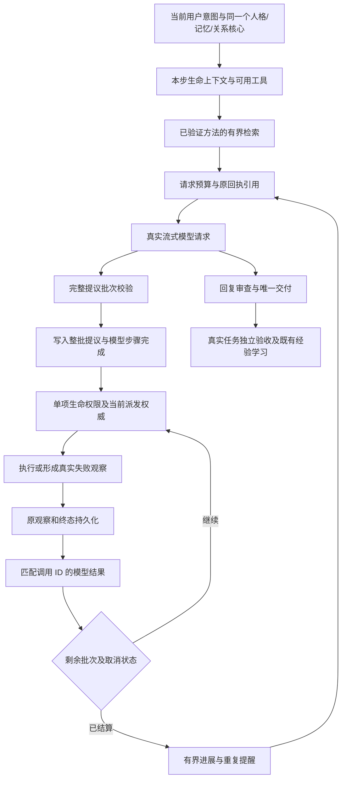

# Codex、Pi、DeepSeek Harness：第二轮源码分析与 Agent 移植

> 后续实现见 [Agent 增益系统调研与接入](2026-11-03-agent-ecosystem-integration.md)。本文保留第二轮快照和当时的 32 项容量；当前候选库已增加到 1000 项，并补充 Hermes 工具发现、方法分页和用量诊断。

日期：2026-11-03。适用阶段：Phase 1 本地数字生命。改造对象：桌面主生命循环中的执行、上下文续行、已验证方法的发现与复用。人格、关系、记忆和任务的权威仍由现有生命系统持有。

这轮直接修复了影响实际执行的限制：同一模型步骤只能提出一个工具调用；适配器抛错后，下一次模型请求可能缺少对应结果；方法检索缺少字段排序与参数用途区分；得到相同成功结果的重复调用没有调整策略的提示。新增代码实际进入生产主循环，下面区分源码复用、架构参考和验证范围。

## 1. 来源与调查方法

| 上游 | 固定提交 | 下载范围 | 许可证 |
| --- | --- | --- | --- |
| [Codex](https://github.com/openai/codex/tree/84dfc209d2697876dc7693611473e91616b3223d) | `84dfc209d2697876dc7693611473e91616b3223d` | 22 个源码及许可文件：工具路由/调度、上下文历史/配对、技能目录/检索、记忆检索 | Apache-2.0 |
| [Pi](https://github.com/earendil-works/pi/tree/62752fd4c37a72e0f3c1cc83e9ac3b4299f31fe6) | `62752fd4c37a72e0f3c1cc83e9ac3b4299f31fe6` | 14 个源码及许可文件：Agent 循环、AgentSession、会话、压缩、技能、命令与编辑工具 | MIT |
| [DeepSeek Harness](https://github.com/deepseek-ai/deepseek-harness/tree/ce7073d51254c26cd63b22a60835b8f948deb447) | `ce7073d51254c26cd63b22a60835b8f948deb447` | 30 个源码及许可文件：循环/inbox、压缩、技能、goal、plan/todo、反馈、spill、重复提醒 | MIT |

共缓存 66 个文件，1,112,416 字节。下载量代表调查材料范围，不代表运行过上游完整产品。主要沿调用关系检查模型请求、工具提议、校验、派发、结算、续行、压缩与技能使用；没有以 README 的功能清单代替实现分析。

固定源码 URL、文件哈希、实际复制范围和未下载成功的条目记录在 [来源清单](2026-11-03-agent-harness-deep-source-manifest.json)。四个额外下载因 GitHub API 403 失败，涉及 checkpoint-policy、timeout-policy 和 tool-workflow；这些文件不作为已分析实现或复制成果。Native executor、tool-result-pruner 和 Codex BM25 测试通过固定提交的 GitHub 页面补充检查，单独标记为网页检查，没有伪造本地文件哈希。

## 2. Codex：真正值得吸收的实现

### 工具执行拥有步骤快照与运行期边界

入口是 `codex-rs/core/src/tools/router.rs` 和 `parallel.rs`。`ToolCallRuntime` 持有产生这次工具声明的 `StepContext`，以免延后执行时拿另一轮声明解释旧调用。调度拥有共享读写锁与取消令牌，记录调用并把失败转换成工具输出；并行执行依赖路由能力，不能把“模型可提出多个工具”理解成“所有副作用都能并发”。

Alicization 对应的是 prepared 工具注册表、每项 `beforeAction`、`authorizeDispatch`、`assertDispatchCurrent`、事件落盘和资源租约。本轮接受一批提议，默认逐项执行。每一项都重新检查工具是否仍启用及现有生命权限。涉及同一文件、前台输入和不确定副作用的约束继续由已有执行权威决定。

### 上下文视图与真实历史分开

`context_manager/history.rs` 保持可追溯的原始来源；`normalize.rs` 维护调用与结果的配对。缩短模型视图不能把未完成调用变成完成，也不能让工具结果丢失其调用身份。

本地已有的 SQLite 原始事件与 `life_read_tool_observation` 正好承接这一原则。本轮进一步把模型结果回传放在 `action.settlement.completed` 和行动终态之后。成功与适配器失败使用同一路径；存储失败时不发布一个看似已经持久化的结果，也不派发下一项。

### 技能发现不是把所有技能正文堆进 prompt

实际实现位于 `codex-rs/ext/skills`。`step_state.rs` 准备不可变、经过策略检查的本步目录；`catalog_delta.rs` 按预算发布新增或修改的技能元数据，并在压缩后重建目录视图。检索与调用权限分离，选中技能不等于获得执行授权。

本轮从 `dynamic_skill_selector` 移植了以下代码到 `third-party/codex-skill-selector.ts`：

- Fielded BM25：名称、短描述、描述的权重为 8、4、1；`K1=1.2`、`B=0.75`，计算文档频率与长度归一化。
- Character n-gram：长度 2～5；较长 ASCII 词从三字符片段开始；按字段权重及逆文档频率排序。
- Reciprocal rank fusion：`k=60`，融合两条排序，保持确定的平局规则。

本地适配明确不同于上游：融合的词项通道使用 BM25，上游 `rrf_lexical_char` 使用 weighted lexical；增加连续中文的相邻双字词项，使“保存这份文件”能够匹配“保存 文件”。查询及单字段限制 4096 UTF-8 字节，查询最多 64 个词项，候选最多 1000 项，每条排序最多参与 50 项。

`agent-harness/procedure-context.ts` 把这套检索接到已验证的方法目录。先检查来源、启用状态、独立评测、ID、版本及操作列表，再排序；最多披露四项、方法数组最多 3000 字节。参数的结构角色补充检索用途，例如 JSON 键名、附件、下拉选项、窗口标题和独立字节核验，让同一组操作具有更可区分的接口语义。不会把旧路径、历史正文或原始脚本当成当前参数。调用仍由 `learned-procedure-runtime.ts` 重新读取版本、来源与接口，并经过现有任务验收。

容量必须区分：检索器能够处理最多 1000 项候选，但当前 `procedure-candidate-repository.ts` 仍将持久化方法候选限制为 32 项，满额时拒绝新增并保留既有版本。大目录测试只验证检索边界；本轮没有把学习仓库扩容到 1000。未来扩容需要同时处理完整索引事件的写入放大、来源核验成本、归档和恢复，而不能只改查询上限。

### 记忆不能照搬成第二个自我

`ext/memories/src/local/search.rs` 实现路径限定、查询匹配、上下文行及游标；搜索结果是可定位的数据。它并不为数字生命自动提供情绪或关系连续性。Alicization 继续使用现有分层记忆、证据引用和生命状态，不新增一个从 Markdown 自由加载的人格权威。

## 3. Pi：闭环在流、工具与续行交界处

### AgentSession 与 AgentLoop 的职责分开

`packages/coding-agent/src/core/agent-session.ts` 的 `_installAgentNextTurnRefresh` 在下一次回复之前处理压缩，重建系统提示及工具负载，并更新模型和 thinking level。`packages/agent/src/agent-loop.ts` 负责实际模型步骤、工具批次、转向消息和后续消息。准备上下文之后还会重新检查队列，避免长时间准备期间到来的用户输入被略过。

本地已有 TurnOS 和持续任务权威，因此不导入另一套 Pi AgentSession 成为角色中心。保留现有消息中断、任务控制和人格来源，在这些边界内复用执行代码。

### 提议完整性先于副作用

Pi 遇到 `stopReason='length'` 会拒绝该不完整消息中的全部工具提议，即使某个参数对象碰巧能够解析。每个调用还经过参数准备、校验、before/after hook 和结束事件。

本地流式驱动现在先收集整批提议：检查数量、输入 schema、工具状态、真实调用 ID 及 ID 唯一性，再等待结束并排空真实 `fullStream`。缺少 finish、长度截断、内容过滤、无完成提议的工具结束、重复 ID、超出剩余预算或非法尾项都不能发布部分批次。xsAI 可能先发 wire finish、后发工具提议，所以必须排空至 EOF。

### 实际移植顺序批次执行器

`third-party/pi-tool-batch.ts` 来自 Pi 的 `executeToolCallsSequential`。本地将准备、执行、结果落盘收敛为一个 `executeAndSettle` 回调，并在派发前及结算后检查 AbortSignal。适配器失败会形成真实失败观察，模型可以据此改计划；取消或持久化失败会停止余下派发。

同批次中，如果前项要求刷新生命状态或报告副作用可能已经发生，余下提议不会继续派发。运行时为这些未派发提议记录明确的 `BATCH_REPLAN_REQUIRED` 结果，补齐调用配对，再由下一次模型请求重新判断。跳过的尾项不会被算成多次真实失败而耗尽重试规则；原不确定效果仍必须通过既有执行权威核验。普通确定失败可以让相互独立的观察继续，工具取消与存储失败则结束派发。

一批调用在 provider 历史里保留为一条 assistant 消息的 `tool_calls` 数组，随后按调用顺序回传对应结果。一批不是多次模型请求。完整提议先写入事件库，再开始第一项行动；提议本身不创建 active action，不代表已派发权限。

主循环保留 64 次模型步骤和最多 63 个行动提议的独立预算，为最终答复留出步骤；每批最多 8 项并受剩余行动预算约束。模型首次请求之前就能看到这两个限额。相关提示明确独立提议才能合批，依赖操作必须使用新鲜观察中的参数。

### 其他模块的取舍

`compaction/compaction.ts` 根据安全切点、近期保留量和文件操作信息形成摘要，会话管理器持久化并重新加载投影；`skills.ts` 通过元数据发现与按需加载正文；`edit.ts` / `edit-diff.ts` 处理编辑匹配与差异。文件编辑算法可以复用，但不能跳过本地文件恢复、授权、目标绑定和独立字节核验。此次实际新增复制范围是批次协调器；上一轮的 `truncateMiddle` 改造与已有事件流移植继续使用，没有宣称整体集成 Pi 引擎。

## 4. DeepSeek Harness：服务之间的闭环比插件数量重要

### Agent 阶段、Inbox 与请求准备

`packages/core/agent-loop/src/agent.ts` 区分 idle、running 和 maintenance。维护期间到来的工作会登记唤醒，用户输入进入 next-step 或 next-turn。pre-step 固定模型选择、提示组装与工具集合；prepareRequest 不允许后续插件擅自换成另一模型。完成的 assistant 消息进入会话，再把工具批次交给工具执行层；达到 max-tokens 时不直接执行不完整提议。

`tool-executor-native` 是很薄的接线层，实际委托 `ToolExecutionPipeline` / `executeToolBatch`。这说明“引入一个 executor 包”本身不足以补齐执行能力，关键是每一步的策略、观察、错误与结算能否接回原会话。本轮以现有主循环为唯一 owner 接入这些语义。

### Goal 与 Todo 的完成含义不同

`goal-round-driver` 在当前 agent 处于 idle、目标 active 且 armed、没有竞争消息时申请下一轮；轮次绑定 goalId、revision 和 round。续行前 flush 会话，异步等待后再次检查状态，并处理旧轮次失效和轮次限制。`plan-mode` 的协作指导与真正的沙箱/执行权限分离；`tool-todo` 持久化整个清单，模型勾选不等于外部任务被验收。

本地的 obligation、work plan、effect 和 independent verification 已经区分责任、计划、效果与验收。继续以这些真实记录决定任务是否完成；本轮没有让回复文本、进度提示或检索排名直接完成责任。

### 先清理工具输出，再决定语义压缩

`compaction-basic/index.ts` 先测量，达到压力阈值后执行模型无关的 tool-result pruning，再测量；仍超预算才选择摘要范围。`region.ts` 用当前 surface 的位置及 token 预算选择完整调用/结果边界，写入 compaction/start 后再摘要，提交时检查所选范围仍然有效。

`compaction-tool-result-pruner` 用来源事件关联替换结果，记录原节点的 shadow price，保持计量可重放。本地使用内容哈希与原事件分页回读，不复制 Cordis 的 surface/seq 数据模型。这轮还修复了派生进展提示本身挤占小窗口的问题：提示最多 1536 字节，优先缩短重复的近期观察列表，原始回执及必要人格/记忆不因这类提醒被替代。

### 实际移植重复调用提醒

`packages/guard/repeat-tool-reminder/src/index.ts` 对完整参数做深层排序，追踪相同调用，在 3、5、8 次时提示调整；提醒是额外上下文，不自行禁止工具。

本地 `third-party/deepseek-repeat-tool.ts` 保留参数规范化与阈值递进逻辑，改成由本轮已经结算的调用/结果派生，不引入常驻 WeakMap 状态。增加观察内容身份，避免把正在发生变化的轮询误认为无进展；大结果压缩前后使用相同原文 SHA-256。嵌套 JSON 与 `__proto__` 等键保留为数据。

这与已有“相同失败三次停止本轮继续提议”的规则分工明确：成功但无变化只提醒，不因重复而假定失败；真实同输入同错误的连续失败仍保留原有停止规则。用户新回合重新派生状态，不把旧回合的失败计数强加给新意图。

## 5. 当前生产链路

三个上游贡献的是机制及可复用代码。它们不会替代本地人格、记忆、情绪、表达与长期责任。界面和 Live2D 继续从同一生命状态与执行记录投影，本轮没有另建一套行动人格。

## 6. 回归、许可和实际边界

最终快照在 28 个测试文件中通过 803 项回归，失败 0 项。广泛回归中的一个真实模型用例按默认开关跳过，随后单独启用并通过：三轮各一次真实模型请求，修订未来读取步骤、保留已经成功的写入，真实读写与独立目标核验均通过。全仓 `pnpm typecheck`、`pnpm lint:fix`、桌面生产构建和 `git diff --check` 通过；lint 保留仓库已有警告，新增 harness 模块无警告。源码指纹为 `400785270c416bbed77aab72e169a1a48f9774d1e69ea79309e392073ae29caa`。

验证记录见 [本轮验收](2026-11-03-agent-harness-deep-validation.json)。包含实际本地 HTTP SSE、xsAI、生产后台主循环与 SQLite 联调：一批两项、单个 assistant 调用消息、逐项授权及结算、正常成功、后续工具撤销和第二项被拒；另覆盖非法尾项、不完整流、取消、落盘失败、长输出精确回读、方法撤销、中文检索及已有记忆/执行/表达交界。

编译与测试使用现有 Node 运行时，测试不打开前台应用。上游只缓存选定源码，没有安装上游依赖或拉取整个仓库。新 MIT 许可、Codex 完整 Apache LICENSE / NOTICE 及修改说明位于 `apps/stage-tamagotchi/resources/licenses`，现有打包规则会包含 `resources/**`。

以下不能由本轮结果推出：已经达到三款上游产品的总体能力；任意任务都可以自主完成；数字生命的全部长期体验已验收。尚未完成同模型、同预算、同环境的跨产品任务对照；批次默认顺序执行，没有用未证明安全的并发速度作为成果；没有替换现有记忆为自由摘要，也没有新增模型权重训练。

进一步判断执行力，应记录具体任务的独立验收率、模型请求数、无效重复次数、恢复后重复副作用、输入/输出 token、被撤销方法再用次数和中断延迟。模型生成了“已完成”不能作为验收依据。真实前台键鼠、混合 DPI、外部 CLI 可用性及安装包验收仍以各自专门证据为准。
