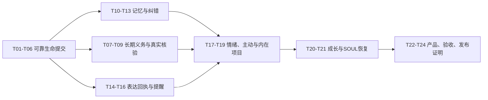

# Alicization 数字生命：逐文件实施任务单

日期：2026-10-04。状态：实施与验证中，各节点未完成事项见[当前验证记录](C:/Users/Administrator/Desktop/git/alicization/docs/research/2026-10-04-digital-life-implementation-progress.md)。设计依赖：[18节点架构与契约](C:/Users/Administrator/Desktop/git/alicization/docs/superpowers/specs/2026-10-04-digital-life-implementation-design.md)。目标是持续人格、关系、认知、表达和行动的完整闭环，所有实现先在桌面验证。

本文件把开发任务固定到改动文件、生产接线、输入输出、异常与验收。当前已有本地桌面修复必须保留；本任务不预设回退用户工作，也不把研究文档当成已实现能力。

## 1. 开工顺序与依赖图



第一批直接开始 T01～T06。T07～T16可在基础提交门通过后按依赖交叉实现，但不能在同一文件由多个writer同时改权威。每批至少跑通一个正常场景和失败／恢复场景，再继续。

## 2. 文件定位表

本表保留设计时的文件编号。F39–F56 对应能力已经实施；为保持职责清晰，一部分拆成多个 focused service，实际文件和接线以[当前验证记录](C:/Users/Administrator/Desktop/git/alicization/docs/research/2026-10-04-digital-life-implementation-progress.md)和生产代码为准，不将草案文件名当作当前运行时结构。

| ID | 文件／目录 | 状态 |
| --- | --- | --- |
| F01 | [DB facade](C:/Users/Administrator/Desktop/git/alicization/apps/stage-tamagotchi/src/main/services/alicization/db.ts) | 已有 |
| F02 | [Event store](C:/Users/Administrator/Desktop/git/alicization/apps/stage-tamagotchi/src/main/services/alicization/turn-os/event-store.ts) | 已有 |
| F03 | [Checkpoint store](C:/Users/Administrator/Desktop/git/alicization/apps/stage-tamagotchi/src/main/services/alicization/turn-os/checkpoint-store.ts) | 已有 |
| F04 | [Event loop](C:/Users/Administrator/Desktop/git/alicization/apps/stage-tamagotchi/src/main/services/alicization/turn-os/event-loop.ts) | 已有 |
| F05 | [Production chat](C:/Users/Administrator/Desktop/git/alicization/apps/stage-tamagotchi/src/main/services/alicization/main-chat-background-run.ts) | 已有 |
| F06 | [Chat preparation](C:/Users/Administrator/Desktop/git/alicization/apps/stage-tamagotchi/src/main/services/alicization/main-chat-session-runtime.ts) | 已有 |
| F07 | [Mind construction](C:/Users/Administrator/Desktop/git/alicization/apps/stage-tamagotchi/src/main/services/alicization/runtime-mind-state.ts) | 已有 |
| F08 | [Core persistence boundary](C:/Users/Administrator/Desktop/git/alicization/apps/stage-tamagotchi/src/main/services/alicization/runtime-visual-presence-state.ts) | 已有 |
| F09 | [Mind head repository](C:/Users/Administrator/Desktop/git/alicization/apps/stage-tamagotchi/src/main/services/alicization/memory-mind-state-runtime.ts) | 已有 |
| F10 | [Composition root](C:/Users/Administrator/Desktop/git/alicization/apps/stage-tamagotchi/src/main/services/alicization/runtime.ts) | 已有 |
| F11 | [Task contracts](C:/Users/Administrator/Desktop/git/alicization/packages/stage-shared/src/alicization-transport-contracts.ts) | 已有 |
| F12 | [Runtime event contracts](C:/Users/Administrator/Desktop/git/alicization/packages/stage-shared/src/alicization-runtime-events.ts) | 已有 |
| F13 | [Task handlers](C:/Users/Administrator/Desktop/git/alicization/apps/stage-tamagotchi/src/main/services/alicization/runtime-invoke-handlers-task.ts) | 已有 |
| F14 | [Executor](C:/Users/Administrator/Desktop/git/alicization/apps/stage-tamagotchi/src/main/services/alicization/executor-runtime.ts) | 已有 |
| F15 | [Short commitments](C:/Users/Administrator/Desktop/git/alicization/apps/stage-tamagotchi/src/main/services/alicization/commitment-ledger.ts) | 已有 |
| F16 | [Reminder runtime](C:/Users/Administrator/Desktop/git/alicization/apps/stage-tamagotchi/src/main/services/alicization/runtime-delivery-reminders.ts) | 已有 |
| F17 | [Reminder due scheduler](C:/Users/Administrator/Desktop/git/alicization/apps/stage-tamagotchi/src/main/services/alicization/runtime-reminder-due-scheduler.ts) | 已有 |
| F18 | [Recall](C:/Users/Administrator/Desktop/git/alicization/apps/stage-tamagotchi/src/main/services/alicization/long-term-memory-recall.ts) | 已有 |
| F19 | [Hybrid retrieval](C:/Users/Administrator/Desktop/git/alicization/apps/stage-tamagotchi/src/main/services/alicization/long-term-memory-hybrid-retrieval.ts) | 已有 |
| F20 | [Working memory owner](C:/Users/Administrator/Desktop/git/alicization/apps/stage-tamagotchi/src/main/services/alicization/life-core/working-memory.ts) | 已有 |
| F21 | [Memory cleaner](C:/Users/Administrator/Desktop/git/alicization/apps/stage-tamagotchi/src/main/services/alicization/life-core/working-memory-long-term-cleaner.ts) | 已有 |
| F22 | [Belief revision](C:/Users/Administrator/Desktop/git/alicization/apps/stage-tamagotchi/src/main/services/alicization/belief-revision.ts) | 已有 |
| F23 | [Emotional kernel](C:/Users/Administrator/Desktop/git/alicization/apps/stage-tamagotchi/src/main/services/alicization/emotional-kernel.ts) | 已有 |
| F24 | [Emotional ledger](C:/Users/Administrator/Desktop/git/alicization/apps/stage-tamagotchi/src/main/services/alicization/emotional-ledger.ts) | 已有 |
| F25 | [Initiative arbiter](C:/Users/Administrator/Desktop/git/alicization/apps/stage-tamagotchi/src/main/services/alicization/initiative-arbiter.ts) | 已有 |
| F26 | [Proactive feedback](C:/Users/Administrator/Desktop/git/alicization/apps/stage-tamagotchi/src/main/services/alicization/runtime-proactive-feedback.ts) | 已有 |
| F27 | [Self-evolution](C:/Users/Administrator/Desktop/git/alicization/apps/stage-tamagotchi/src/main/services/alicization/self-evolution/version-runtime.ts) | 已有 |
| F28 | [SOUL lifecycle](C:/Users/Administrator/Desktop/git/alicization/apps/stage-tamagotchi/src/main/services/alicization/runtime-soul-lifecycle.ts) | 已有 |
| F29 | [Desktop Eventa](C:/Users/Administrator/Desktop/git/alicization/apps/stage-tamagotchi/src/shared/eventa.ts) | 已有 |
| F30 | [Browser audio](C:/Users/Administrator/Desktop/git/alicization/packages/stage-ui/src/libs/speech-audio-playback.ts) | 已有 |
| F31 | [Stage speech](C:/Users/Administrator/Desktop/git/alicization/packages/stage-ui/src/components/scenes/use-stage-embodiment-speech.ts) | 已有 |
| F32 | [Playback manager](C:/Users/Administrator/Desktop/git/alicization/packages/pipelines-audio/src/managers/playback-manager.ts) | 已有 |
| F33 | [Audio types](C:/Users/Administrator/Desktop/git/alicization/packages/pipelines-audio/src/types.ts) | 已有 |
| F34 | [Speech pipeline](C:/Users/Administrator/Desktop/git/alicization/packages/pipelines-audio/src/speech-pipeline.ts) | 已有 |
| F35 | [Renderer application](C:/Users/Administrator/Desktop/git/alicization/apps/stage-tamagotchi/src/renderer/App.vue) | 已有 |
| F36 | [Desktop stage logic](C:/Users/Administrator/Desktop/git/alicization/apps/stage-tamagotchi/src/renderer/pages/index.desktop.ts) | 已有 |
| F37 | [Native stage window](C:/Users/Administrator/Desktop/git/alicization/apps/stage-tamagotchi/src/main/windows/main/index.ts) | 已有 |
| F38 | [Card lifecycle](C:/Users/Administrator/Desktop/git/alicization/apps/stage-tamagotchi/src/main/services/alicization/runtime-card-scope-lifecycle.ts) | 已有 |
| F39 | `C:/Users/Administrator/Desktop/git/alicization/apps/stage-tamagotchi/src/shared/life-contracts.ts` | 计划新增 |
| F40 | `C:/Users/Administrator/Desktop/git/alicization/apps/stage-tamagotchi/src/main/services/alicization/life-state-store.ts` | 计划新增 |
| F41 | `C:/Users/Administrator/Desktop/git/alicization/apps/stage-tamagotchi/src/main/services/alicization/life-state-commit.ts` | 计划新增 |
| F42 | `C:/Users/Administrator/Desktop/git/alicization/apps/stage-tamagotchi/src/main/services/alicization/life-read-view.ts` | 计划新增 |
| F43 | `C:/Users/Administrator/Desktop/git/alicization/apps/stage-tamagotchi/src/main/services/alicization/life-ingress.ts` | 计划新增 |
| F44 | `C:/Users/Administrator/Desktop/git/alicization/apps/stage-tamagotchi/src/main/services/alicization/life-effect-intents.ts` | 计划新增 |
| F45 | `C:/Users/Administrator/Desktop/git/alicization/apps/stage-tamagotchi/src/main/services/alicization/life-obligation-runtime.ts` | 计划新增 |
| F46 | `C:/Users/Administrator/Desktop/git/alicization/apps/stage-tamagotchi/src/main/services/alicization/life-goal-verification.ts` | 计划新增 |
| F47 | `C:/Users/Administrator/Desktop/git/alicization/apps/stage-tamagotchi/src/main/services/alicization/life-entity-resolution.ts` | 计划新增 |
| F48 | `C:/Users/Administrator/Desktop/git/alicization/apps/stage-tamagotchi/src/main/services/alicization/life-fact-versioning.ts` | 计划新增 |
| F49 | `C:/Users/Administrator/Desktop/git/alicization/apps/stage-tamagotchi/src/main/services/alicization/life-evidence-invalidation.ts` | 计划新增 |
| F50 | `C:/Users/Administrator/Desktop/git/alicization/apps/stage-tamagotchi/src/main/services/alicization/life-appraisal.ts` | 计划新增 |
| F51 | `C:/Users/Administrator/Desktop/git/alicization/apps/stage-tamagotchi/src/main/services/alicization/life-expression-receipts.ts` | 计划新增 |
| F52 | `C:/Users/Administrator/Desktop/git/alicization/apps/stage-tamagotchi/src/main/services/alicization/life-interest-projects.ts` | 计划新增 |
| F53 | `C:/Users/Administrator/Desktop/git/alicization/apps/stage-tamagotchi/src/main/services/alicization/life-recovery.ts` | 计划新增 |
| F54 | `C:/Users/Administrator/Desktop/git/alicization/apps/stage-tamagotchi/src/main/services/alicization/life-runtime-composition.ts` | 计划新增 |
| F55 | `C:/Users/Administrator/Desktop/git/alicization/apps/stage-tamagotchi/src/main/services/alicization/life-schema-migrations.ts` | 计划新增 |
| F56 | `C:/Users/Administrator/Desktop/git/alicization/apps/stage-tamagotchi/scripts/life-loop-acceptance.ts` | 计划新增 |

新增 focused services 的测试与对应实现同目录同名 `.test.ts`，沿用桌面vitest配置。真实Electron验收由F56驱动独立QA身份，不放进普通unit test。

## 3. 二十四项任务

### T01 契约与生产路径基线

依赖：无。文件：F04～F12、F29、F39。

- 定义LifeRef／OwnerFence／CommitResult／Obligation／GoalVerification／ExpressionReceipt与严格schema；限定数组、字符串、时间、数值与未知字段。
- 固定prepareExecution → participant.runProviderStep → executeTool／publishReply → onTurnSettled真实路径；每条补一个节点／owner／产物引用表。
- 列出目前core state的所有writer与meta keys，并标记身体纯投影；不因名字相近推断已接线。
- 记录3条现有场景的输入、provider配置、节点输出和缺失证明；保留正常工具／reply／cancel基线。

验收：非法引用／跨card／旧version不能通过schema；基线可复核且不使用真实身份做破坏性试验。

### T02 M1 schema与迁移器

依赖：T01。文件：F01、F40、F55。

- 按SQL草案增加4张基础表、索引、迁移版本和内容hash。
- baseline读取旧meta／mindheads，不改变原人格；生成owner version。
- 加入实际WAL／synchronous／foreign_keys回读；生产FULL，性能数据单独记录。
- 迁移支持中断重入、备份一致快照、空间不足与schema错误；不盲目DROP checkpoint。

验收：临时现有schema迁移后旧事实／turn／task数量与hash一致；重复迁移无重复baseline；中断可恢复；migration失败不进入健康writer。

### T03 身份原子提交与事务内repository

依赖：T02。文件：F01～F03、F09、F40、F41。

- 新增`commitLifeMutationBatch`，已有writer队列只入一次；内部repository接收opaque transaction token。
- 支持operation key＋request hash、read set CAS、owner版本、commit receipt、effect intent。
- F02／F03暴露事务内append／checkpoint端口，保留公共端口的原有协议。
- 返回duplicate／conflict／rejected／failed，commit成功才允许发布。

验收：第2个owner写失败全体rollback；同键同内容返回同receipt；同键不同内容拒绝；并发旧read set不能覆盖；不会等待自己造成队列死锁。

### T04 替换core持久化失败面

依赖：T03。文件：F07～F10、F41、F54。

- 把autobiographical、reflection、motive、habit和相关core状态准备成typed batch；移除这些核心写的非取消catch吞错。
- VisualPresenceState继续作为renderer投影，投影写失败与core写失败分错误类型。
- 所有对应旧writer切换为新facade，停用同字段的重复写路径；不保留两份权威。
- 提交后更新cache和emit；错误显示degraded并保留用户输入。

验收：写失败不能emit“已永久保存”状态；重启恢复最后一致owner；身体不可用时核心连续性仍在。

### T05 ingress、read view与版本化cache

依赖：T03。文件：F05～F07、F38、F42、F43、F54。

- 用户turn／工具回调／due／反馈建立durable ingress引用和payload hash。
- 新建每card只读view连接，短事务读取一致版本；模型不持有事务。
- cache key按owner version／SOUL hash／policy／embedding namespace；card切换关闭连接和旧task输入。
- phase hold／defer保留next attempt，普通重复frame可合并；明确用户重复输入不误去重。

验收：重复事件幂等；同文字不同sourceKey保留；读者看不到writer中间字段；旧card结果不更新新card。

### T06 接入生产Turn OS与恢复骨架

依赖：T04、T05。文件：F04～F06、F10、F12、F38、F53、F54。

- 在prepareExecution前后、executeTool前、publishReply前、onTurnSettled后注入对应commit／receipt hook。
- runtime事件增加有限life commit／verification类型；reducer与parser明确处理，新事件不能成为未识别错误。
- 保留既有尾部回放、cancel settlement与deliveryOwner；不把诊断图替换成执行authority。
- 建立启动core／turn／SOUL／task／body对账顺序和degraded状态。

验收：真实生产调用路径使用新receipt；正常聊天／工具／取消回归；数据库关闭后重开，turn尾部和core版本一致。

**第一批退出门G1**：T01～T06完成；身份原子提交、真实入口、失败透明、重启恢复四项同时通过，才进入下一批。

### T07 长期义务与短期关切分语义

依赖：G1。文件：F01、F11、F13、F15～F17、F45、F55。

- M2建义务表；实现create／accept／reschedule／cancel／bind／verify／fulfilment commands。
- 复用TaskThread attemptId与CAS；增加obligation generation，不把短TTL改成无限TTL。
- 时间解析保存原表达、用户时区、基准与dueAt；不确定时间需澄清。
- 迁移确定旧任务／提醒，legacy completion没有回执则delivery unknown。

验收：跨天／改期／取消／重启；旧generation不履约新责任；无法执行的请求不能先承诺。

### T08 dispatch intent与原adapter唯一调用者

依赖：T07。文件：F04、F05、F14、F44、F54。

- 为现有executeAction增加intent保存／claim／dispatched／receipt桥，不另启动相同工具。
- 绑定capability、actionId、thread、attempt、generation、参数hash与确认范围。
- 扩展manifest的副作用、retryClass、verifier与补偿声明；保留普通执行默认可用的策略。
- lease过期的dispatched进入uncertain；只读重试与mutation恢复分别处理。

验收：同一intent只有一个adapter调用；确认后改危险参数重新评估；取消后无新dispatch；未知结果不重复mutation。

### T09 独立目标核验与结果回写

依赖：T08。文件：F11、F12、F14、F20、F46。

- 实现file／setting／reminder／user-reported四类verifier和unknown默认。
- goal proof在义务接受时固定；actual observation、目标verdict和用户满意分别保存。
- satisfied才能fulfilled；not-satisfied／unknown／stale有明确状态与后续动作。
- 结果同次更新目标、WorkingMemory carry与必要经历引用。

验收：工具success但目标文件内容错误→not-satisfied；写完回执前崩溃→只读核验；用户自述完成不升级为独立验证。

### T10 M3实体注册与双时间事实版本

依赖：G1。文件：F01、F18、F19、F21、F47、F48、F55。

- 实现entities／aliases／fact versions／dependencies；homonym alias不设全局unique。
- 逻辑stream与原triple factId分开，保留旧dedupe；predicate登记单值／多值／状态范围。
- valid与recorded两个时间区间；未知历史不根据createdAt补造。
- 矛盾判断先实体与时间，后有限语义提议，再CAS写入。

验收：咖啡→茶的当前／历史回答、两个同名朋友、多兴趣共存、时间不重叠不误冲突；旧事实ID与来源仍可追溯。

### T11 检索预算与下游采用证明

依赖：T10。文件：F06、F18、F19、F20。

- 检索前加生命周期／scope／来源过滤；复用RRF，不直接叠不兼容score。
- 有限query expansion与实体关联；tokenizer／预算fallback显式报告。
- 保存evidence bundle版本、被淘汰原因和provider请求实际采用的引用。
- 真实reply trial与无记忆对照验证行为变化，失败透明。

验收：召回条目进入provider request；旧／撤销事实即使相似度高也不进入当前回答；正确不知道；中文留出质量不下降。

### T12 来源撤销与有进度的遗忘

依赖：T10。文件：F01、F18、F21、F27、F49。

- tombstone先形成检索屏障；对dependency graph按批次遍历并保存游标。
- 多来源项移除失效证据后重审；単一来源概览、信念、候选和adapter按owner失效。
- 清理检索索引、cache、可访问正文与派生摘要，匿名撤销审计保留。
- 复用Persona artifact cleanup／unload saga；不能声称删行即可遗忘权重。

验收：删除→重启→reindex后不复活；清理中断可恢复；有另一有效来源的事实不会无条件全删。

### T13 用户纠错贯通认知、情绪与计划

依赖：T07、T10～T12。文件：F07、F22～F24、F45、F48～F50。

- 修正命令关联被替代belief／fact与所有依赖appraisal／goal。
- 当前view中准备撤销旧计划、更新情绪依据、重新生成适合表达；一个commit发布。
- 新表达绑定已提交版本；错误结构至多一次修复；无证据仍未知。

验收：第一条纵向场景完成：纠正偏好后，不再执行旧计划，情绪／关系／话语一致，重启仍保持；同事件重试不重复delta。

### T14 音频结束结果贯穿完整管线

依赖：G1。文件：F30～F34；同步相关audio event map与全部playback consumers。

- 定义typed completed／interrupted／failed result与playedMs／errorCode；所有play调用必须return结果。
- source.start、stream read、空源、suspended context和abort分别分类。
- manager onStart仍表示调度开始；真实audio-started由browser driver报告。
- manager only completed→end；failed→failure事件；interrupt重复发生只结算一次。

验收：真实错误不能end；取消后无旧end；stream前面已播放后失败保留partial；兼容buffered／streaming且嘴型正确收尾。

需要同步的现有消费者包括Stage与Web／Pocket performance playground，它们只适配声音契约，不重新定义人格。禁止保留`Promise<void>|Result`分支把旧void默认为成功。

### T15 Eventa表达回执与身体健康

依赖：T14、T03。文件：F29、F31、F35～F37、F39、F51、F55。

- M4 receipt表；RPC严格校验sender／surfaceSession／delivery／segment／epoch／sequence。
- start／terminal即时，progress节流；原对话ack保留renderer投递语义。
- segment实际对齐才算字边界；未知partial不截造“已听到文本”。
- 身体加载、渲染、声音和native命中状态进入health；空白不可见区域释放点击。

验收：旧epoch晚end不履约新段；重复RPC幂等；角色不可见时不挡桌面；renderer重连无重复播放。

### T16 提醒完成条件改成明确投递证明

依赖：T07、T09、T15。文件：F16、F17、F45、F46、F51。

- scheduled task处理／生成完成与obligation提醒fulfilled分别定义；持久化reply后不直接推断满足投递判据。
- 绑定deliveryId、generation与requiredChannel；文本rendered或音频ended按设置判断。
- 静音／音频失败有明确fallback协商和状态，未送达则等待或blocked。
- 过期与开机补提醒按latePolicy处理，普通过期候选不补发。

验收：第二条纵向场景完成：跨天约定→改期→重启→投递→回执→归档；未rendered／未播完不称已提醒完成。

### T17 情绪因果、时间衰减与关系反馈

依赖：T13、T15。文件：F23～F26、F50、F55。

- M4 appraisal表；保留已有reducer权重但集中parameterVersion和cause key。
- 时间服务区分epoch／monotonic／时区；短时情绪衰减与长期信任分层。
- 修正appraisal撤销旧贡献并重算；对沉默、明确反馈、话题转移和投递失败分别处理。
- 表达与主动消费相同emotion／relationship版本，禁止放宽执行权限。

验收：重复回调无重复情绪；误读修复影响下轮；休眠／回拨不数值爆炸；故障不会伪判用户拒绝。

### T18 事件驱动的主动调度与预算

依赖：T07、T17。文件：F25、F26、F43、F44、F54及现有subconscious tick接线。

- 硬条件先过滤，再按用户需要／责任／共同项目／关系主动／内部兴趣排序。
- 相同topic与证据版本去重，hold是合法结果；安静时段与未回复退避。
- 统一模型／后台／工具／费用预算，取消可抢占；无新事件不跑认知模型。
- 显式提醒独立责任规则，不能被普通主动计数误取消。

验收：没有价值时安静；新证据可产生恰当主动；未回复不刷屏；低资源时保留责任与当前交互。

### T19 兴趣与个人项目的真实活动

依赖：T08、T09、T18。文件：F07、F25、F45、F46、F52及现有motive／desire接线。

- 由人格种子／真实经历形成稳定兴趣，生成一个资源受限的项目义务。
- 至少支持一个真实本地活动：在允许目录阅读资料并生成带来源的小笔记／创作产物。
- 实际观察、内部构思、模型想象分来源；无结果就不宣称已完成体验。
- 分享候选等待合适时机，用户反馈进入关系与反思。

验收：第三条纵向场景完成；项目可暂停、取消、恢复，成果存在，失败透明，兴趣跨天保持且不抢用户任务。

### T20 反思候选与可撤销成长

依赖：T12、T17、T19。文件：F20、F21、F27、F49及既有learning task／persona gate。

- 新经历窗口幂等task key；有限候选、支持与反对证据、适用范围和read set。
- 区分事实、技能、关系、表达习惯与核心人格；raw transcript／失败／review不得训练。
- 对照回放通过后CAS应用并失效context；下次prepare记录真正消费的patch版本。
- 来源失效与回滚沿依赖传播；loader真实回执核对。

验收：留出场景行为改善；一个表扬不改基础人格；冲突／取消无生产漂移；rollback恢复原行为。

### T21 SOUL激活saga与人工修改

依赖：T03、T20。文件：F10、F28、F41、F53、F55。

- M5 intent表；复用现有atomic content writer，增加base／target hash、prepared／file-replaced／activated与backup。
- 文件真实回读后才life commit与publish；watcher也走相同版本激活边界。
- 文件替换后DB失败的启动恢复；用户人工修改冲突不覆盖；回滚是新intent。

验收：每个saga步骤中断后恢复到可解释状态；手工修改保留；新人格投影与SOUL hash一致。

### T22 日常产品入口与闭环诊断

依赖：T07、T12、T15、T20。文件：F13、F29、F35、F39；现有Workbench／task投影与i18n。

- 增加义务列表／改期／取消、生命摘要／closure、身体health；纠错／忘记／成长沿现有治理入口。
- UI mutation有expectedVersion、pending／error、保留输入；不能直写人格owner。
- 展示“等待什么／实际结果／缺少哪类证据”，工程指标仅在展开诊断中出现。
- DTO type parity与权限scope一起验证；所有文案集中i18n。

验收：普通用户可完成纠错、改期、取消、忘记和回滚；无无响应按钮或伪成功；诊断能找到真实未闭合节点。

### T23 跨系统验收harness与故障注入

依赖：T06～T22。文件：F56及各service对应tests；复用既有质量／live provider trial。

- 固定中文gold set、provider／model／token预算和随机种子；冻结留出场景。
- unit验证状态机与不变量；integration用真实临时SQLite、原生mock、虚拟时间和回执乱序。
- 实际打包桌面运行3条纵向场景，注入进程关闭、writer失败、取消、旧回调、静音、身体加载失败。
- 写manifest：git commit＋dirty diff hash、exe hash、schema／model／embedding／policy、结果证据与未验证项。

验收：30场景逐项有pass／fail／not-run证据；没有“所有stage完成”替代真实结果；不触碰用户原身份。

### T24 性能、长期观察与发布包

依赖：T23。

- 按事件类别统计token、tool步骤、CPU／GPU／RAM、writer延迟与后台任务；在用户机器测预算。
- recall 10k／100k规模、索引切换、forget批处理与恢复；按失效类别优化，保持事实与权限不变量。
- 30／90天持续体验分开记录，时间压缩模拟不替代长期关系评价。
- scoped typecheck／lint、构建Windows安装器与解包版，记录来源版本和真实桌面验收；维护materially touched READMEs。

验收：首次工程发布需G1～G4；长期成熟声明还需真实长期观察。不能为了马上打包把未验证项写成通过。

## 4. 四个交付门与证据

| 门 | 必须具备 | 不能作为替代证明 |
| --- | --- | --- |
| G1可靠连续 | 原子core提交、唯一writer、失败透明、重启正确、真实生产hook | 仅helper／类型测试 |
| G2责任与表达 | 跨天约定、改期／取消、目标核验、真实表达回执 | 工具success或对话已归档 |
| G3认知与内在生活 | 纠错贯通、主动克制、真实项目、成长可撤销 | 生成心理独白或更多消息 |
| G4桌面运行 | 原生角色可见、空白穿透、声音／嘴型／动作一致、打包来源、恢复场景 | renderer截图或开发模式可用 |

每条证据记录context／owner版本、实际产物与错误。模型输出仅是候选／表达，不能给自己的行动盖成功章。

## 5. 实施时使用的检查命令

以下是**未来实施后的命令**，本次方案编写没有运行它们。桌面filter运行时相对路径基于桌面包目录。

```powershell
pnpm -F @proj-alicization/stage-tamagotchi exec vitest run src/main/services/alicization/life-state-commit.test.ts src/main/services/alicization/runtime-visual-presence-state.test.ts src/main/services/alicization/turn-os/event-loop.test.ts src/main/services/alicization/turn-os/replay.test.ts
pnpm -F @proj-alicization/stage-tamagotchi typecheck
pnpm -F @proj-alicization/stage-tamagotchi lint
pnpm -F @proj-alicization/stage-ui typecheck
pnpm -F @proj-alicization/stage-shared typecheck
pnpm -F @proj-alicization/pipelines-audio typecheck
pnpm -F @proj-alicization/pipelines-audio build
pnpm -F @proj-alicization/stage-tamagotchi build:win
```

声音改动还需执行 `pipelines-audio` 和 `stage-ui` 的相关manager／playback／speech tests；按实际新增文件更新target list。根级typecheck／lint按仓库规则运行；若环境或已有其他包错误阻塞，记录具体非本次问题并保留scoped结果，不能通过无关重写消除。

真实QA用独立`ALICIZATION_USER_DATA_PATH`和临时工作目录；实际API调用记录预算，训练和对外发送不作为默认验收动作。涉及Vue实现按现有Composition API／UnoCSS／i18n约定，接口接入使用Eventa，native行为不在unit依赖真实Electron。

## 6. 第一个开发批次的明确成果

完成T01～T06后应交付：

- core状态从模型候选到DB commit再到UI的真实接线。
- 写失败／版本冲突／重复事件／取消竞态／重启都有结构结果。
- 当前用户人格和记忆完整迁移，SOUL仍为人格来源。
- 原有工具、对话、主动与身体能力保持可用，停用重复core writer。
- 一份真实调用与恢复证据，可直接支撑下一批长期义务和表达回执实现。

这批只建立可靠底座；用户可体验的数字生命增量由G2／G3完整场景体现。之后每批同时完成行为、结果回写和故障路径，避免只留下新的孤立模块。
