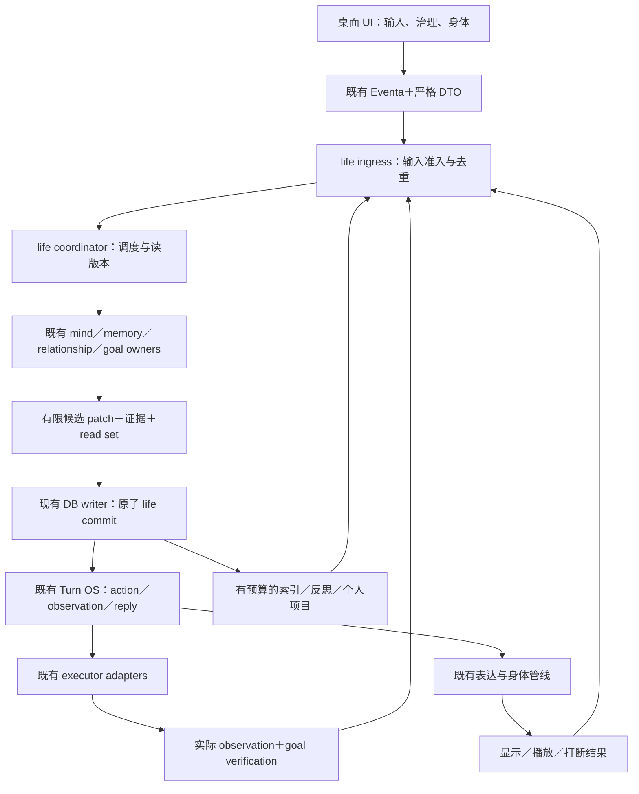

# Alicization Phase 1 数字生命：可实施架构与节点契约

日期：2026-10-04，实施更新：2026-10-05。基线：`7880afc29ab33a4cf4de89f7a6610664278494c3` 与工作区已有桌面修复。N00–N17 已接入桌面生产路径，schema 已实施到 v5；最终工程与原生验收状态见[实施验证记录](C:/Users/Administrator/Desktop/git/alicization/docs/research/2026-10-04-digital-life-implementation-progress.md)。文中的 SQL 是设计草案，实际迁移以 `life-schema-sql.ts`、`life-schema-version.ts` 和生产 repository 为准。

本文件回答“在哪里改、如何接、存什么、按什么顺序执行、何时算成功、失败怎样恢复”。配套文件：

- [逐文件实施任务单](C:/Users/Administrator/Desktop/git/alicization/docs/superpowers/plans/2026-10-04-digital-life-implementation-plan.md)
- [分阶段 SQL 草案](C:/Users/Administrator/Desktop/git/alicization/docs/research/2026-10-04-digital-life-schema-draft.sql)
- [外部实现到本项目的源码映射](C:/Users/Administrator/Desktop/git/alicization/docs/research/2026-10-04-digital-life-implementation-source-map.md)

## 1. 固定决策：开发时不再重新选择的基础

1. 桌面主进程为当前生命权威；renderer 负责输入与身体，不修改人格／记忆／任务权威状态。
2. 保留现有 Turn OS 的 action／observation／reply 循环、WorkingMemory、LongTermMemoryRecall、TaskThread、scheduled task、self-evolution 和身体管线。
3. 新增身份级协调层，协调已存在 owner 的读版本、提交与效果；不是另一套通用 agent，也不是巨型状态 store。
4. 身份状态继续使用现有每 card 的数据库目录：`userData/alicizations/cards/<cardId>/alicization.db`。新增表写入相同数据库；SOUL 仍是文件权威，用恢复协议跨越文件／DB 边界。
5. 只有现有 DB 写队列能写 SQLite。新增事务入口必须调用队列一次；内部 repository 使用显式事务 token，不能重新入队、重新 BEGIN 或调用含副作用的公共 facade。
6. Turn 的 sequence 是每轮顺序；life revision 是跨轮身份状态顺序；task attemptId 是执行尝试；obligation generation 是约定版本；playbackEpoch 是本次播放实例。五者不能互换。
7. 初期领域契约放桌面 `src/shared`；稳定后的跨端语义才迁入 `stage-shared`。已存在的 runtime event 类型继续在现有共享文件集中扩展。
8. 身体为统一状态的投影。模型、声音、Live2D／VRM、客户端都不能成为人格来源。
9. 外部实现提供算法与恢复经验；不引入另一套默认记忆数据库、默认常驻服务或未授权的人格 writer。
10. 首个版本实现纠错连续、跨天履约、有限自主项目三个完整场景。后续逐步丰富能力；不要求一次发布全部新表和功能。

## 2. 现有结构的准确理解

| 现有实现 | 已经提供的能力 | 本次扩展 |
| --- | --- | --- |
| `turn-os/event-loop.ts` | 模型动作／回复、动作观察、取消、终态与投递结算 | 身份 read fence、生命提交 hook、目标核验事件 |
| `turn-os/event-store.ts` | JSON-safe 事件、去重、每轮序号、持久化 | 事务内 append 端口，不改变原有去重内容比较 |
| `turn-os/checkpoint-store.ts`／`replay.ts` | v3 checkpoint、尾部回放、不确定恢复判断 | 同一次可选原子 transition；继续保留尾部回放 |
| `main-chat-background-run.ts` | 生产聊天真正组合 participant／event loop | 在 prepare、action、reply settlement、turn settled 接入生命提交 |
| `runtime-mind-state.ts`／`digital-life-*` | 世界、信念、目标、关系、情绪、身体与人格投影 | 产生带版本的候选变化，提交成功后才发布 |
| `runtime-visual-presence-state.ts` | 多个 mind head 与整体视觉状态持久化 | 核心字段原子写、错误透明，视觉投影不承担独立人格权威 |
| `life-core/working-memory*` | 短期携带、压缩、长期候选清洗 | 绑定表达／执行结果与证据版本 |
| `long-term-memory-*` | 来源、query planning、RRF、索引与 review | 双时间事实版本、实体消歧、撤销依赖传播 |
| `task_threads`／executor | attemptId、更新时间 CAS、恢复策略 | obligation 绑定与独立 goal verification |
| `scheduled_tasks`／reminder runtime | 到期、claim、requeue、complete | 区分处理完成和提醒满足投递条件 |
| self-evolution／persona pipeline | 候选、回放、激活、回滚、训练治理 | read set、来源依赖、上下文真正采用后的回执 |
| 音频／embodiment 管线 | 句段、动作、嘴型、播放事件 | 类型化结束结果和主进程表达回执 |

当前事件先写、checkpoint 后写，`replayTurn` 会重放 checkpoint 之后的事件；因此两者分步并不自动等于丢事件。要修的是相关**核心状态**与投递／执行意图不能产生相互矛盾的成功结论。

当前 `memory_facts` 的 dedupe key 包含 subject、predicate、object。时间版本扩展不能把不同 object 粗暴改成同一个旧 fact ID；新版本流通过 `stream_id` 关联原有事实 ID。

## 3. 部署结构与调用方向



模块调用遵守：transport → application orchestration → domain owner → repository。repository 不能调用模型、IPC、文件或工具；owner 不导入 Vue；renderer 不导入 Node／数据库。`runtime.ts` 只注入依赖和绑定已有 facade，不再加入业务分支。

### 3.1 新增 focused 文件的职责

以下文件均在桌面 Alicization service 目录下，具体绝对路径见任务单。

| 文件 | 职责 | 不拥有的内容 |
| --- | --- | --- |
| `life-runtime-composition.ts` | 注入 DB、provider、现有 owner、时钟与 adapter | 业务规则 |
| `life-ingress.ts` | 来源准入、去重、引用与权限范围 | 事实真伪判断 |
| `life-read-view.ts` | 同一版本的短时一致视图 | 状态写入 |
| `life-state-commit.ts` | read fence、批次提交、提交结果 | 人格／情绪算法 |
| `life-state-store.ts` | 新增基础表与事务内写入 | 模型和 UI |
| `life-effect-intents.ts` | 非对话副作用 intent／lease／恢复桥 | TaskThread 状态机与对话投递 |
| `life-obligation-runtime.ts` | 长期约定、代次、履约判据 | 具体工具执行 |
| `life-goal-verification.ts` | 目标判据与实际证据核对 | 由模型自称成功 |
| `life-entity-resolution.ts` | 来源作用域下的实体确认／消歧 | 自行编造人物资料 |
| `life-fact-versioning.ts` | 时间版本与事实冲突事务 | 替代 LongTermMemoryRecall |
| `life-evidence-invalidation.ts` | 来源失效及依赖清理 | 改写无关记忆 |
| `life-appraisal.ts` | 事件因果记录与已有 emotion reducer 接线 | 另一套情绪人格 |
| `life-expression-receipts.ts` | 表达回执、去重与可证明范围 | 阅读／理解／满意推断 |
| `life-interest-projects.ts` | 有经历支持的兴趣与项目候选 | 无限后台探索 |
| `life-recovery.ts` | 跨 owner 对账与恢复入口 | 无依据重放危险操作 |

已有纯算法尽量继续使用原文件；这些新增文件是缺少的接线和生命周期边界。不得给每个节点再加一个通用 agent 或独立模型会话。

## 4. 公共契约：实现者可以直接据此定义类型

以下 TypeScript 为新契约草案，未注册到生产代码。`LifeOwner` 不替换现有领域类型，只用于版本与引用。所有外部 DTO 使用 Valibot 校验、拒绝未知关键字段；现有 JSON Schema 工具 registry 继续使用当前 AJV 路径。

```ts
type LifeOwner =
  | 'soul' | 'self' | 'cognition' | 'emotion' | 'relationship'
  | 'goals' | 'working-memory' | 'long-term-memory' | 'expression'

type LifeRef = {
  cardId: string
  kind: 'runtime-event' | 'conversation-turn' | 'fact' | 'episode'
    | 'obligation' | 'task' | 'verification' | 'appraisal' | 'candidate'
  id: string
  version: string
}

type OwnerFence = {
  owner: LifeOwner
  revision: number
  contentHash: string
}

type LifeCommitRequest = {
  cardId: string
  operationKey: string
  baseRevision: number
  ingressIds: string[]
  readSet: OwnerFence[]
  mutationBatchId: string
  runtimeTransitionId: string | null
}

type LifeCommitResult =
  | { status: 'committed' | 'duplicate'; commitId: string
      revision: number; owners: OwnerFence[]; effectIds: string[] }
  | { status: 'conflict'; changedOwners: LifeOwner[]; currentRevision: number }
  | { status: 'rejected'; code: string; offendingRefs: LifeRef[] }
  | { status: 'failed'; code: string; operationKey: string; retryable: boolean }

type GoalProof =
  | { kind: 'file'; canonicalPath: string; contentHash: string | null
      requiredSections: string[] }
  | { kind: 'setting'; key: string; expectedValueJson: string }
  | { kind: 'reminder'; requiredChannel: 'text-rendered' | 'audio-ended'
      latePolicy: 'ask-on-resume' | 'expire-if-obsolete' }
  | { kind: 'user-reported'; requestedEvidence: string }

type GoalVerification = {
  obligationId: string
  generation: number
  threadId: string | null
  attemptId: string | null
  verdict: 'satisfied' | 'not-satisfied' | 'unknown' | 'stale'
  verifierId: string
  verifierVersion: string
  proofRefs: LifeRef[]
  checkedAt: number
  diagnosticCode: string | null
}

type ExpressionReceipt = {
  receiptId: string
  cardId: string
  deliveryId: string
  turnId: string
  utteranceId: string
  segmentId: string
  playbackEpoch: string
  surfaceSessionId: string
  sequence: number
  state: 'rendered' | 'audio-started' | 'audio-progress' | 'audio-ended'
    | 'audio-interrupted' | 'audio-failed'
  playedMs: number
  alignedTextEnd: number | null
  alignmentSource: 'tts' | 'viseme' | 'segment' | null
  errorCode: string | null
  occurredAt: number
}
```

`mutationBatchId` 指向主进程内部的有限 typed domain commands，renderer／模型不提交任意字段 patch。每个 owner 提供 `prepareChange(view, evidence) → commands` 和事务内 repository；commands 只包含其拥有的操作。

引用版本必须是具体数据版本，不是字符串“最新”。ID 由主进程分配；UI 可提供请求幂等键，主进程仍绑定 card、sender、操作类别与内容哈希。secret 不放上述 DTO 或普通日志。

### 4.1 首批模型产物

认知使用现有 `buildDigitalLifeMindState` 与 main gateway 接线，新增受限 proposal 段，而不是又启动完整聊天代理。产物包含：

| 产物 | 有限字段 | 验证 |
| --- | --- | --- |
| 情境解释 | speech acts、涉及实体、当前需要、事实／假设引用 | 所有引用属于输入 view，数量有上限 |
| 信念候选 | proposition、provenance、支持／反对来源、时间、修正对象 | 不接受无来源现实经历 |
| appraisal | 事件原因、影响目标、关系意义、效价／激活／可控／不确定维度 | 有限数值、明确 cause key |
| 义务提议 | kind、beneficiary、时间表达、判据、范围、替代／取消对象 | 能力存在、时间已确定才可接受 |
| 选择 | `express/act/clarify/hold/reflect`、原因、关联目标 | action 必须经 capability registry；hold 可无用户文本 |
| 表达计划 | 段落、speech act、绑定 obligation、证据、身体意图 | 新承诺必须先绑定已提交义务 |

初始限额：每次解释最多 8 个实体候选、12 个事实候选、4 个义务变更、6 个 appraisal 目标引用。超限返回结构错误，最多一次结构修复；不能悄悄截断必要引用。复杂任务可显式提高预算，记录配置版本。

普通聊天复用现有有效状态；需要新理解才调用一次认知 proposal，表达使用现有 provider step。召回宽化至多一次，结构修复至多一次；都受本轮总预算约束，不形成多层无限重试。

## 5. 持久化与事务设计

### 5.1 新表的归属和分期

SQL 草案共 12 张新增表；按依赖启用，不一次强制迁移所有功能。

| 批次 | 表 | 作用 |
| --- | --- | --- |
| M1 | life_ingress、life_commits、life_owner_versions、life_effect_intents | 输入可靠准入、身份版本、提交账本、非对话 dispatch intent |
| M2 | life_obligations | 跨天约定与目标判据，关联现有 task／scheduled task |
| M3 | memory_fact_versions、memory_entities、memory_entity_aliases、life_evidence_dependencies | 时间版本、同名消歧、来源传播 |
| M4 | life_appraisals、life_expression_receipts | 情绪因果与表达结果 |
| M5 | life_soul_activation_intents | SOUL 文件变更恢复协议 |

`life_owner_versions` 只保存版本、hash 和数据引用；真正状态仍在现有 meta／领域表。提交账本保存改了什么及引用，不重复存一份完整私密人格。`life_effect_intents` 管 dispatch，不再管理 TaskThread 终态。对话 intent 仍由 Turn OS pendingDelivery 管理。

### 5.2 完整提交算法

1. 事务外：读取 view、调用模型、准备各 owner commands 和预算／证据检查。
2. 入现有 writer 队列一次，`BEGIN IMMEDIATE`。
3. 查询 operation key。已有相同 request hash 返回原 receipt；相同 key 不同内容为 `IDEMPOTENCY_CONFLICT`。
4. 查询 card scope、commit clock 与 read set。只因无关 owner 变化可在事务内重验后 rebase；读依赖变化返回 conflict，不覆盖。
5. 依次执行 typed repository commands；更新对应 meta／领域行及 owner version。
6. 若有 runtime transition，事务内分配该 turn 的 sequence、append 事件、运行纯 reducer 并保存 checkpoint。使用同一事务 token，不能调用公开的 queued append／save。
7. 写 commit row、非对话 effect intent 和 ingress settled；引用与 hash 校验失败则全体 rollback。
8. `COMMIT` 成功后返回 receipt，才更新内存缓存／发出状态／触发 dispatch。
9. 提交后 UI 投影失败只是投影失败，不回滚已经发生的身份提交。下次刷新读取已提交版本。

事务内不调用模型、IPC、TTS、文件或工具。不用公开 `upsertMindHead()` 包在另一个 queued transaction 内，避免排队等待自身或嵌套 BEGIN。[SQLite 事务规则](https://www.sqlite.org/lang_transaction.html)

现有纯工具事件可保留“事件先写、checkpoint 后写”的有效回放协议。只有需要与 life state 同时形成事实的 transition 使用新原子入口；避免为了原子化重写成熟的取消结算逻辑。

### 5.3 一致读取与取消竞态

view 读取使用每 card 的只读连接，在短只读事务中读取 owner version 与对应状态；立即结束事务，模型调用不占读锁。现有 writer 仍唯一。避免其他服务在同一个写事务连接中穿插读取中间状态。

DB write 的 await 被 AbortSignal 中断，不足以证明事务未提交。提交请求拥有 operation key；未知结果通过 writer 完成或新连接对账确认。已经提交的记录不能因等待者取消就声称“没有发生”。取消立即 abort 当前声音／工具，再持久化取消命令；若持久化失败，进入 degraded 并报告，不继续执行新变更。

生产建议把核心写连接设为 WAL＋FULL，启动后回读实际 pragma；当前 NORMAL 能保持应用崩溃后的事务一致，但断电持久性不同。减少毫无变化的写入，状态按真实节点批次提交。缓存／逐帧声音能量不逐帧写 DB。[SQLite synchronous](https://www.sqlite.org/pragma.html#pragma_synchronous)

## 6. 十八个实现节点

每个节点注明现有入口、输入／输出、实际步骤、持久化和失败行为。N00～N17 是节点编号，不要求每个节点都有一次 LLM 调用。

### N00 输入准入与事件身份

**入口**：既有 chat start、proactive feedback、工具 observation、reminder due、SOUL watcher、renderer receipt。新增 `life-ingress.ts`。

**输入**：sender、card、source、sourceKey、occurredAt、内容／原始证据引用。**输出**：ingressId、accepted／duplicate／rejected。

**步骤**：验证 sender 和 card → 绑定用户／surface scope → 按 `(card,source,sourceKey)` 去重 → 同键不同内容拒绝 → 保存引用与 observedAt → 唤醒调度。聊天原文已有 conversation turn／runtime event 时只引用，不复制到三个日志。ASR 暂定文本不进入长期记忆，final 输入才能作为用户 turn。

权限撤销、scope switch 和 kill switch 在入口检查；文件／网页中的文字是数据，不能作为新的执行授权。无可靠 sourceKey 的重复文本不能仅凭文字 hash 当成同一事件，避免吞掉用户重复表达。

**失败**：DB 不可写时不宣称已接收永久事项；文字仍可由 UI保留为待发送，核心处于 degraded，禁止产生需持久保证的新副作用。

### N01 一致生命视图

**入口**：当前 main chat prepare、subconscious tick、execution callback prepare；新增 `life-read-view.ts`。

**输入**：card、当前 ingress、关联 turn／task、所需 owner。**输出**：viewId、life revision、read set、SOUL hash、当前事实／关系／情绪／目标与能力快照。

**步骤**：短时一致读取 → 核对 SOUL 实际 hash／activation 状态 → 将未确认记忆和未知工具状态明确标记 → 返回只读对象。原有 VisualPresenceState 分成核心字段与可重建身体投影；核心缺失不能通过默认空对象伪装健康。

缓存 key 至少包括 card、owner versions、SOUL hash、policy revision、embedding namespace。只因身体帧变化不失效全部记忆上下文。

**失败**：读出坏 JSON／不支持 schema 进入 recovery，不静默生成新人格。初次真正没有人格时才走 genesis。

### N02 注意力与输入仲裁

**现有**：attention、dialogue ingress governor、main gateway work coordinator、initiative arbiter。

**输入**：当前会话／工具／后台状态、事件显著性、用户边界与资源预算。**输出**：process-now／defer／coalesce／ignore-as-obsolete，并给 reason。

**算法**：明确取消与停止优先；用户新输入及时处理；到期责任进入责任队列；真实工具结果可更新后台事实但避免抢话；普通主动候选后置。相同桌面观察合并最新状态，丢弃过时 probe；显式用户输入不合并。

每 card 只允许一个主动表达 authority。后台模型可以运行有限纯推理，但返回时需 read fence。取消／回执不排在长模型任务后面。

**持久化**：有责任的 defer 在 ingress／任务中记录 next attempt；轻量重复 frame 可丢。hold 并非执行失败，也不需要输出固定安慰句。

### N03 记忆检索与上下文预算

**现有**：LongTermMemoryRecall、query expansion、RRF、memory-os 和 WorkingMemory。**输入**：需要、实体、时间、当前 thread、scope、预算。**输出**：evidence bundle＋采用／排除原因。

**算法**：先过滤 card、来源撤销、review 与敏感范围 → 计划实体／时间／种类 → 并行取得 lexical、structured、semantic、episodic、consolidation 候选 → 现有 RRF 合并 → 时间／实体约束复查 → 去重与同源压缩 → 按 token 成本选择证据。

初始每通道最多 20 个候选，汇总至多 80 个；最终常规上下文最多 12 项独立证据。宽检索配置最多 40 项并一次扩展，不自动每轮走最宽模式。这些是起始预算，不是能力评分；基线测量后调整。

常规80项分配为lexical20、structured20、semantic20、episodic10、consolidation10；缺失通道的配额可按配置移交，但不能因此越过scope／生命周期过滤。独立来源不足时可以少于12项，不用重复概览填满预算。

RRF 保留当前 `k=60`；真实性／权限先过滤，不能被相关性高分覆盖。中文全文／char-gram 和语义互补；实体别名展开最多两跳，visited set 防循环。context cap 使用 provider 可用 token，预留输出、工具 schema 与安全余量；预留不足先压缩，不能截断当前请求。

**持久化**：访问计数不提升可信度；保存本轮证据版本与淘汰理由。向量失败时可用结构／全文通道，但明确 degraded coverage，不伪称语义召回正常。

### N04 情境理解、信念与修正

**现有**：world／entity world、belief ledger／revision、dialogue semantics、claim evidence ledger。新增 fact versioning／entity resolution 接线。

**步骤**：从当前输入识别 speech act 与涉及人物 → 查 scoped aliases → 生成有限解释 → 区分 observed／reported／inferred／imagined／fictional → 与相关事实比较 → 输出新增／确认／修正／争议／过期 commands。

单值 predicate，如用户当前称呼，只有时间范围重叠且对象互斥才冲突；多值如兴趣允许并存。关系背景、人物同名或时间模糊时，不自动合并。用户对自身当前偏好的明确修正可以作为 reported 更新；外部客观事实仍保留转述来源。

`stream_id` 标识逻辑事实流，`fact_id` 沿用原 triple ID。改变 object 产生新条目／版本，旧版保留适当有效区间。自我修正记录支持／反对证据，不能用重复反思让猜测升格。

**下游**：旧信念失效后标记受影响计划、appraisal、概览与候选，交给 N05、N06、N15重新评估。

**失败**：结构错误最多修复一次；仍失败就保留未知并透明告知。不要把上一次 heuristic 投影说成模型已经理解成功。

### N05 情绪评估与关系状态

**现有**：emotional kernel／ledger、affective residue、relationship model／outcomes。新增 `life-appraisal.ts` 做原因与去重。

**输入**：事件影响的目标／关系、当前人格与既往状态、实际反馈。**输出**：appraisalId、原因链、有限状态变化与行为倾向。

每个 cause key＋appraisal version 只应用一次。模型给事件意义，现有 reducer 计算有边界的状态；最初保留已有权重，集中登记 parameterVersion，不一次重写全部参数。短时状态按 `baseline + (previous-baseline) * exp(-ln(2)*elapsed/halfLife) + eventDelta` 衰减，再做对应范围 clamp。

halfLife 按现有状态／参数配置选取，不能把信任等长期关系按分钟整体衰减。elapsed 用时间服务校正回拨／休眠。修正 appraisal 时撤销旧贡献并重新计算受影响状态，不能只叠加一项相反 delta。

情绪只影响注意、语气、表达和主动机会；不会放宽权限。技术故障不自动降低对用户的信任。未回复只更新可观察的互动节奏，不生成“用户讨厌我”的事实。

**持久化**：appraisal 原因与版本、现有 emotion／relationship owner 状态和来源依赖在同一 life commit。

### N06 长期目标、义务与计划

**现有**：goal stack、短期 commitment、TaskThread、scheduled task。新增 obligation runtime。

**输入**：明确请求／约定、当前关切、个人项目候选、能力与时间。**输出**：obligation、关联 task／reminder、计划与验收条件。

新义务必须有来源、对象、时间或触发条件、Proof、范围、取消方法。未知“下午”需澄清；“明天”按用户时区解析成具体日期；“过十分钟”记录解析基准，不能重启时重新加十分钟。仅聊天建议不是已接受义务。

状态：proposed → accepted → waiting／in-progress → verifying → fulfilled；独立 blocked／failed／cancelled／superseded。TaskThread 管执行状态，obligation 管对用户／她自己的责任。TaskThread completed 不自动使 obligation fulfilled。

改期原义务保留 ID、generation 加一，并 CAS 更新 scheduled task；取消先增 generation／记录取消请求，停止新 dispatch，再处理运行中部分结果。旧 generation 回执归档但不履约当前责任。

个人项目使用同一义务／任务机制，只是 beneficiary 是 self，资源受限且不抢用户请求。短期关切的 TTL 继续适用，不能通过 TTL 释放跨天义务。

**失败**：无法满足能力／时间条件时协商或 blocked，表达不能先承诺再假装已有工具。

### N07 行为仲裁与内在活动

**现有**：motive、desire、habit、initiative arbiter、proactive policy。新增 interest-projects 管持久候选。

**输入**：至多 5 个当前候选、关系边界、义务、资源与新颖性。**输出**：express／execute／internal-reflect／wait／drop-obsolete。

先应用硬条件：取消、kill switch、无授权、无可靠来源、无预算、过期，任一不满足不能执行。再分层：用户当前需要 → 明确到期责任 → 有结果的共同项目 → 普通关系主动 → 内部兴趣。层内按现有价值／成本规则选择，所有参数版本化。

普通主动同一 topic＋evidence version 只允许一项未结候选；没有新价值不再问候。初始默认每日最多 3 次普通主动、至少 2 小时间隔；未回复后下次间隔翻倍、最多 24 小时，安静时段默认不发送。用户可修改；明确约定提醒走独立责任规则。

兴趣至少关联一段实际经历或明确人格种子，记录 reason、evidence、是否仍关心、关联项目。内部构思可以成为“构思”，真实阅读需 observation；没有后台运行就不能伪造活动历史。

**持久化**：选择与原因、待发送有效期、内部项目进度；hold 只保存必要变化。无新事件／义务／项目进展时不调用 LLM。

### N08 对话表达与受限生成

**现有**：main chat context／provider step、answer／visible-reply、memory fact blocks。**输出**：既有 reply artifact＋有限 speech plan。

上下文编译次序固定：SOUL 身份 → 当前用户动作与边界 → 当前情况／待处理责任 → 相关证据 → 情绪／关系表达条件 → 能力与实际结果 → 输出契约。每块带来源、版本、token 成本；外部内容只处于数据域。

普通闲聊不强制输出多阶段复杂 JSON；出现记忆修订、义务或执行时使用受限结构产物。模型可以选择表达，但不能任意改人格核心或 risk policy。只有实际证据支持的任务才能报告完成。

首个可靠版本对用户可见内容按完整表达单元校验后发布：涉及承诺、事实修订与任务结果的单元先完成 N09；未校验 token 不直接播音。保留 provider 内部流式和生成进度，后续再依据场景开启更细句段发布。复杂承诺优先整段缓冲，避免用户听到未落盘的承诺。

若表达文本新增未绑定的“我会做某事”，返回 `UNBOUND_OBLIGATION` 并最多重生成一次；拒绝以正则检查作为完整语义证明。普通表达也要保留可纠正机制，语义检查误判进入审计与留出评价。

### N09 校验与身份提交

**入口**：prepare 之后、action dispatch 之前、reply delivery 之前、结果更新之后。

**检查**：scope → source refs → read fence → domain command schema → obligation／action generation → budget → risk policy version → 同一身份／关系／表达一致 → 事务提交。

commit 接受纯 owner commands，不接受模型的任意对象 merge；校验字段白名单，例如情绪候选不能改变权限，记忆候选不能写 SOUL。无变化不增 revision，必要审计与输入处理结果仍可持久化。

冲突后仅重新计算读依赖改变的节点，至多两次；用户当前 turn持续冲突则明确失败／澄清，后台任务 hold 重排。不能无限重算并占住交互。

**成功**：receipt 发布对应 owner 版本；失败不 emit 成功状态。提交与等待取消竞态按 operation key 对账。

### N10 工具派发与执行

**现有**：ToolRegistry、executeAction、executor runtime、channel adapters、TaskThread。非对话 effect intent 是 dispatch 恢复标记。

执行前 resolveActive → 校验 input → 风险分级 → 必要确认 → 校验确认绑定的 capability／版本／参数 hash／目标／范围 → 检查 thread attempt、obligation generation → 保存 intent → claim → 使用原 adapter 执行。

只有该 effect 的当前 claimant 可以进入 adapter；用户聊天 inline 路径 claim 并等待 observation，后台恢复不另建第二个 caller。lease 过期且已有 dispatched 记录时进入 uncertain，先 N11 只读对账，不自动发起新 mutation。

现有 manifest 扩展副作用类型、目标资源、verifierId、retryClass、compensationCapabilityId；只声明实际支持的取消和幂等性。低风险普通本地动作默认可用；危险动作遵守当前策略与旁路配置。

工具 error／timeout／partial 成为真实 observation，仍回到 Turn OS 和心智；由模型根据事实决定下一步，不用人格固定句掩盖失败。

### N11 目标验证与结果意义

**新增**：goal verification；**复用**：action observation、execution events、attempt fencing 与恢复。

判据在 N06 固定，不能等工具结束后由同一模型随意降低标准。初期 verifier：

- file：验证 canonical path、存在、内容 hash／必要段落；成功只证明文件要求，不替代未运行的编译／功能测试。
- setting：通过 owner API 回读 key／value。
- reminder：使用对应 rendered 或 audio-ended 回执；不解释为用户理解。
- user-reported：记录用户自述完成，provenance 为 reported，不能升级成工具已独立验证。
- 其他动作：没有可靠 verifier 就 unknown；必要时进行新的获准只读观察。

核验用相同 attemptId／generation；目标变更后旧核验标 stale。satisfied 使义务 fulfilled；not-satisfied 可按策略修复或 failed；unknown 进入 verifying／blocked 并如实报告。

结果回写到工作记忆、目标、相关经历与必要关系／情绪；技术结果不等于用户满意。实际用户反馈后才评价陪伴意义。

### N12 统一表达与身体驱动

**现有**：speech timeline、embodiment coordinator、stage speech、audio playback。**输入**：committed revision、utterance／segment、speech act、情绪／关系、body capability snapshot。

表达计划选择基态、语气、韵律、视线、面部、动作和 lipsync driver；同一 cue 含 owner revision 与 playbackEpoch。持续人格与当前任务状态分离：例如正在执行不必永久显示强烈表情。

播放器使用 AudioContext 时间计算已调度／实际播放范围。流式 chunk 区分 queued、started、ended；嘴型使用实际正在播放的 chunk，不用生成进度。unsupported 表情选择中性或相容基态，记录降级原因。

新增 typed audio result：completed／interrupted／failed、playedMs、errorCode。`source.start` 抛错、stream reader失败、空音源不能 resolve 为成功；onEnd 的 Promise 正常结束只接受 completed。

现有 playback manager 的 onStart 是开始调用 play，早于浏览器音源真正开始，不可直接映射成 audio-started。保留调度开始事件；浏览器驱动根据 AudioContext 已运行且当前时间进入 source 的实际播放区间产生 audio-started。即使如此也只证明软件播放状态，不证明声卡／扬声器可被用户听见。底层 result 需要同步贯穿 `pipelines-audio` 的 manager、types、speech pipeline／event map，不能只改浏览器函数返回值后被 manager 丢弃。

硬打断先取消音频与嘴型，然后清除旧 epoch cue，动作允许安全收尾。舞台加载失败时 native hit-test 释放空白区域，并发出 body unavailable；核心身份继续存在。

### N13 表达回执与对话真实性

**入口**：renderer 现有 playback manager＋新增 Eventa receipt RPC。**输出**：本轮各段的 rendered／played／partial／failed 状态。

主进程验证 sender、card、surfaceSessionId、deliveryId、segment、epoch 与单调 sequence。重复 receipt 返回已有结果；旧 surface 的迟到结束不能把新播放标成功。只保存节流后的进度与终态，不逐帧 IPC／写库。

保留生成全文与用户可见文本；另保存表达状态。完全 ended 的段可以视为已播放；部分播放只有真实 TTS／viseme 对齐才计算字符边界，没有对齐则 alignedTextEnd=null。

投递 ack 表示 renderer 接受／显示的协议事实；audio-ended 只证明播放结束；两者都不能证明用户看见、听见、理解或满意。提醒义务使用用户所选 channel 判据。文本模式、声音静音或故障时按明确 fallback 协议转换，不静默宣称已播完。

`rendered` 由文本组件mounted、相应内容实际进入DOM且surface可显示时上报；主进程再核对该BrowserWindow处于visible状态。隐藏窗口接收到数据只能是received，不能满足text-rendered判据。窗口可能被其他应用遮挡，因此该判据仍只证明软件显示状态，不证明人的阅读。

**持久化**：receipt、表达 owner、相关义务 fulfilment 在同一 commit；发布状态后客户端重连按已提交 deliveryId恢复，不重播已完成段。

### N14 记忆结算、事实版本与撤销

**现有**：WorkingMemory long-term queue／cleaner、ingest journal、tombstone、review。**输入**：真实输入、committed reply、表达状态、工具结果与核验。

长期候选可来自明确用户事实、真实行动结果、共同经历或有支持来源的反思。失败消息仍可为运行排错记录，但不成为成功经历／人格训练。候选 → 清洗 → 来源／作用域 → temporal conflict → review／admit → 事实版本和 episode → index intent。

memory_fact_versions 支持同时问“在某时刻成立什么”和“当时系统知道什么”。若旧时间未知，valid_from=null、precision=unknown，不能拿 created_at 冒充事情发生时间。实体消歧不充分的历史条目不自动归给同名人物。

忘记先写 tombstone／查询屏障，再沿 dependencies 有界遍历：事实 → consolidation／belief → appraisal／plan → self candidate／training artifact。每批记录进度，循环用 visited refs处理；多来源条目移除失效证据后重审，不能一律全删。

清理包括索引、cache、候选、可访问历史正文和自我摘要；保留必要的匿名 ID／撤销审计。训练权重的完全消除不能由删除行保证，按现有 artifact cleanup saga 撤销相应 adapter。新语义稳定后再调整长期训练准入。

### N15 反思、兴趣发展和人格成长

**现有**：reflection、learning tasks、self-evolution version、persona pipeline。**输入**：新经历窗口、结果、明确反馈、相关支持／反对证据、base read set。

初始触发：累计显著新经历、目标完成／失败、关系修复或用户明确要求；同一输入窗口只有一个 task key。不是每分钟全文总结。后台先读快照，产生至多 3 个候选，各含改变范围、证据、反证、适用情境和撤销计划。

事实更正直接走记忆 owner；局部表达／习惯走现有候选版本；核心人格改动走 SOUL intent；训练另走既有授权和质量门。候选不能改风险策略、执行权限或应用代码。

候选在隔离身份与留出场景对照，记录模型／参数／测试配置；通过后 CAS 应用，失效 context cache，下一次 prepare 必须记录实际消费的 candidate／patch版本。存储 active 不等于所有客户端已消费，使用消费回执核对。

冲突候选重审或保持 pending，不猜测 merge；取消无生产变化；来源撤销后 active candidate失效并可回滚。为个人项目形成兴趣／技能时复用这套机制，不从连续自我总结中凭空长出“记忆”。

### N16 启动、恢复、暂停与关闭

顺序：取得本机单运行实例与 card scope → 读取 schema／SOUL → 对账 soul intent → 回放现有 unfinished turn → 恢复 core owner views → 核对 obligation generation 与 task attempts → 处理 effect uncertain／pendingDelivery → 检查 body／provider／audio能力 → ready／degraded。

过期 lease 只使工作可被重新检查，不自动使 dispatched 写操作可重试。对话 delivery 使用既有 replyId／deliveryId；原提醒历史 completed 没有回执时标 legacy processing complete／delivery unknown，不能补造已送达，也不批量重发。

休眠／恢复／时钟回拨使用统一时间服务：存 UTC epoch，超时用 monotonic，重新计算 due；过期普通主动丢弃，明确约定按 latePolicy处理。关机期间没有 runtime，就没有真实内部活动记录。

关闭停止 ingress admission → abort 可取消任务／播放 → 等待有限 writer flush → 保存未知执行标记 → 释放连接与 watcher。操作未知结果保留 uncertain；不能关闭时把所有 running 强行设 failed或completed。

### N17 产品治理与可观察闭环

**现有**：MemoryWorkbench、主聊天与 task投影、onboarding、stage；**新增**：桌面 life inspector读模型。

命令接口：read life summary、read closure trace、list／reschedule／cancel obligation、correct／forget memory、list／apply／rollback candidate、report expression receipt。命令有 requestId、expectedVersion、具体 card与有限 payload；UI不直接upsert内部状态。

日常界面显示真实状态：正在做／等什么／结果／需要决定／已取消但可能部分完成。详细 inspector 展示节点输入引用、output artifact、commit、实际回执与错误，不展示原始隐含思维链。

每次动作生成 ClosureRecord：ingress→view→proposal→commit→action／expression→verification→memory／growth disposition。缺少证据显示 pending／unknown／not-applicable，不用阶段标签全 completed就宣称生命闭环。

## 7. 必须跨节点检查的六类一致性

| 不变量 | 精确检查 |
| --- | --- |
| 人格连续 | 所有输出的 SOUL hash、self／relationship version 与相应 committed view一致 |
| 事实可追溯 | 每项现实声明绑定有效来源；撤销来源不能在缓存与正文继续复活 |
| 约定真实 | 用户可见承诺绑定 accepted obligation；fulfilled有符合requiredProof的回执 |
| 执行一致 | actionId＋attemptId＋generation贯穿permission、dispatch、observation、verification |
| 表达一致 | segment、playbackEpoch与同一状态版本驱动声音／嘴型／表情；旧cue不可重入 |
| 成长真实 | active candidate引用有效证据、经过评价、有消费与回滚记录 |

上述检查是针对事实与状态，不要求回复使用固定句子。可用语言多样化，同时保证同一主体的经历和行动不矛盾。

## 8. 四个实际时序

### 8.1 用户纠正“她误以为你喜欢咖啡”

N00记录纠正 → N01取得旧事实与当前计划 → N04识别用户偏好新版本与生效时间 → N05重新评估依赖旧判断的关怀情绪 → N06撤销／更新饮品计划 → N09同次提交事实、belief、appraisal与计划 → N08／N09发布有依据的表达 → N13记录显示／播放 → N14更新consolidation索引 → N15只形成适用范围明确的候选。重启后读取相同commit，当前建议使用新偏好；询问上个月仍能解释旧版。

### 8.2 明天提醒，随后改成后天

N06解析日期并创建obligation generation1、scheduled row与投递判据 → N09提交后确认。改期输入CAS generation2与新triggerAt。旧timer捕获generation1，即使到期也不派发。关闭后重启恢复generation2。到期只claim最新记录，生成提醒后等待选定channel回执，满足判据才fulfilment。用户说已经办完是另一项reported结果，不混为提醒本身的投递证据。

### 8.3 写文件后在回执前断电

N09保存目标／intent → N10dispatched与attempt记载 → adapter写文件 → 电源中断。启动N16看到dispatched未settled → N11按canonicalpath与内容判据读取 → 满足则补核验receipt并回写；不满足／无法读则unknown或修复协商。原动作不会无条件重放。备份恢复同样先对账外部真实状态。

### 8.4 有兴趣的自主活动

真实共同经历支持某兴趣 → N15候选通过形成小范围偏好 → N07空闲时选择一个获准个人项目 → N06定义有限资源／产物 → N09保存 → N10／N11实际完成或明确失败 → N14记录经历与技能证据 → N07选择恰当分享时机 → N12／N13统一表达 → 用户反馈进入下一次N05／N15。无真实工具活动时只能记录构思，不能说已经阅读或体验过。

## 9. 资源、时间与失败策略的初始配置

全部为 v1 可修改工程默认值，不能被当成认知科学结论。

| 项目 | 初始规则 |
| --- | --- |
| 表达 authority | 每 card最多1个；新用户打断撤销旧epoch |
| 后台计算 | 每 card最多1项重任务；全应用受统一资源预算 |
| 纯检索 | 默认最多4通道并发，数据库短读，不并发writer |
| 模型结构修复 | 至多1次，受原turndeadline约束 |
| 版本冲突重算 | 至多2次，只重算依赖变化的节点 |
| 后台 lease | 初始60秒，每20秒续期；native不可取消动作过期只对账 |
| effect重试 | 仅明确未执行或安全只读；退避1／5／30秒，最多3次，再blocked |
| 普通主动 | 默认每日3次、2小时最短间隔、未知反馈后退避 |
| 句段回执 | start／terminal即时，progress最多每500ms；相同进度不写 |
| shutdown | 初始最多5秒flush；超过保留unknown，不伪造完成 |
| forgetting | 每批最多100个依赖，保存游标与屏障，直到清理完成 |
| 索引切换 | namespace含model／dimension／metric／textCompilerVersion；完成覆盖验证后切换 |

模型超时、工具超时、writer失败、投影失败、身体失败分别有错误代码与责任owner。core状态不可持久时不继续承诺新副作用；纯展示可以降级。日志的失败不能再次破坏原本正确的settlement。

## 10. schema迁移与旧数据的实际处理

1. 检查写连接实际SQLite版本、空闲空间、schema形状与必要native能力；建立一致backup并记录旧版本。
2. 使用新增migration runner按M1～M5执行；迁移版本写现有`alicization_meta`。schema不符明确失败，不用catch-all假装列已存在。
3. M1读取旧meta和mindheads，为各owner生成baseline hash／version与commit记录；不让模型重新“初始化人格”。现有事实、任务、turn和文件继续保留。
4. M2只迁移确定的persisted TaskThread／scheduled task为义务；模糊短关切不自动变长期承诺。缺失delivered proof标unknown，不重发所有旧事项。
5. M3保留fact IDs和triple dedupe；按predicate／entity／scope建立stream。不能消歧或时间未知的条目标记unknown/disputed，不捏造历史区间。consolidation仍引用原sourceIds。
6. 切换writer前暂停当前card、停止相关旧持久化入口、等writequeue排空；同一核心字段切换后只有新batch写入口，旧函数成为调用新入口的focused facade。禁止长期双写两个权威。
7. 新旧runtimeevent parser在明确schema升级内迁移，保留事件和checkpoint证据；不盲目DROP checkpoint。可重建checkpoint必须先证明完整事件足以回放。
8. 中断后凭migration标记重入；先验schema和数据hash，再启用writer。重大不一致从backup恢复；回滚新schema之前停止新writer并对账外部副作用。

SQL草案采用原表存在后的新表DDL；migration runner负责事务、批次、backfill、验证和cutover。**不能直接对用户生产数据库执行整份SQL当成完成迁移。**

### 10.1 SOUL 文件激活的具体步骤

1. 读取并验证当前SOUL，核对base hash；在同一card目录生成operationId对应的临时内容与backup路径，路径不是模型提供。
2. 准备目标内容，解析schema与人格约束，计算target hash，flush临时文件；数据库提交prepared intent和来源。
3. 进入现有SOUL写队列，暂停watcher自触发消费；再次核对base hash，使用已有Windows atomic content writer的rename／重试能力替换文件。
4. 回读真实文件，hash等于target才记录file-replaced；生成新personality projection并用life commit激活，随后发布SOUL changed与失效缓存。
5. 重启时文件为base说明尚未替换，可按intent恢复；文件为target说明需补激活；两者都不是则conflicted，不覆盖用户手工修改。
6. 回滚使用同样的新intent与真实文件回读；watcher发现人工修改也走parse→source标记→commit→publish，不能先emit再补DB版本。错误只影响该操作，最后一致人格继续可读。

### 10.2 桌面 Eventa API 草案

在现有 `src/shared/eventa.ts` 注册事件并引用桌面 `life-contracts.ts` DTO；handler仍由主进程注册。表中名字是新提议。

| Invoke名 | 请求 | 回应／用途 |
| --- | --- | --- |
| electronAlicizationReadLifeSummary | cardId、knownRevision | owner versions、health、当前关切、义务与身体状态摘要 |
| electronAlicizationReadLifeClosure | cardId、turnId／ingressId | 节点产物、证据引用、commit与待完成原因 |
| electronAlicizationListObligations | cardId、status、cursor、limit | keyset分页，cursor=(updatedAt,id)，limit初始上限50 |
| electronAlicizationRescheduleObligation | requestId、cardId、obligationId、expectedRevision、dueAt、timezone | 新generation／revision或冲突 |
| electronAlicizationCancelObligation | requestId、cardId、obligationId、expectedRevision、reason | 已提交取消请求与实际执行阶段 |
| electronAlicizationReportExpressionReceipt | ExpressionReceipt | accepted／duplicate／stale／rejected |
| electronAlicizationReadBodyHealth | cardId、surfaceSessionId | 加载、渲染、音频、命中区域与能力状态 |

记忆纠正、忘记、候选应用与回滚优先扩展现有Workbench接口，不新增同义RPC。read接口不持有写锁；mutation校验sender、scope、expectedVersion、request内容hash。所有错误使用结构化code与`errorMessageFrom`，UI保留可重试状态和用户输入。

## 11. 开发与验收完成的定义

一个节点完成必须同时有：类型与schema、owner／存储、生产入口接线、下游使用、取消／错误、重启恢复、诊断证据、对应场景验证。新增测试或文件存在不算完成。

第一批开发从M1和核心mindheads原子提交开始；第二批处理义务与表达回执；第三批把认知纠正贯穿memory／emotion／plan；然后启用真实个人项目和成长。具体任务顺序、文件和验收用例在配套任务单中固定。

## 12. 本地证据入口

| 文件 | 本次核对内容 |
| --- | --- |
| [生产聊天组合](C:/Users/Administrator/Desktop/git/alicization/apps/stage-tamagotchi/src/main/services/alicization/main-chat-background-run.ts:1034) | 实际创建EventLoop、participant和prepare的路径 |
| [EventLoop](C:/Users/Administrator/Desktop/git/alicization/apps/stage-tamagotchi/src/main/services/alicization/turn-os/event-loop.ts:615) | 事件先落盘、reducer、checkpoint及观察／取消结算 |
| [EventStore](C:/Users/Administrator/Desktop/git/alicization/apps/stage-tamagotchi/src/main/services/alicization/turn-os/event-store.ts:355) | 单个queued事务、去重与序号分配 |
| [Replay](C:/Users/Administrator/Desktop/git/alicization/apps/stage-tamagotchi/src/main/services/alicization/turn-os/replay.ts:117) | checkpoint之后尾部回放 |
| [数据库](C:/Users/Administrator/Desktop/git/alicization/apps/stage-tamagotchi/src/main/services/alicization/db.ts:2489) | per-card目录、writer queue、WAL配置与现有表 |
| [TaskThread契约](C:/Users/Administrator/Desktop/git/alicization/packages/stage-shared/src/alicization-transport-contracts.ts:891) | attemptId、expectedUpdatedAt和现有status |
| [提醒runtime](C:/Users/Administrator/Desktop/git/alicization/apps/stage-tamagotchi/src/main/services/alicization/runtime-delivery-reminders.ts:400) | 归档后complete的当前语义 |
| [音频播放](C:/Users/Administrator/Desktop/git/alicization/packages/stage-ui/src/libs/speech-audio-playback.ts:68) | 完成、取消、错误的底层结果边界 |
| [身体播放接线](C:/Users/Administrator/Desktop/git/alicization/packages/stage-ui/src/components/scenes/use-stage-embodiment-speech.ts:4671) | playback manager事件与身体收尾 |
| [事实存储](C:/Users/Administrator/Desktop/git/alicization/apps/stage-tamagotchi/src/main/services/alicization/db.ts:2797) | triple dedupe、conflicts／supersedes与版本扩展边界 |
| [RRF](C:/Users/Administrator/Desktop/git/alicization/apps/stage-tamagotchi/src/main/services/alicization/long-term-memory-rrf.ts:38) | 当前k=60的多通道融合 |
| [自我演化](C:/Users/Administrator/Desktop/git/alicization/apps/stage-tamagotchi/src/main/services/alicization/self-evolution/version-runtime.ts:228) | 候选应用、snapshot writer、active patch与rollback |
